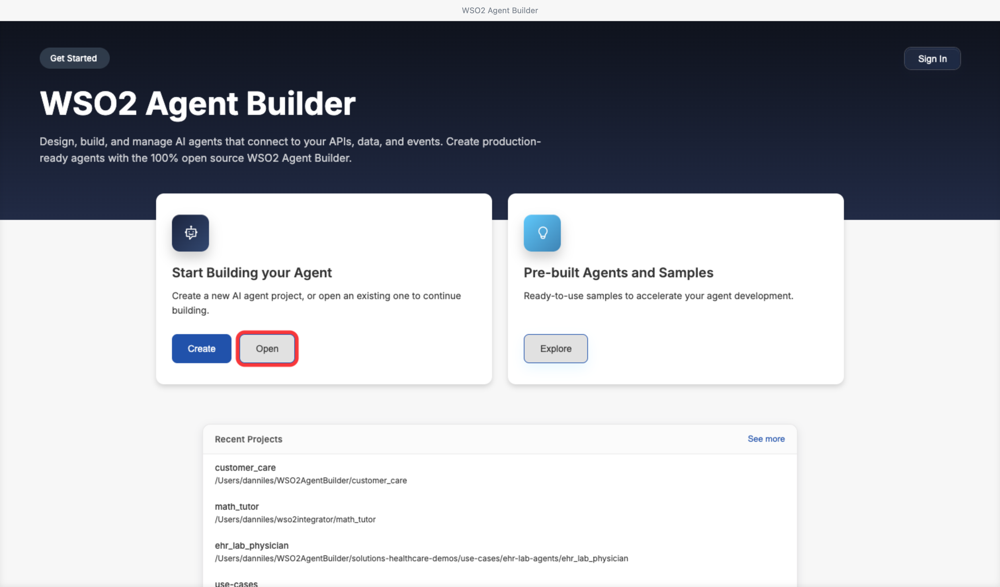
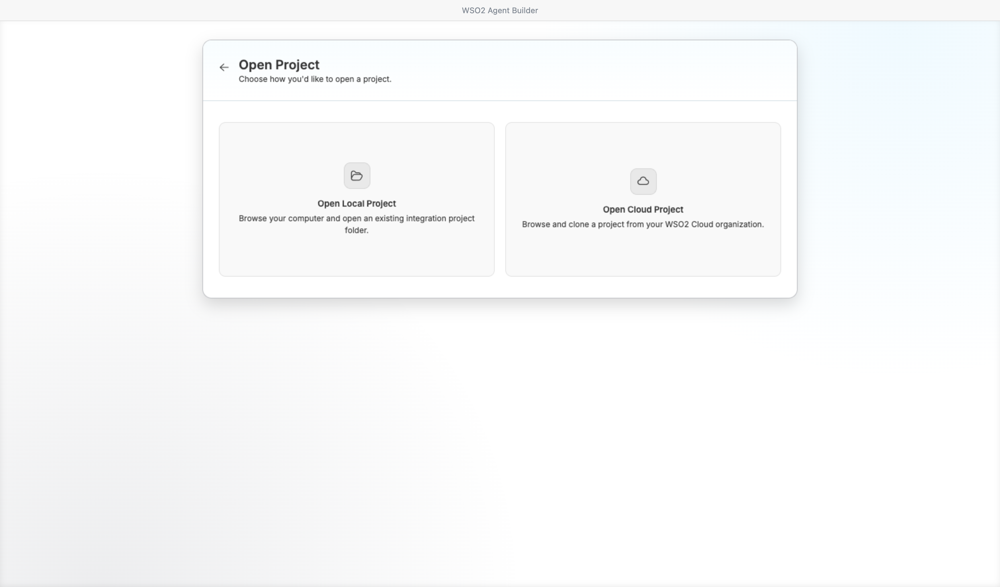
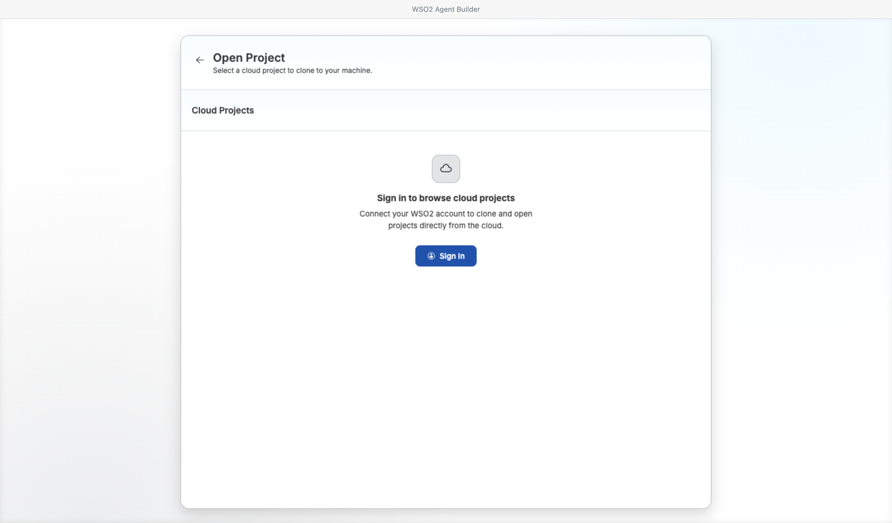
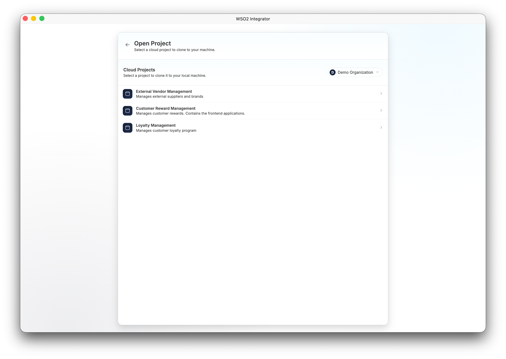

import ThemedImage from '@theme/ThemedImage';
import useBaseUrl from '@docusaurus/useBaseUrl';

If you already have a project, you can open it from the Choreo Agent Builder home screen. You can open projects stored locally on your machine or clone cloud projects from your Choreo Cloud organization.

On the Choreo Agent Builder home screen, click **Open** on the **Start Building your Agent** card.

   

## Choose a source

The form opens with the prompt `Choose how you'd like to open a project` and presents two cards.

      

- **Open Local Project** — *Browse your computer and open an existing integration project folder.*
- **Open Cloud Project** — *Browse and clone a project from your Choreo Cloud organization.*

### Open a local project

1. Click **Open Local Project**.
2. A native file browser appears. Navigate to the directory that contains your project.
3. Select the project folder and click **Open**.

Choreo Agent Builder detects the project structure and opens the [project view](../../editor/views/project-view.mdx).

### Open a cloud project

1. Click **Open Cloud Project**.
2. Click **Sign In** to connect your Choreo Labs account (if you are not already signed in).

   

3. After signing in, the form lists the cloud projects available in your organization. The active organization is shown at the top right (for example, **Demo Organization**), and each entry displays the project name and description.

   

4. Click a project to clone it to your local machine and open it in Choreo Agent Builder.

## Troubleshooting

If the editor shows **Choreo Agent Builder cannot start** or **Your project dependencies need to be updated** instead of your project, your installed Ballerina version, or the version that resolved the project's dependencies, is earlier than 2201.14.0. See [Moving to Ballerina 2201.14](../../editor/troubleshooting/moving-to-ballerina-2201-14.mdx) to update, or to stay on your current version.

## What's next

- [Project view](../../editor/views/project-view.mdx) — Manage, run, and debug your project
- [Create a project](./create-a-project.mdx) — Create a new project from scratch
