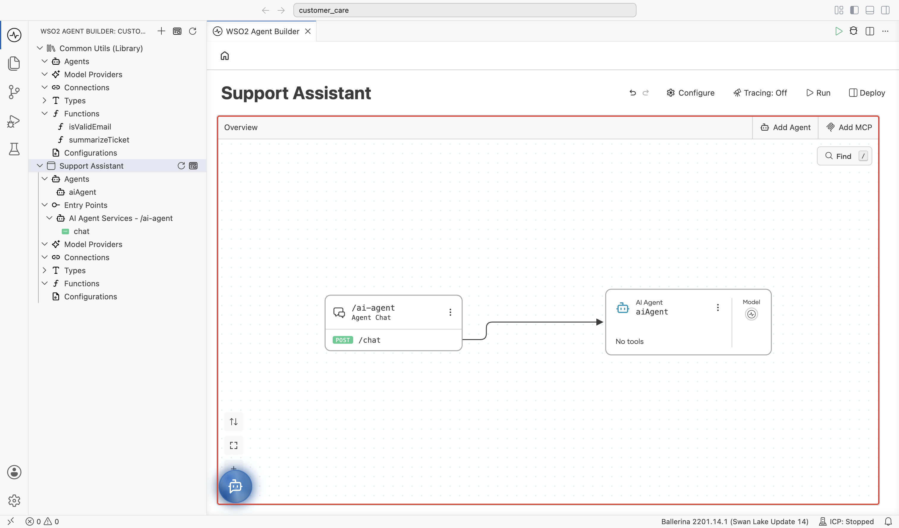
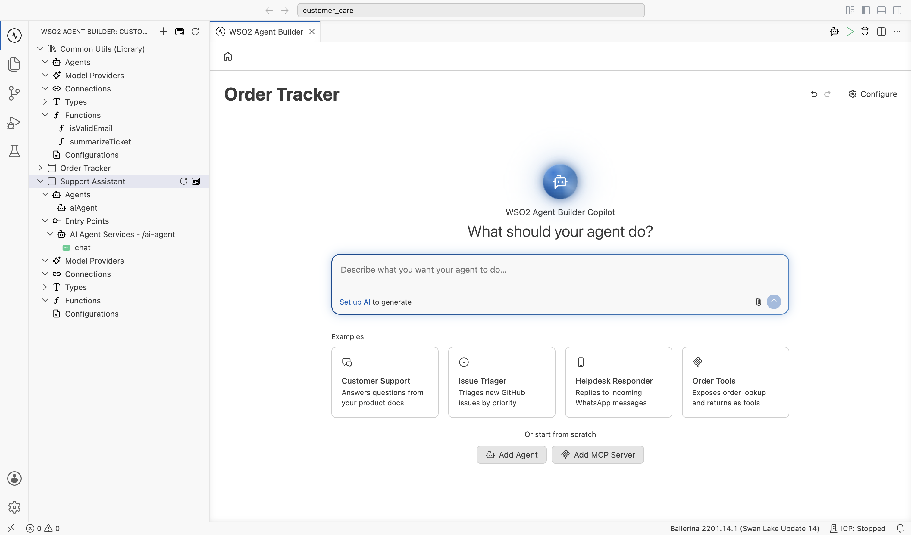
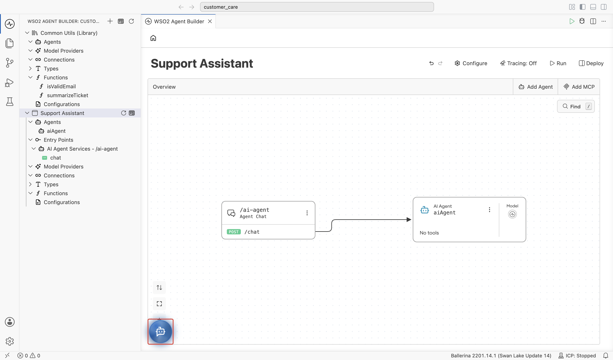
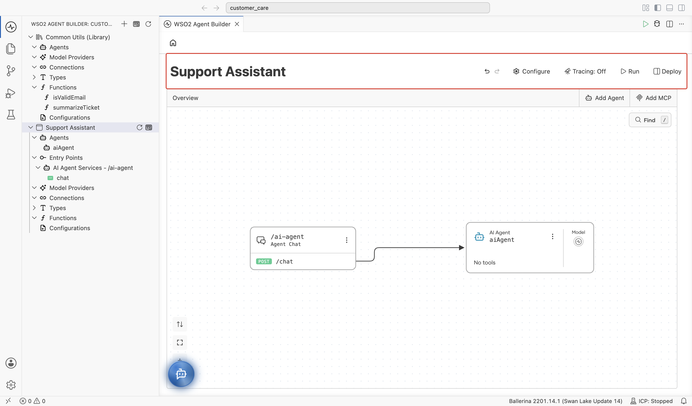
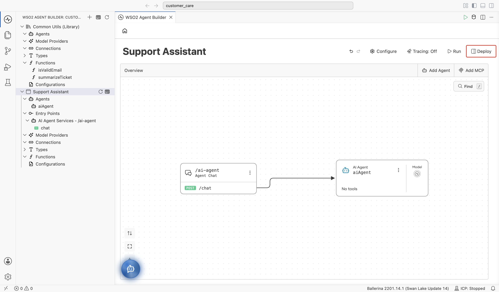
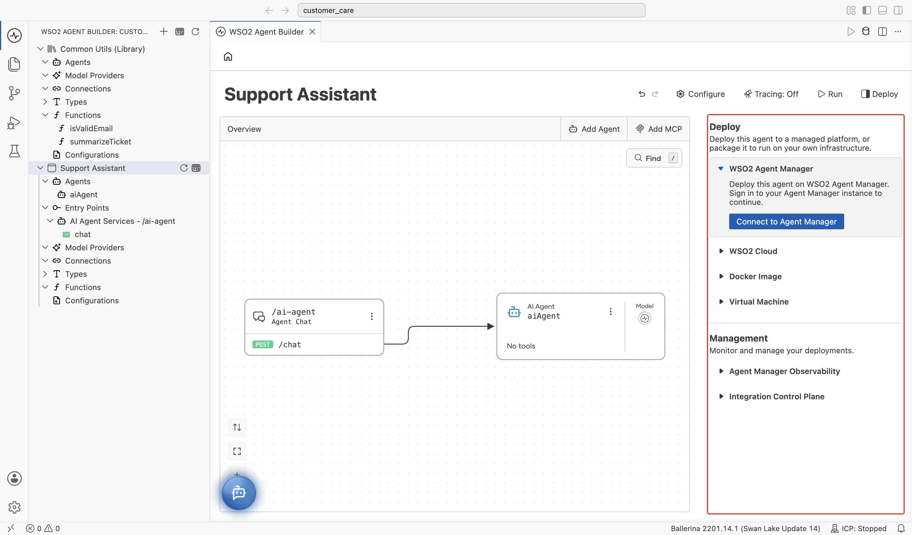

import ThemedImage from '@theme/ThemedImage';
import useBaseUrl from '@docusaurus/useBaseUrl';

The Integration view is the primary development interface in Choreo Agent Builder. Use it to build, test, and deploy a single agentic integration. It combines a project explorer, a visual overview canvas, and deployment options in one unified workspace.

## Overview canvas

The **Overview** canvas is the central area of the Integration view. It displays a visual overview of your agentic integration, showing how triggers, agents, and their tools and models relate to each other.

### Agent diagram

The agent diagram renders your agentic integration as an interactive graph. Each node represents a component:

- **Triggers** appear on the left, such as an **Agent Chat** endpoint and its resources.
- **Agents** show their tools and the model they use.
- **Lines** between nodes show which agent each trigger calls.

An agent that no trigger calls shows **No trigger yet**. Select **Add Trigger** on the agent card to connect it to a chat channel, an API endpoint, an event source, or a file source.

Click any node to open that component. Click a node's three-dot menu (**⋮**) to access actions such as **Delete**.

### Canvas controls

Use the controls in the bottom-left corner of the canvas to adjust the view:

- **Lay out top to bottom**: switches the diagram between a left-to-right and a top-to-bottom layout.
- **Fit to screen**: adjusts the zoom level to show all nodes.
- **+**: zoom in.
- **−**: zoom out.

Select **Find** at the top right of the canvas, or press **/**, to search for entry points and agents.

### Build with Copilot

Describe what you want in natural language, and [Choreo Agent Builder Copilot](../copilot/copilot.mdx) generates the agentic integration with the appropriate agents, triggers, and tools.

- **New agentic integration**: The canvas shows the Copilot composer. Describe what you want your agent to do and send it, or pick one of the **Examples**. To build it yourself, select **Add Agent** or **Add MCP Server** under **Or start from scratch**.

  

- **Agentic integration with artifacts**: Select the Copilot orb in the bottom-left corner of the canvas to open Copilot.

  

### Add agents and MCP servers

Use the buttons at the top of the canvas to add components to your agentic integration:

- **Add Agent**: Create an agent, a durable agent, or an agent definition, or select one of the pre-built agents.
- **Add MCP**: Add an MCP server that exposes tools to MCP clients.

To add connections, types, functions, model providers, and configurations, use the **+** action next to that section in the project explorer.

## Toolbar

The toolbar sits at the top of the Integration view and provides quick access to common actions for building, running, and deploying your agentic integration.

| Action | Description |
|---|---|
| **Undo** / **Redo** | Reverses or reapplies recent changes. Works across both the visual designer and the code editor. |
| **Configure** | Opens the configuration panel, equivalent to adding a configuration from the project explorer. |
| **Tracing** | Turns tracing on or off for the agentic integration. The button shows the current state, for example **Tracing: Off**. |
| **Run** | Builds and runs your agentic integration locally. Choreo Agent Builder compiles the Ballerina code, starts the services, and displays the output in the terminal panel. |
| **Deploy** | Shows or hides the deploy panel on the right side of the view. |

## Deploy panel

Select **Deploy** in the toolbar to open the deploy panel on the right side of the view. The panel provides options to deploy the agent to a managed platform or package it to run on your own infrastructure. Select **Deploy** again to close it.

| Option | Target |
|---|---|
| **Choreo Agent Manager** | Deploy the agent on Choreo Agent Manager. Select **Connect to Agent Manager** to sign in to your Agent Manager instance. |
| [**Choreo Cloud**](../../deploy-and-run/deploy-to-choreo-cloud/index.mdx) | Fully managed cloud platform for hosting and running agentic integrations. |
| [**Docker Image**](https://wso2.com/integration-platform/docs/integrator/deploy-and-run/self-hosted/containerized-deployment) | Build Docker images to deploy on Docker, Kubernetes, or OpenShift. |
| [**Virtual Machine**](https://wso2.com/integration-platform/docs/integrator/deploy-and-run/self-hosted/vm-deployment) | Deploy agentic integrations as standalone JAR files on virtual machines. |

The panel also includes a **Management** section for monitoring and managing your deployments, with **Agent Manager Observability** and the [Integration Control Plane (ICP)](../integration-control-plane.mdx).

## What's next

- [Flow Canvas](../canvases/flow-canvas/flow-canvas.mdx) — Build logic using the visual designer.
- [Integration artifacts](../../develop-and-test/index.mdx) — Learn about artifact types and their configuration.
- [Deploy to Choreo Cloud](../../deploy-and-run/deploy-to-choreo-cloud/index.mdx) — Deploy your agentic integration to the cloud.
