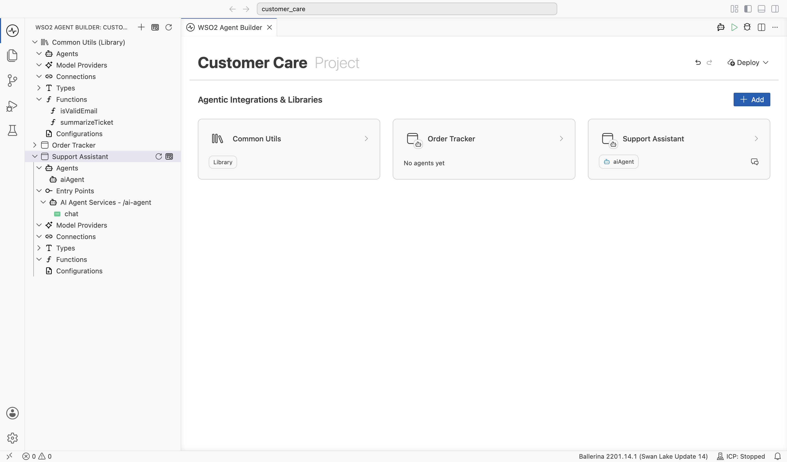
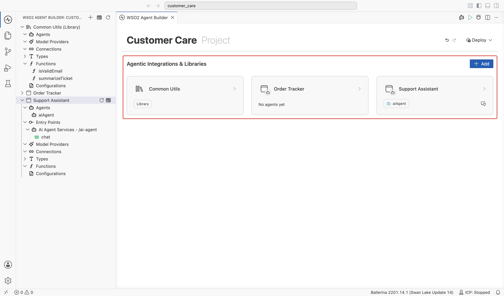
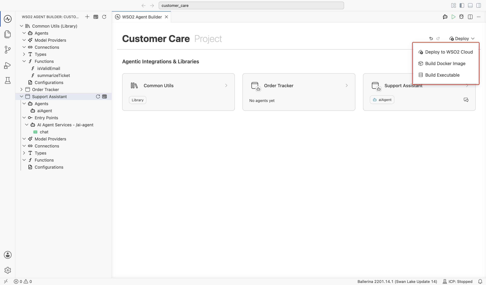

import ThemedImage from '@theme/ThemedImage';
import useBaseUrl from '@docusaurus/useBaseUrl';

The Project view is the top-level view in Choreo Agent Builder. It appears when you open a project that contains multiple agentic integrations or libraries, giving you an overview of everything in the project and project-level deployment actions in one place.

## Project overview canvas

The project overview canvas is the central area of the Project view. It displays the project name as a heading and lists every agentic integration and library in the project.

### Agentic integrations and libraries

The **Agentic Integrations & Libraries** section displays a card grid showing each agentic integration and library in the project. Each card shows:

- The name (for example, `Common Utils` or `Support Assistant`).
- For a library, a `Library` badge. For an agentic integration, the agents it contains, or `No agents yet` if it has none.

Click any card to navigate to the [Integration view](./integration-view.mdx) or [Library view](./library-view.mdx), where you can build and manage its artifacts.

### Add agentic integration or library

Click the **+ Add** button at the top of the canvas to add a new agentic integration or library to the project. Select the type, provide a name and configuration, and the new entry appears in the card grid and project explorer.

## Deploy menu

Click **Deploy** at the top right of the Project view to deploy or package the agentic integrations in the project.

| Option | Target |
|---|---|
| [**Deploy to Choreo Cloud**](../../deploy-and-run/deploy-to-choreo-cloud/index.mdx) | Fully managed cloud platform for hosting and running agentic integrations. |
| [**Build Docker Image**](https://wso2.com/integration-platform/docs/integrator/deploy-and-run/self-hosted/containerized-deployment) | Build Docker images to deploy on Docker, Kubernetes, or OpenShift. |
| [**Build Executable**](https://wso2.com/integration-platform/docs/integrator/deploy-and-run/self-hosted/vm-deployment) | Build standalone JAR files to run on virtual machines. |

## What's next

- [Integration view](./integration-view.mdx) — The primary development interface for individual agentic integrations.
- [Library view](./library-view.mdx) — Build and manage reusable libraries.
