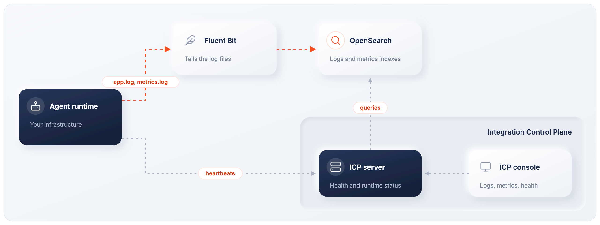

import ThemedImage from '@theme/ThemedImage';
import useBaseUrl from '@docusaurus/useBaseUrl';

When your agents run on your own infrastructure, the [Integration Control Plane](https://wso2.com/integration-platform/docs/integrator/icp) (ICP) can show their logs and metrics in one console, alongside health and runtime status. ICP reads this data from one of two observability providers: Moesif or OpenSearch. With OpenSearch, the data is populated by Fluent Bit tailing the runtime's log files.

Setting up OpenSearch involves four steps:

1. Deploy OpenSearch.
2. Create the index templates for logs and metrics.
3. Configure the agent to write structured logs and metrics.
4. Set up Fluent Bit to ship the logs to OpenSearch.

:::info Complete guide
The full step-by-step procedure, including commands and configuration, is in [Observability setup](https://wso2.com/integration-platform/docs/integrator/icp/observability-setup) in the Integration Control Plane section.
:::

## Related

- [Logging](./logging.mdx), [Metrics](./metrics.mdx), and [Distributed Tracing](./tracing.mdx) — instrument the agent itself.
- [OpenSearch](./open-source/opensearch.mdx) — use OpenSearch as a general-purpose log analytics backend.
- [Connect an agent to ICP](https://wso2.com/integration-platform/docs/integrator/icp/connect-runtime) — a prerequisite for viewing data in the console.
