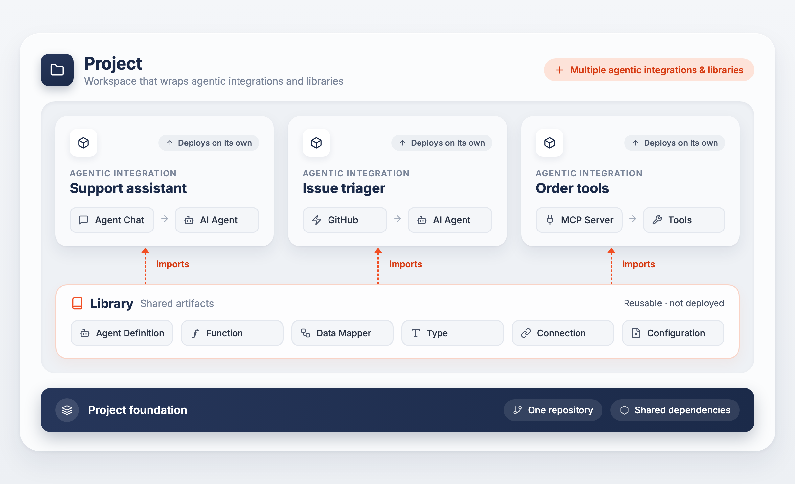

import ThemedImage from '@theme/ThemedImage';
import useBaseUrl from '@docusaurus/useBaseUrl';

WSO2 Agent Builder organizes your work into three concepts that build on each other:

- **Project** — a workspace that groups multiple agentic integrations and libraries together, sharing a single repository and dependencies.
- **Agentic integration** — a deployable unit built from AI agents, the triggers that invoke them (chat channels, API endpoints, event sources, and file sources), and MCP servers. It can be built, tested, and deployed on its own.
- **Library** — a reusable package of shared logic (agent definitions, functions, data mappers, types, connections) that one or more agentic integrations import.

A project can hold any number of agentic integrations and libraries side by side.

## Create Your Project

- **[Create a project](./create-a-project.mdx)** — Set up a new project workspace to hold multiple agentic integrations and libraries.

    - **[Create a new agentic integration](./create-a-project.mdx#add-an-integration)** — Add a new agentic integration to your project.
    - **[Create a library](./create-a-project.mdx#add-a-library)** — Add a library to your project to share common logic across its agentic integrations.

- **[Open a project](./open-a-project.mdx)** — Open an existing project from your local filesystem, or clone one from WSO2 Cloud.

- **[Explore sample integrations](./explore-sample-integrations.mdx)** — Start from a pre-built agent or sample instead of a blank agentic integration.

## What's next

- [Integration artifacts](../index.mdx) — Understand the AI artifact types you build inside an agentic integration
- [Project view](../../editor/views/project-view.mdx) — Manage, run, and debug a multi-package project
