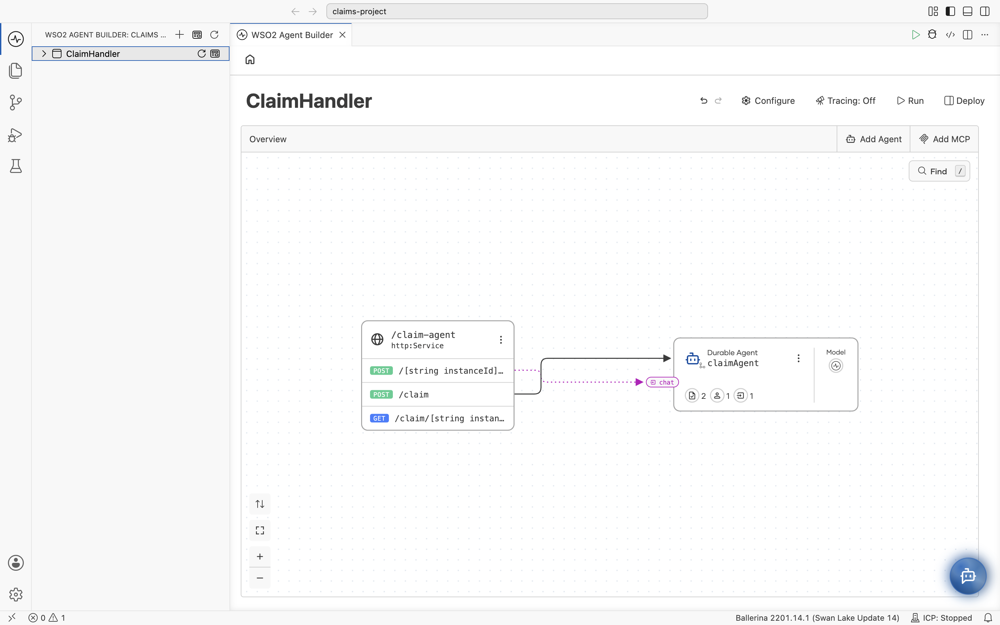

import ThemedImage from '@theme/ThemedImage';
import useBaseUrl from '@docusaurus/useBaseUrl';

A durable agentic workflow is an [AI agent](../agents/agents.mdx) that runs as a [durable workflow](https://wso2.com/integration-platform/docs/integrator/develop-and-test/integration-artifacts/workflow/durable-workflow). You describe the goal in natural language and the model decides the steps, adapting to each request at runtime. Because every step runs on the durable workflow runtime, the agent survives crashes and restarts, can wait days for a person or an event, and resumes exactly where it left off. In WSO2 Agent Builder, you build one as a **durable agent**.

## When to use it

Use a durable agent instead of a regular AI agent when the process has to outlive a single request:

- A step must wait for a person, such as approving a payment or reviewing documents, possibly for hours or days.
- The agent must wait for data from an external sender partway through a run.
- In-flight work must not be lost or repeated when the agentic integration restarts.

If you only need a person to approve a tool call before it runs, a regular agent with a gated tool may be enough. See [Gated Tools vs Durable Agentic Workflow](../agents/human-in-the-loop/gated-tools-vs-durable-agentic-workflow.mdx).

## In this section

- **[Create a Durable Agent](./create-durable-agent.mdx):** Describe the goal in natural language, and give the agent activities, data events, and human tasks as its capabilities.
- **[Run a Durable Agent](./run-durable-agent.mdx):** Start an agent instance from a flow, and bind the instance ID the rest of the flow needs.
- **[Send an Agent Data Event](./send-agent-data-event.mdx):** Deliver one turn on a channel the running agent listens on, and keep the correlation token it returns.
- **[Get a Data Event Result](./get-data-event-result.mdx):** Read the agent's answer to a sent turn, using that correlation token.
- **[Get an Agent Result](./get-agent-result.mdx):** Read what an agent instance finally produced, addressed by its instance ID.

## What's next

- [Build a Durable Agent](../../../get-started/quickstarts/build-durable-agent.mdx): A worked example of an agent that validates expense claims and pays them out only after a Finance reviewer approves.
- [Durable Workflow](https://wso2.com/integration-platform/docs/integrator/develop-and-test/integration-artifacts/workflow/durable-workflow): The same durable execution model, with the steps wired by hand instead of chosen by an agent.
- [AI Agents](../agents/agents.mdx): The agent building block (model, system prompt, tools, memory) that a durable agent builds on.
- [Gated Tools vs Durable Agentic Workflow](../agents/human-in-the-loop/gated-tools-vs-durable-agentic-workflow.mdx): Choose between a gated tool and a durable agent for human-in-the-loop approval.
