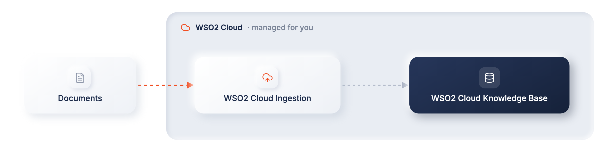

import ThemedImage from '@theme/ThemedImage';
import useBaseUrl from '@docusaurus/useBaseUrl';

Before an agent can retrieve from a knowledge base, load your documents into it. Agent Builder does not ingest documents itself: you ingest them in WSO2 Cloud, or with your knowledge base provider for [other knowledge bases](#ingest-into-other-knowledge-bases).

With a WSO2 Cloud Knowledge Base, WSO2 Cloud manages document ingestion, while your WSO2 Integrator project connects to the resulting knowledge base to retrieve content at runtime. This separation keeps ingestion out of the query integration and lets you update the indexed content in WSO2 Cloud without rebuilding or redeploying the integration.

:::info Prerequisites

- Access to a WSO2 Cloud organization and project.
- Documents that you want to use to ground agent responses.
:::

## Create and populate the knowledge base in WSO2 Cloud

Follow [Create a knowledge base in WSO2 Cloud](https://wso2.com/integration-platform/docs/saas/manage/rag-ingestion/create-knowledge-base) to:

1. Create a knowledge base in your WSO2 Cloud project.
2. Add the documents or data source that you want the knowledge base to index.
3. Start ingestion and wait until the content is ready to query.

Keep the knowledge base in the same WSO2 Cloud project that you select in WSO2 Integrator. The editor uses that project context to discover the available knowledge bases and supply their connection details securely.

:::note
Document ingestion is performed in WSO2 Cloud. You do not need to build a separate automation with a data loader, embedding provider, vector store, or `Ingest` action for this workflow.
:::

## Keep the knowledge base up to date

When source content changes, update or re-ingest it from WSO2 Cloud. The query integration continues to use the same knowledge base connection and does not need to change unless you replace the knowledge base itself.

## Ingest into other knowledge bases

If you use a [Vector Knowledge Base](./knowledge-bases.mdx#vector-knowledge-base), an [AWS Bedrock](./knowledge-bases.mdx#aws-bedrock) knowledge base, or an [Azure AI Search Knowledge Base](./knowledge-bases.mdx#azure-ai-search-knowledge-base) instead, ingest documents in one of two ways:

- **Use the provider's own ingestion.** Load the content with the provider's tools, for example by syncing an Amazon S3, SharePoint, or Confluence data source into an Amazon Bedrock knowledge base, or by indexing documents into an existing Azure AI Search index. Then connect your integration to that knowledge base and use it for retrieval only.
- **Build an ingestion flow in WSO2 Integrator.** Read documents with a [Data Loader](./data-loaders.mdx) and pass them to the knowledge base's **Ingest** action. This is the only option for a Vector Knowledge Base, because its chunks must be embedded with the same [Embedding Provider](./embedding-providers.mdx) that the integration uses to retrieve them.

See [Knowledge Bases](./knowledge-bases.mdx) for the connection settings and permissions each knowledge base needs for ingestion.

## What's next

- **[Use with an agent](./use-with-an-agent.mdx)** — expose retrieval as an agent tool and generate grounded responses.
- **[WSO2 Cloud Knowledge Base](./knowledge-bases.mdx#wso2-cloud-knowledge-base)** — configure the WSO2 Cloud Knowledge Base connection and retrieval settings.
