import ThemedImage from '@theme/ThemedImage';
import useBaseUrl from '@docusaurus/useBaseUrl';

WSO2 Agent Builder Copilot builds agents and the integrations around them from natural language prompts. It produces ready-to-use artifacts in your project, such as agents, tools, connections, and triggers. Iterate through follow-up prompts to refine logic, add features, or modify behavior.

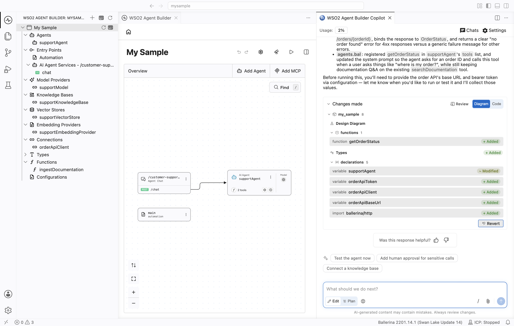

## Clarifying requirements

During the planning or generation phase, Copilot may identify missing information that is critical to the agent. If a requirement is ambiguous, it pauses and presents a list of suggested options. Select one, or select **Other** to type your own answer, then select **Submit**.

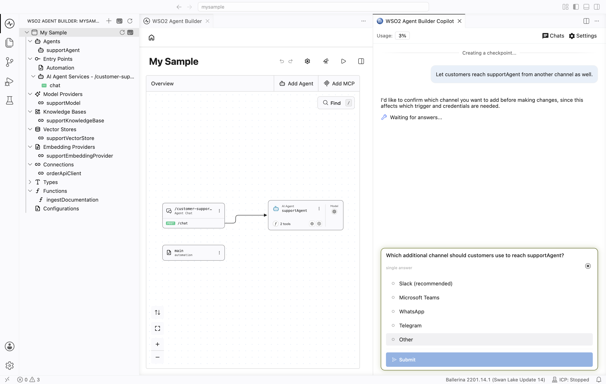

## Using web tools

Copilot can search the internet for external context or up-to-date documentation. It asks for permission before each search unless you enable the web tools toggle in the input bar.

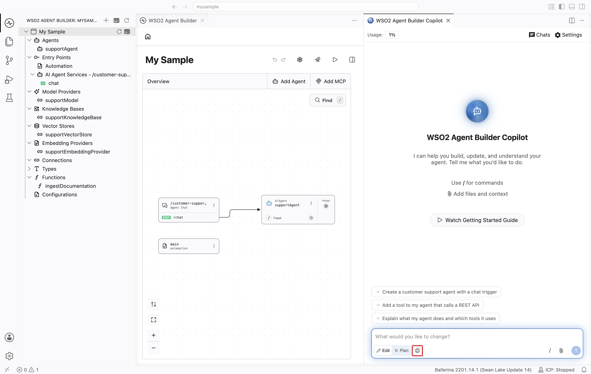

## Generating connectors

Copilot can generate a custom connector when a pre-built one is not available. During generation, if no pre-built connector exists, Copilot prompts you for an OpenAPI specification. You can also ask Copilot directly to generate a custom connector. Provide the specification with **Upload File**, **From URL**, or **Paste Spec**, or select **Skip** to continue without it. Once generated, the connector is available for Copilot to use, for example as a tool for your agent.

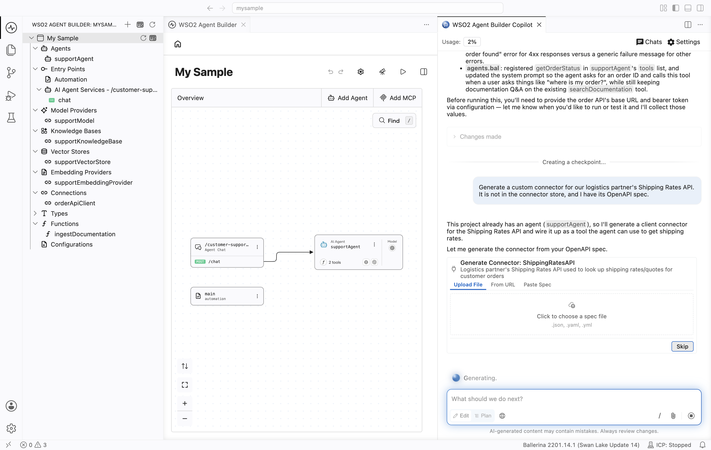

## Running in the background

Copilot runs in the background, so closing the panel does not stop a run. While it works, a status bar item, a floating status orb, and a mini chat keep you informed and let you follow along or reply without opening the full panel. See [Copilot in the Background](./background-copilot.mdx).

## Review generated artifacts

After generation completes, you can inspect exactly what was built or changed before finalizing the changes. Copilot shows the change set in a unified diff diagram that marks added, removed, and modified parts, and you can step through the resulting and previous versions of each artifact. See [Reviewing Changes](./reviewing-changes.mdx).

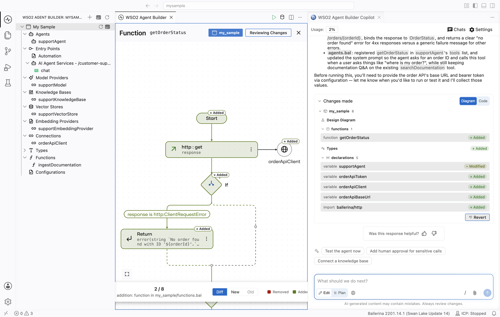

## Configure to Run/Test

When you run or test the integration, Copilot identifies the required configurables and prompts you to enter them. To run, Copilot asks for the missing values in **Configure Application**. To test, it opens **Configure Test Environment**, which reuses the values from your main configuration so you only update the ones that differ for testing. Leave a field blank to skip it and fill it in later.

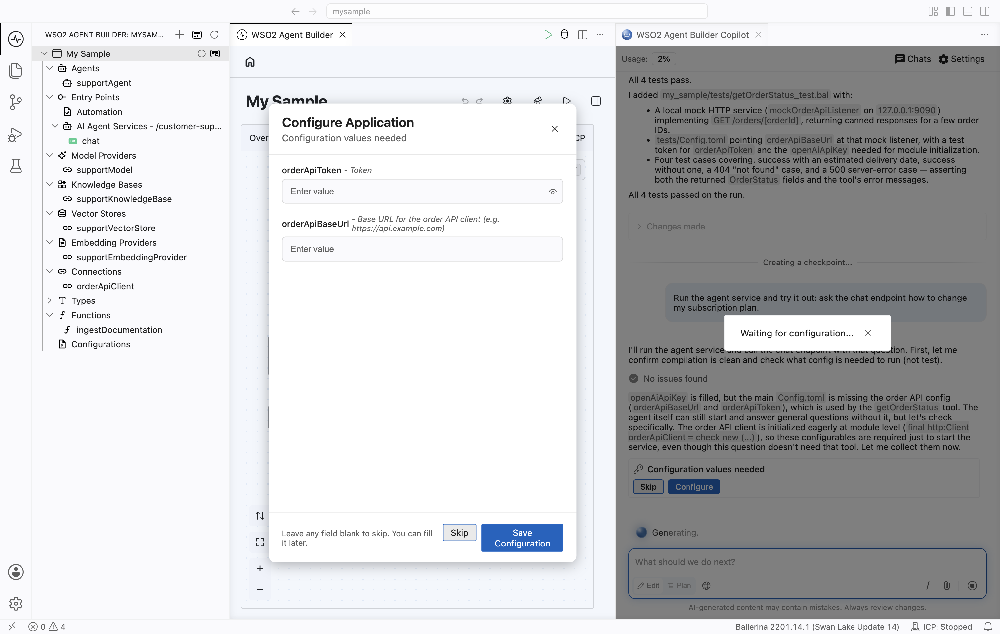

## Generate Integration Tests

Copilot generates tests for your integration, such as tests for an agent's tools, and runs them with the built-in test runner, allowing you to verify the generated artifacts immediately.

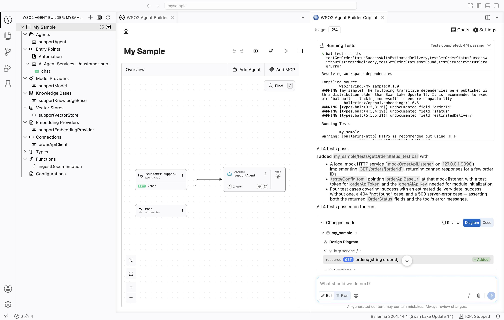

## TryOut your services

You can send test requests to your services from Copilot, including your agent's chat endpoint. Describe what you want to test in plain language, and Copilot starts the service if it isn't running, calls it, and returns the response.

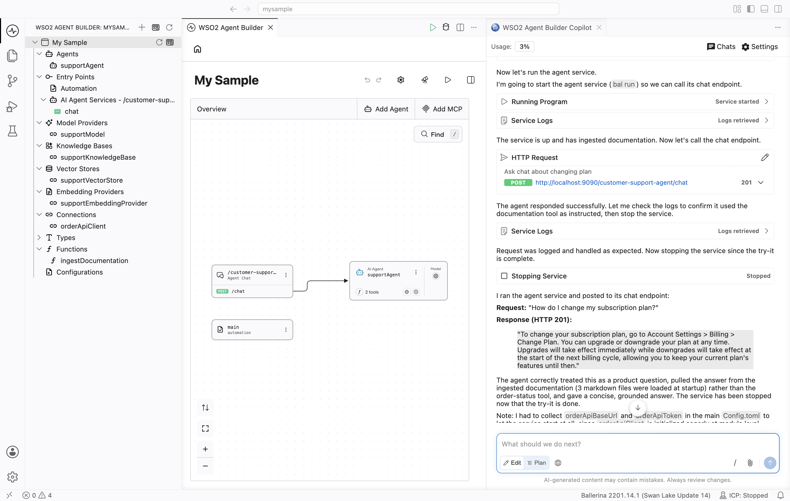

## Debug Runtime Issues

Copilot can run your integrations and read the runtime logs to debug issues as they occur.

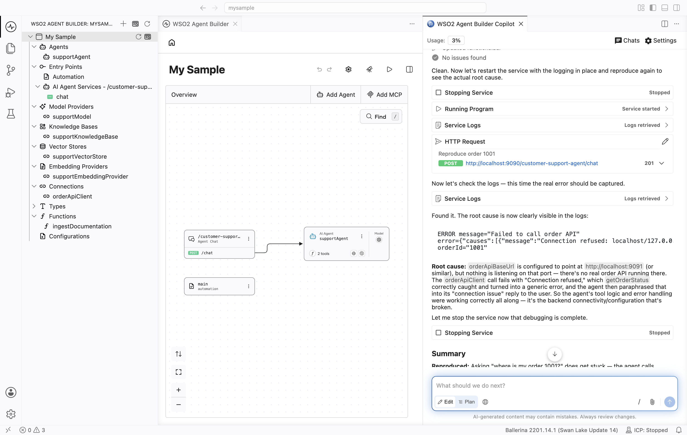

## Follow-up suggestions

When Copilot finishes a response, it offers a few follow-up suggestions as chips below the message. Each chip is a short label for a sensible next step, such as adding a test, handling an error case, or running the service.

Select a chip to place its full prompt in the input bar. Copilot doesn't send it, so you can reword the prompt or add detail first.

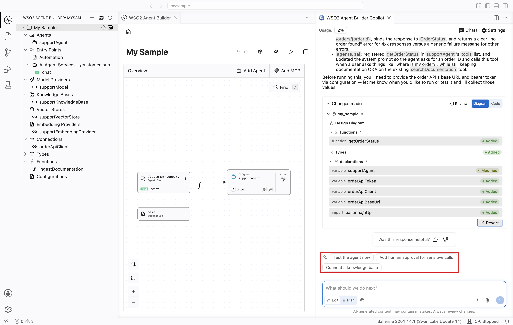

Suggestions appear under the most recent response only, and they clear when you send your next message.

:::note
To turn suggestions off, set `ballerina.copilot.followupSuggestions` to `false` in your editor settings.
:::

## Chat sessions

Each conversation with Copilot is a session. Copilot saves every session for the project, so your work stays available after you reload or restart the editor. Sessions are tied to the project's location on disk, so they no longer appear if you move or rename the project, or open it from a different path.

Select **Chats** in the panel header to list the project's sessions, grouped by when you last used them. Each row shows the session name, the number of prompts it holds, and when it was last updated. Select a row to switch to that session.

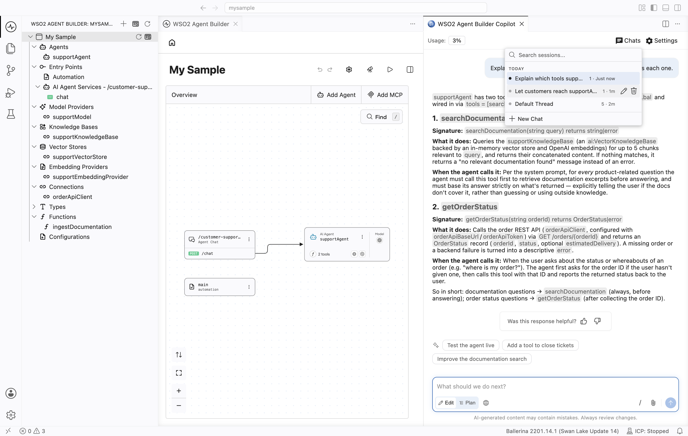

From this list you can:

- **Start a session**: Select **New Chat**. Your existing sessions are kept.
- **Find a session**: Type in **Search sessions** to filter the list by name.
- **Rename a session**: Select the edit icon on the row. Copilot names a session after its first prompt, so renaming helps when several sessions begin alike. If you clear the name, Copilot restores the original.
- **Delete a session**: Select the delete icon, then confirm.

You can't switch sessions while Copilot is generating a response. Finish or stop the response first.

To undo what Copilot changed, select **Restore Checkpoint**. It rolls your integration back to a saved checkpoint and removes the prompts that came after it.

## See also

- [WSO2 Agent Builder Copilot](./copilot.mdx) — Sign in to WSO2 Agent Builder Copilot.
- [Copilot Chat Interface](./chat-interface.mdx) — Chat controls, slash commands, and modes.
- [Copilot in the Background](./background-copilot.mdx) — Follow a run while the panel is closed.
- [Reviewing Changes](./reviewing-changes.mdx) — Inspect a run's changes in a unified diff.
- [Customize Copilot](./customize-copilot.mdx) — Give Copilot project instructions, reusable skills, and your own tools through MCP servers.
- [AI data mapper](https://wso2.com/integration-platform/docs/integrator/develop-and-test/integration-artifacts/supportive-artifacts/data-mapper/ai-mapping) — Generate data mappings using AI.
- [Try-It tool](../../develop-and-test/test/try-it-tool/try-it-tool.mdx) — Test services without leaving the editor.
- [Copilot architecture and data handling](./copilot-architecture.mdx) — How Copilot handles your data.
