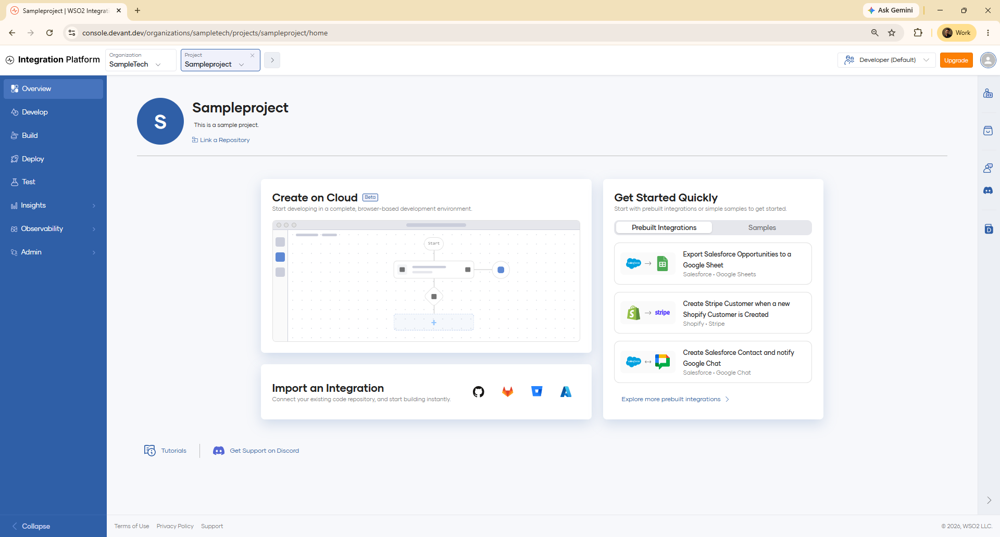
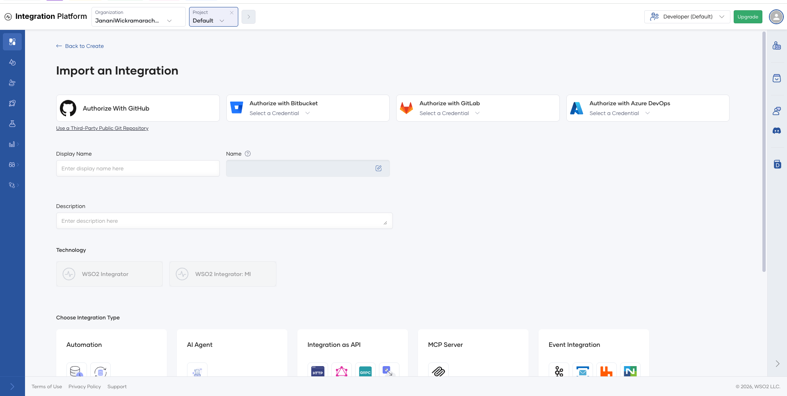
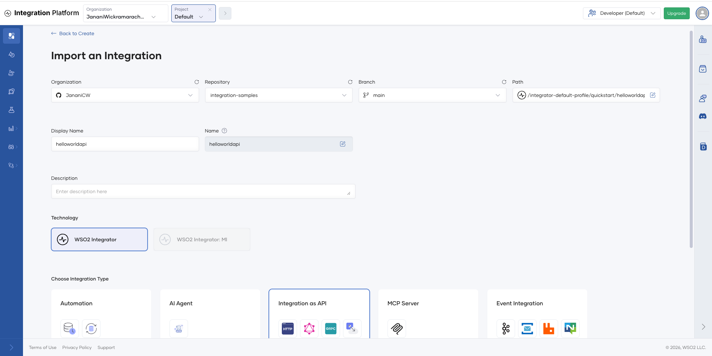
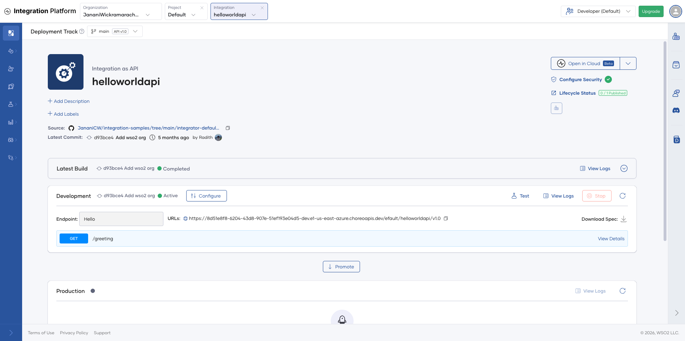

import ThemedImage from '@theme/ThemedImage';
import useBaseUrl from '@docusaurus/useBaseUrl';

If your integration is already in a Git repository, you can import it directly into WSO2 Cloud without going through the WSO2 Integrator editor. WSO2 Cloud automatically builds and deploys the integration to the Development environment once the import is complete.

:::info Prerequisites
- An integration created with WSO2 Integrator editor pushed to a remote Git repository (GitHub, GitLab, Bitbucket, or Azure DevOps).
- A WSO2 Cloud account. Sign up at [WSO2 Cloud](https://console.devant.dev) if you don't have one.
:::

## Connect your Git provider

1. Sign in to [WSO2 Cloud](https://console.devant.dev).

   When you sign up for the first time, WSO2 Cloud creates a default project for you. You land on the project home page.

2. On the project home page, click **Import an Integration** and select your Git provider. Alternatively, click your Git provider's icon directly on the home page to authorize it with WSO2 Cloud.

    

    

    :::warning
    One-click OAuth2 authorization is only available for GitHub. To use Bitbucket, GitLab, or Azure DevOps, you must first add your credentials at the organization level. See [Connect a Git provider](../../deploy-and-run/deploy-to-wso2-cloud/connect-git-provider.mdx) for instructions.
    :::

3. Complete the authorization flow in the browser and return to WSO2 Cloud.

## Import the integration

1. Select the organization that owns the repository.
2. Select the repository and the branch.
3. Set the path to the folder where your integration lives within the repository.
4. Optionally, add a description.
5. Select the integration type. WSO2 Cloud detects the technology automatically.
6. Click **Create**.

    

    

WSO2 Cloud starts the build immediately. Once the build completes, the integration is automatically deployed to the **Development** environment.

## What's next

- [Import a project](./import-a-project.mdx) — Bring a whole project, with several integrations, into WSO2 Cloud at once.

- [View and manage integrations](../../manage/integrations/integrations.mdx) — Inspect build status, deployment status, and manage the lifecycle of your deployed integrations.
- [Runtime configurations](../../manage/configurations/runtime-configurations.mdx) — Set configurable values per environment and manage reusable configuration groups.
- [Security configurations](../../manage/configurations/security-configurations.mdx) — Secure your integration endpoints with API Key or OAuth2 authentication.
- [Endpoint configurations](../../manage/configurations/endpoint-configurations.mdx) — Control endpoint visibility levels for integrations deployed as Integration as APIs.
