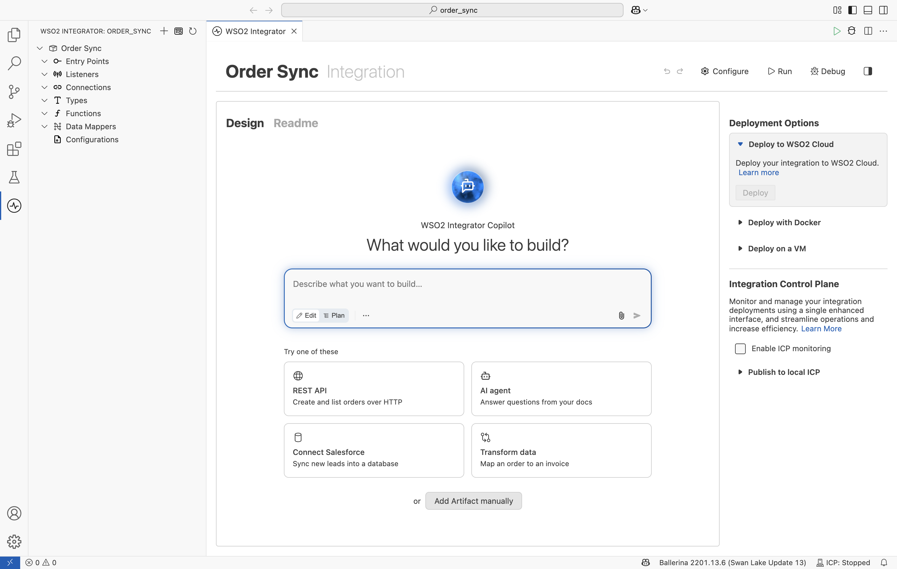
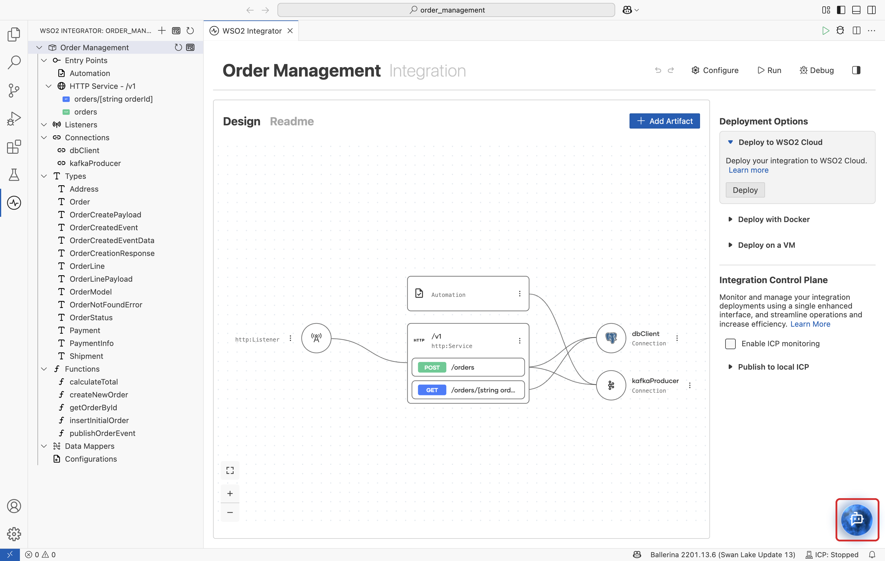
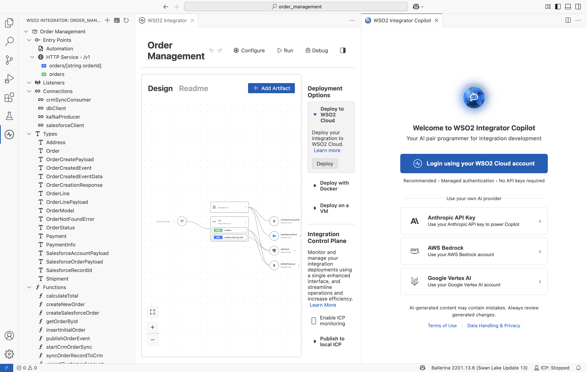
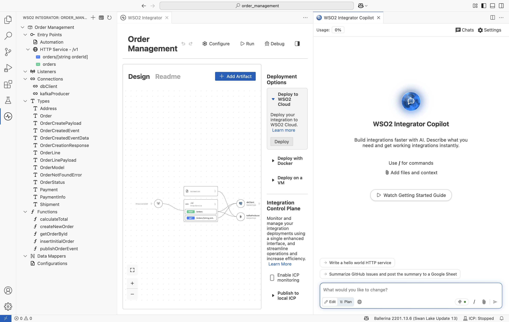

import ThemedImage from '@theme/ThemedImage';
import useBaseUrl from '@docusaurus/useBaseUrl';

If you are already signed in with your WSO2 Cloud account, WSO2 Integrator Copilot uses the same account and is ready to use. Otherwise, sign in from the Copilot welcome screen.

## Sign in from the Copilot welcome screen

1. Open your integration's overview to start working with Copilot.

   - **New integration**: The overview shows the Copilot composer. Describe what you want to build and send it, or pick one of the examples under **Try one of these**. To open the Copilot panel without a prompt, select the Copilot orb above the composer.

     

   - **Integration with artifacts**: Select the Copilot orb in the bottom-right corner. Select it once for a quick chat, or double-click it to open the full Copilot panel.

     

   When a Ballerina file or diagram is open, you can also select the **Open WSO2 Integrator Copilot** icon in the editor toolbar.

2. The Copilot panel opens on the welcome screen with the available sign-in options.

   

   - **Login using your WSO2 Cloud account** (recommended): Sign in with your WSO2 Cloud account. No API keys are required.
   - Under **Use your own AI provider**:
     - **Anthropic API Key**: Use your own [Anthropic API key](https://platform.claude.com/settings/keys) to power Copilot.
     - **AWS Bedrock**: Use your [AWS Bedrock](https://docs.aws.amazon.com/bedrock/latest/userguide/getting-started.html) account.
     - **Google Vertex AI**: Use your [Google Vertex AI](https://docs.cloud.google.com/vertex-ai/docs/authentication) account.

3. Select one option and complete the sign-in. Once authenticated, Copilot opens its chat view and is ready to use.

   

:::info Terms of use and data handling
By signing in, you agree to the WSO2 Integrator Copilot Terms of Use shown on the welcome screen. See [Copilot architecture and data handling](./copilot-architecture.mdx) for how Copilot handles your data.
:::

## What's next

- [Copilot Chat Interface](./chat-interface.mdx) — Learn the chat input bar's controls, slash commands, and modes.
- [Built-in Capabilities](./capabilities.mdx) — Explore planning, review, testing, and more.
- [Customize Copilot](./customize-copilot.mdx) — Give Copilot project instructions, reusable skills, and your own tools through MCP servers.
- [Usage Limits](./usage-limits.mdx) — See how much of your Copilot usage remains, and how to ask for more.
