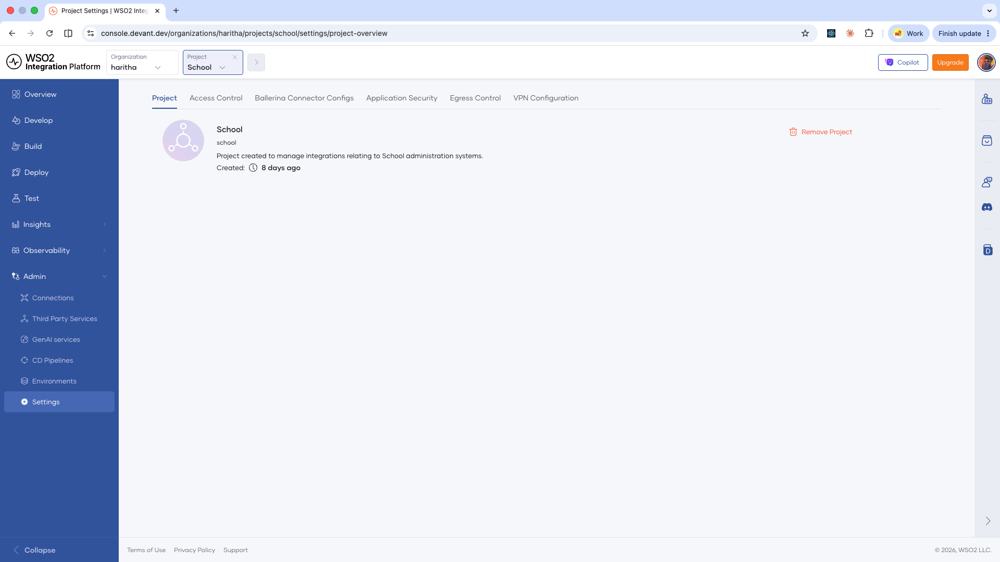
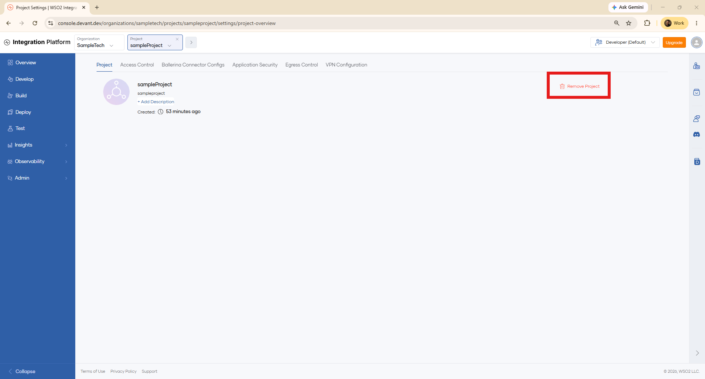
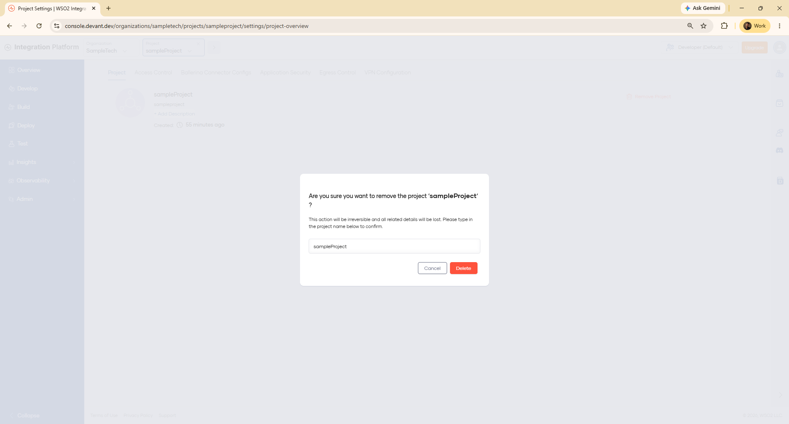

import ThemedImage from '@theme/ThemedImage';
import useBaseUrl from '@docusaurus/useBaseUrl';

A project is the top-level container for your integrations on WSO2 Cloud - Integration Platform. This page explains how to view your projects, edit their details, and remove them when they are no longer needed. To create a project, see [Create a project](../develop-and-test/create-workspace/create-a-project.mdx). To bring one in from a Git repository, see [Import a project](../develop-and-test/create-workspace/import-a-project.mdx).

## View projects

Click **Organization** in the top navigation to open the organization overview. The overview lists all projects in your organization. By default a project named **Default** is automatically created on first sign-up.

## Edit a project

1. From the project home, go to **Admin** > **Settings**.
2. Update the **Name** or **Description** as needed by clicking the respective fields.

    

3. Save your changes.

## Remove a project

:::warning
A project cannot be deleted without deleting all its integrations first.
:::

:::danger
Removing a project is permanent. All history within the project is deleted and cannot be recovered.
:::

1. From the project home, go to **Admin** > **Settings**.
2. Click **Remove Project** on the right side of the page.

    

3. Enter the project name to confirm, then click **Delete**.

    

The project and all its contents are permanently deleted.

## What's next

- [Create a project](../develop-and-test/create-workspace/create-a-project.mdx) — Create a new project.
- [Import a project](../develop-and-test/create-workspace/import-a-project.mdx) — Bring an existing WSO2 Integrator project from a Git repository into WSO2 Cloud.
- [Access control](./users-and-access/access-control.mdx) — Manage roles and permissions for members of your project.
