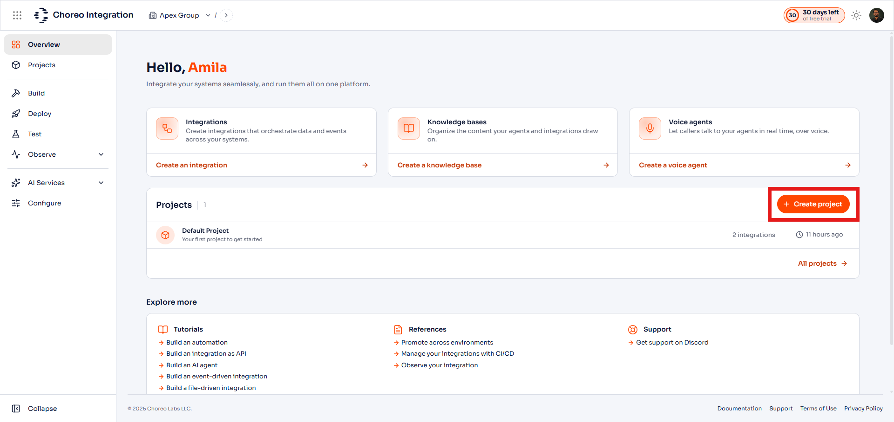
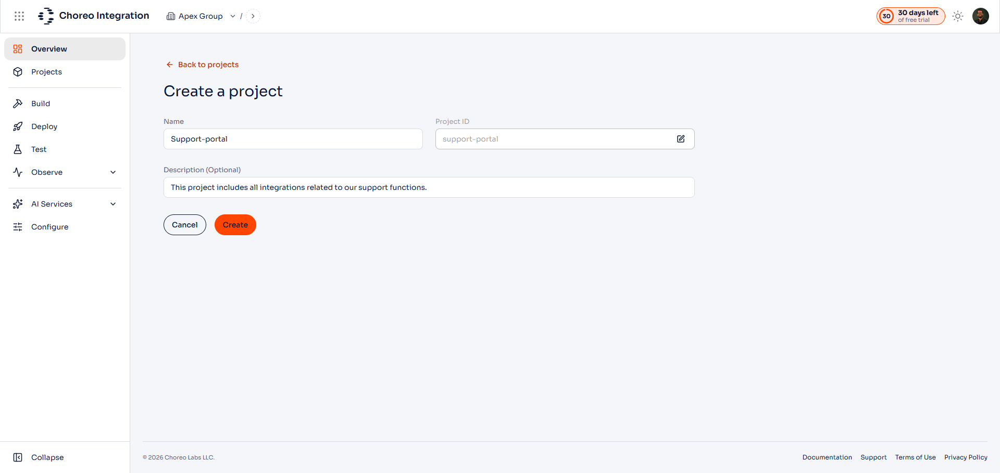
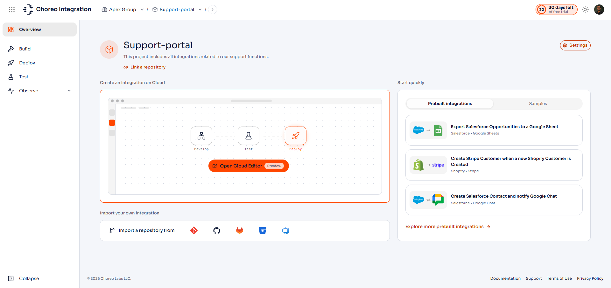

import ThemedImage from '@theme/ThemedImage';
import useBaseUrl from '@docusaurus/useBaseUrl';

A project is the top-level container for your integrations on Choreo Cloud. Use projects to group related integrations and manage them together. Choreo Cloud creates a project named **Default Project** when you first sign up, and you can create more at any time.

:::tip
If your project already exists in a Git repository, import it instead. See [Import a project](./import-a-project.mdx).
:::

## Create the project

1. Sign in to [Choreo Cloud](https://console.cloud.choreolabs.com) and click the organization name in the top navigation to open the organization overview. It lists the projects in your organization.
2. Click **+ Create project**.

    

3. In the **Create a project** form, enter the project details:

    | Field | Description |
    |---|---|
    | **Name** | A human-readable label shown in the console. |
    | **Project ID** | A unique identifier for the project. It is generated from the name, and you can edit it. It must be unique within the organization. It cannot be changed later. |
    | **Description (Optional)** | A short summary of the project's purpose. |

    

4. Click **Create**.

Choreo Cloud creates the project and opens the project home. To link a Git repository to the project, click **Link a repository** on the project home. See [Connect a Git provider](../../deploy-and-run/deploy-to-wso2-cloud/connect-git-provider.mdx).

## Add integrations to the project

The project overview, which a new project opens on, offers several ways to add your first integration:

- **Open Cloud Editor** — Build an integration in the browser-based cloud editor, without installing anything locally. See [Deploy from the cloud editor](../../deploy-and-run/deploy-to-wso2-cloud/deploy-from-cloud-editor.mdx).
- **Import a repository from** — Connect a Git provider and bring in an existing integration. See [Import an integration](./import-an-integration.mdx).
- **Start quickly** — Start from a prebuilt integration or a sample. See [Pre-built integrations](../../get-started/prebuilt-integrations.mdx) and [Start with sample integrations](./start-with-sample-integrations.mdx).

## What's next

- [Import a project](./import-a-project.mdx) — Bring an existing project from a Git repository
- [Import an integration](./import-an-integration.mdx) — Bring a single integration from a Git repository
- [Manage projects](../../manage/projects.mdx) — View, edit, and delete projects
