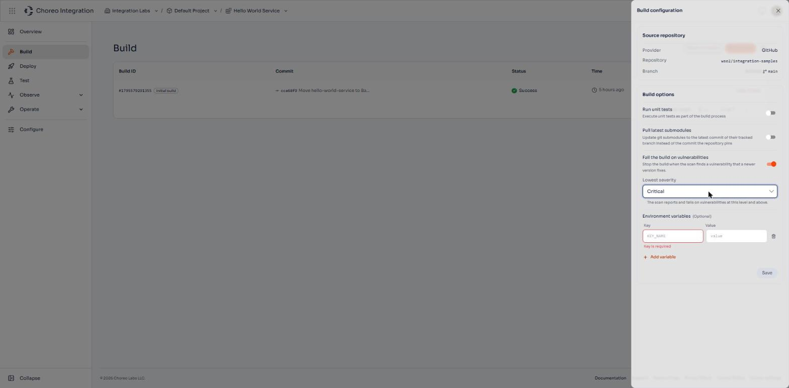

import ThemedImage from '@theme/ThemedImage';
import useBaseUrl from '@docusaurus/useBaseUrl';

You can control how your integration is built on Choreo Integration by configuring the build settings.

## Configure build settings

1. In the left navigation, click **Build**.
2. In the top-right corner of the page, click the settings icon next to **Build latest**.

    The **Build configuration** panel opens on the right, showing the linked source repository for reference and the build options below.

    

3. Configure the following settings:

    | Setting | Description |
    |---|---|
    | **Run unit tests** | When enabled, unit tests run as part of every build. |
    | **Pull latest submodules** | When enabled, Git submodules are updated to the latest commit on their tracked branch instead of the commit the repository pins. |
    | **Fail the build on vulnerabilities** | When enabled, the build fails if a dependency scan finds a vulnerability at or above the **Lowest severity** you select (**Critical**, **High and above**, or **Medium and above**). |

4. Optional: Under **Environment variables**, click **Add variable** to define key-value pairs available during the build. Click the trash icon next to a variable to remove it.
5. Click **Save**.

The updated settings apply from the next build onwards. To verify, you can trigger a build manually by clicking the **Build latest** button.

## What's next

- [Runtime configurations](./runtime-configurations.mdx) — Set configurable values and secrets your integration reads at runtime.
- [Endpoint configurations](./endpoint-configurations.mdx) — Control the visibility of your integration's endpoints per environment.
