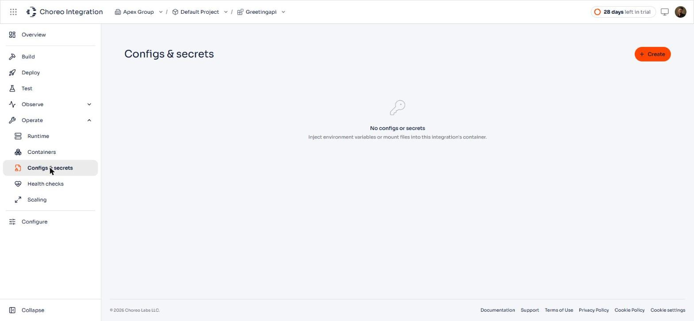
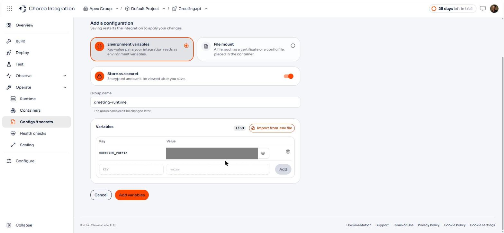
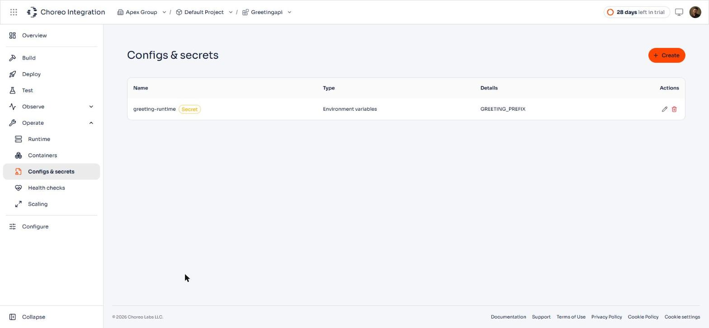
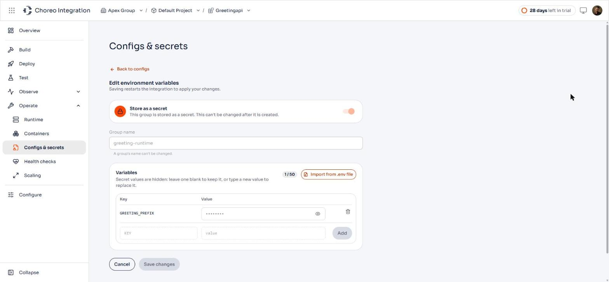

import ThemedImage from '@theme/ThemedImage';
import useBaseUrl from '@docusaurus/useBaseUrl';

For values that aren't Ballerina configurables, such as environment variables or files your integration reads directly from its container, each integration has its own **Configs & secrets** page, at **Operate** > **Configs & secrets**. Unlike [Ballerina configurables](../../configurations/runtime-configurations.mdx), these aren't shared across integrations — every integration manages its own set.

## Add a configuration

1. Open your integration, go to **Operate** > **Configs & secrets**, and click **Create**.

    

2. Choose a type:

    | Type | Description |
    |---|---|
    | **Environment variables** | Key-value pairs your integration reads as environment variables. |
    | **File mount** | A file, such as a certificate or a config file, placed in the container at a path you choose. |

3. Optional: Turn on **Store as a secret** to encrypt the values. A secret can't be viewed again after it's saved, and this setting can't be changed later.
4. Enter a **Group name**. This can't be changed later.
5. Add the variables (or, for a file mount, the file name, mount directory, and content), then click **Add variables** (or **Add file**).

    

Saving restarts the integration to apply the changes.

## Edit a configuration

1. On the **Configs & secrets** page, click the edit icon next to the configuration you want to change.
2. Update the variables or file content as needed. For a secret, every value shows as hidden — leave a field blank to keep its current value, or type a new one to replace it.

    

3. Click **Save changes**.

The integration restarts to apply the changes.

## What's next

- [Runtime Configurations](../../configurations/runtime-configurations.mdx) — Set configurable values the integration reads through Ballerina configurables.
- [Health Checks](./health-checks.mdx) — Configure liveness and readiness probes.
