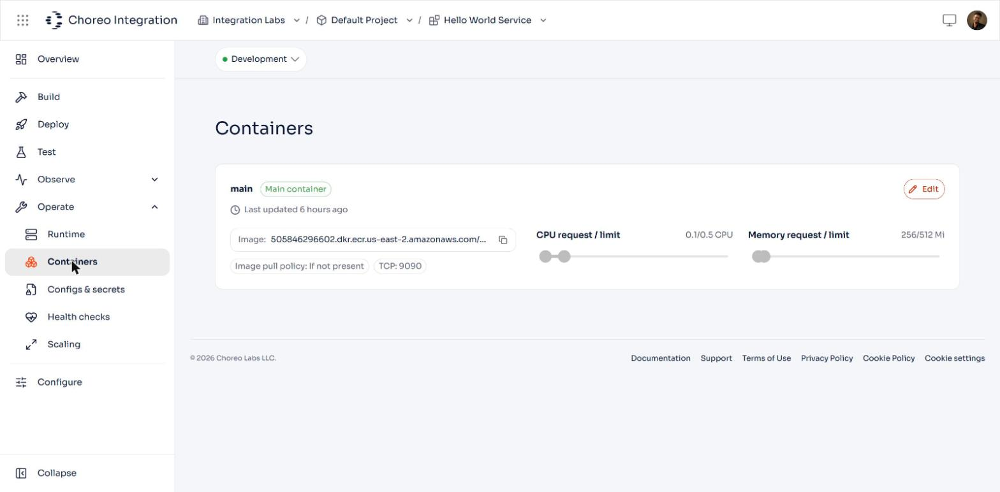
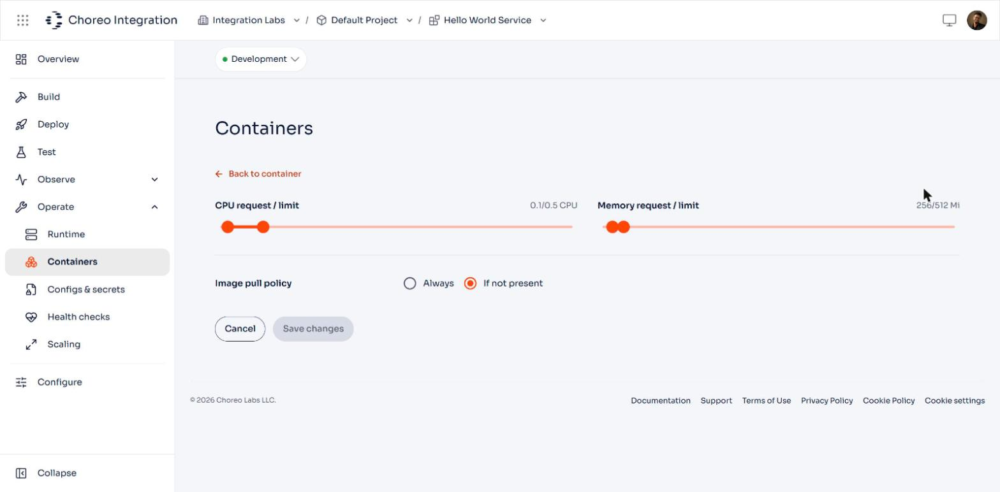

import ThemedImage from '@theme/ThemedImage';
import useBaseUrl from '@docusaurus/useBaseUrl';

Each environment's **Operate** > **Containers** page shows the resource allocation for the integration's container.

## Set container resource limits

1. Click **Edit**.
2. Drag the **CPU request / limit** and **Memory request / limit** sliders to set each value. The request is the amount reserved for the container; the limit is the maximum it can use before being throttled (CPU) or restarted (memory).
3. Choose an **Image pull policy**: **Always** re-pulls the image on every pod restart, and **If not present** only pulls it if it isn't already cached on the node.

    

4. Click **Save changes**.

## What's next

- [Scaling](./scaling.mdx) — Configure autoscaling for this environment.
- [Runtime Status](./runtime-operations.mdx) — View pod status and redeploy an integration's release.
