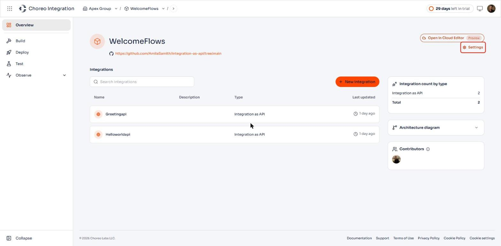
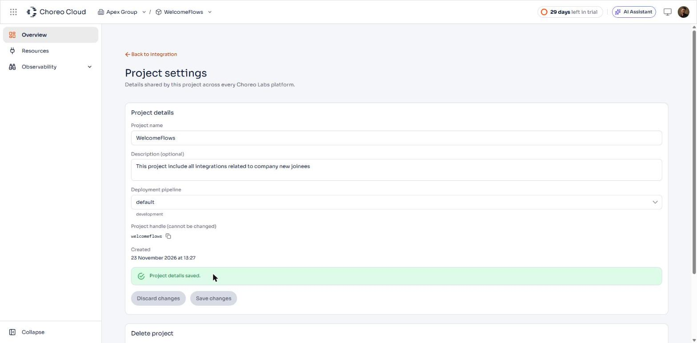
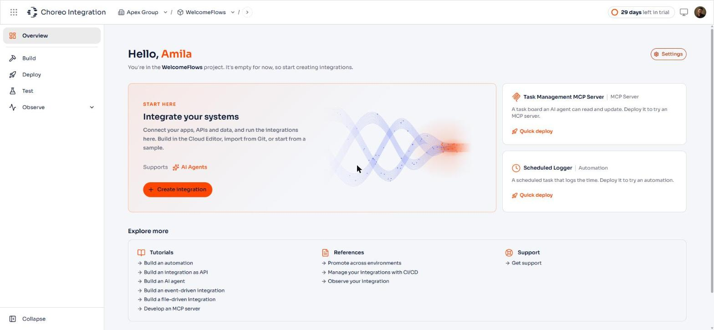
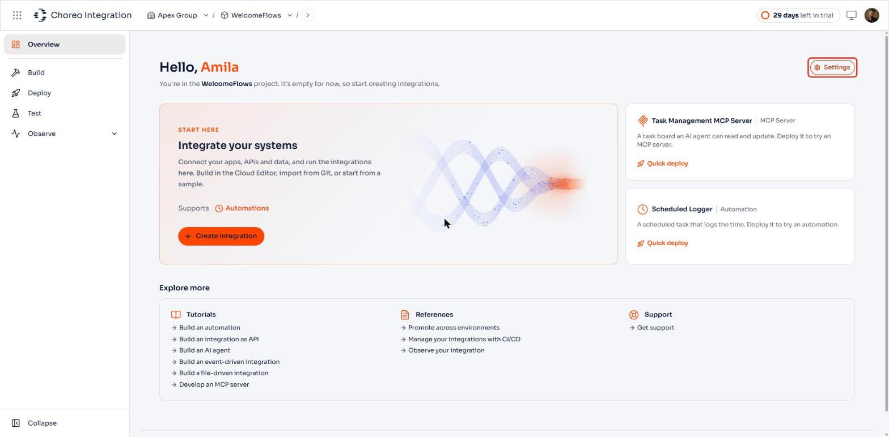
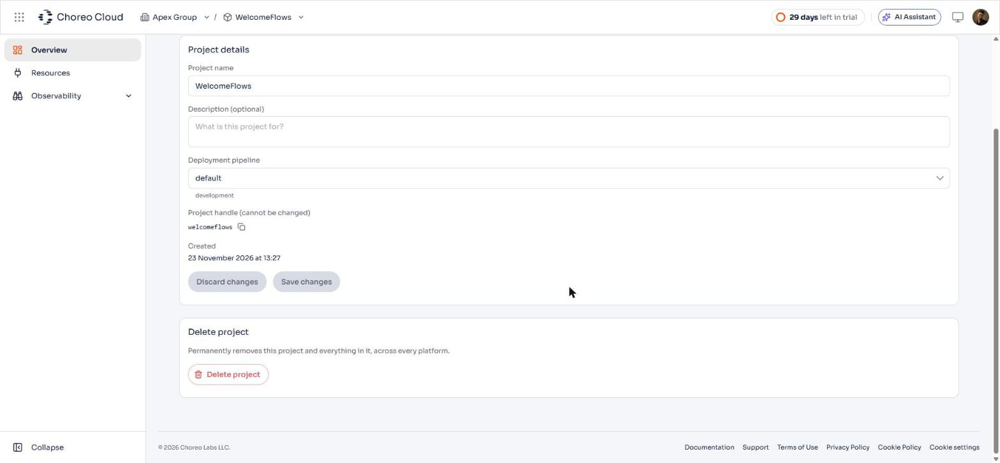
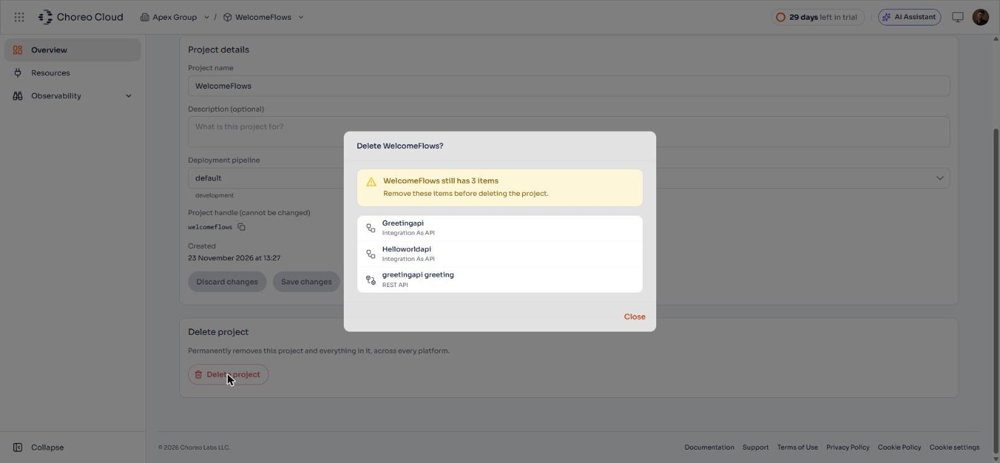
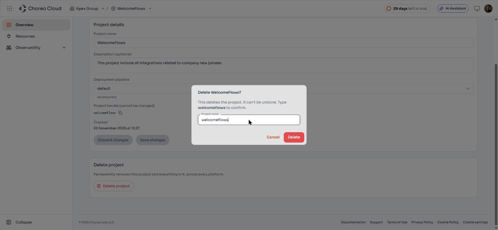

import ThemedImage from '@theme/ThemedImage';
import useBaseUrl from '@docusaurus/useBaseUrl';

A project is the top-level container for your integrations on Choreo Integration. This page explains how to view your projects, edit their details, and remove them when they are no longer needed. To create a project, see [Create a project](../develop-and-test/create-workspace/create-a-project.mdx). To bring one in from a Git repository, see [Import a project](../develop-and-test/create-workspace/import-a-project.mdx).

## View projects

Click the organization name in the top navigation to open the organization overview. The overview lists all projects in your organization. By default a project named **Default Project** is automatically created on first sign-up.

## Edit a project

1. From the project home, click **Settings**.

    

    The **Project settings** page opens with the project's details, which are shared across every Choreo Labs platform.
2. Update any of the editable fields:

    | Field | Description |
    |---|---|
    | **Project name** | The display name shown in the console. |
    | **Description (optional)** | A short summary of the project's purpose. |
    | **Deployment pipeline** | The pipeline the project's integrations are promoted through. See [Configure promotion pipelines](./environments/configure-promotion-pipelines.mdx). |

    The **Project handle** and the **Created** date are shown for reference and cannot be changed.

    

3. Click **Save changes**. To abandon your edits, click **Discard changes**.

## Remove a project

:::warning
A project must be empty before it can be deleted. Remove every item it holds first, including integrations and any APIs they exposed.
:::

:::danger
Removing a project is permanent. All history within the project is deleted and cannot be recovered.
:::

1. From the project home, check the **Integrations** list. If it isn't empty, [delete every integration](./integrations/integrations.mdx#delete-an-integration) in the project first.

    

    Once the project is empty, click **Settings**.

    

2. Scroll to the **Delete project** card and click **Delete project**.

    

3. If the project still holds anything, Choreo Cloud lists what remains and blocks the deletion. Close the dialog, remove each item listed, and start again.

    

4. Once the project is empty, clicking **Delete project** instead opens a confirmation dialog. Type the project's **handle** (not its display name) to enable the **Delete** button, then click it.

    

The project and all its contents are permanently deleted.

## What's next

- [Create a project](../develop-and-test/create-workspace/create-a-project.mdx) — Create a new project.
- [Import a project](../develop-and-test/create-workspace/import-a-project.mdx) — Bring an existing Choreo Integrator project from a Git repository into Choreo Cloud.
- [Members and Access Control](./users-and-access/access-control.mdx) — Manage roles and permissions for members of your project.
