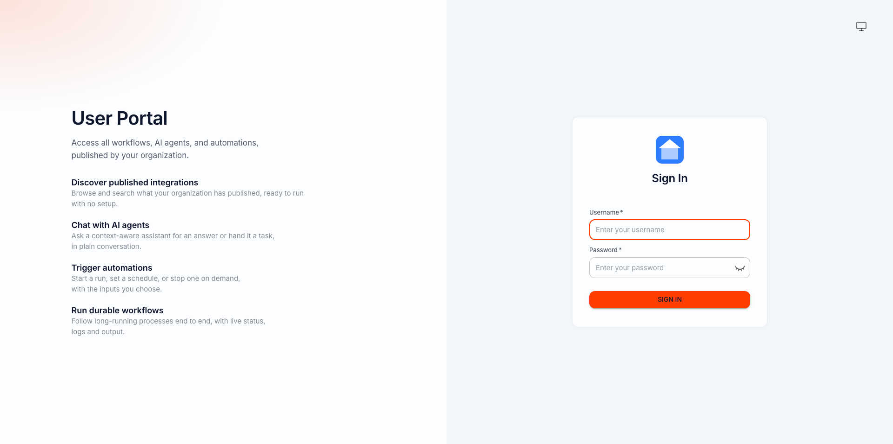

import ThemedImage from '@theme/ThemedImage';
import useBaseUrl from '@docusaurus/useBaseUrl';

The User Portal shows the integrations that an organization [publishes to it](./publish-to-user-portal.mdx). To use them, you sign in to the User Portal of that organization.

Each environment that has the User Portal enabled has its own User Portal. You sign in with the username and password of a User Portal account that the organization gave you.

:::info
If you do not have a User Portal account, or you cannot sign in, contact the organization's administrator. To give someone an account, administrators can follow [Create a user](./manage-users.mdx#create-a-user).
:::

What you can see and do after you sign in depends on your roles in the organization. See [Scopes](./manage-users.mdx#scopes).

## Sign in to the User Portal

1. Open the User Portal link that your organization gave you.

    Administrators can open the User Portal from the Choreo Cloud console. See [Open the User Portal from the console](#open-the-user-portal-from-the-console).

2. Enter your **Username** and **Password**, then click **SIGN IN**.

    

After you sign in, the User Portal opens on the **Overview** page. It lists the integrations that the organization published and that your roles let you see. See [Use the User Portal](./use-user-portal.mdx).

## Open the User Portal from the console

In the Choreo Cloud console, you can open the User Portal in a new tab in either of the following ways:

- On the overview page of a published integration, click **Open User Portal**.
- Under **Integration** > **Configure** > **User Portal**, click **Open portal** on the card of the environment.

## What's next

- [Use the User Portal](./use-user-portal.mdx) to chat with AI agents and run automations.
