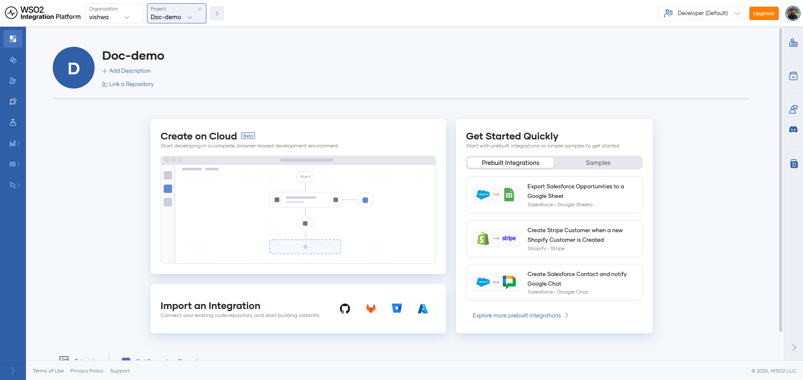
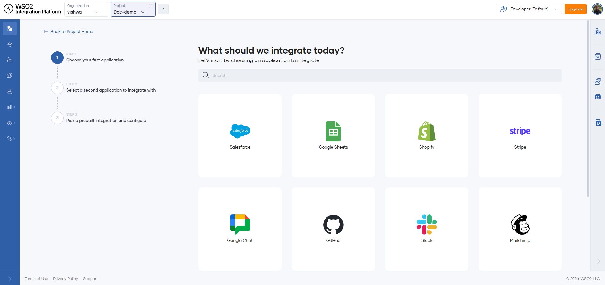
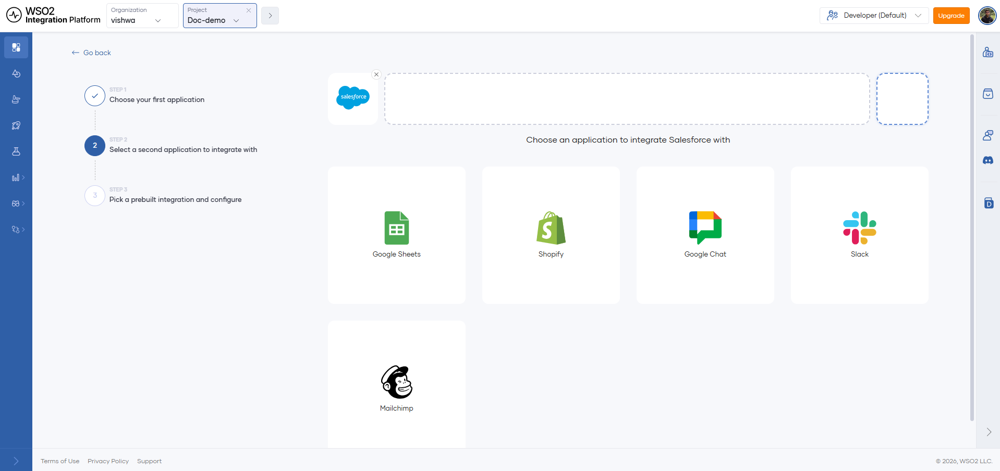
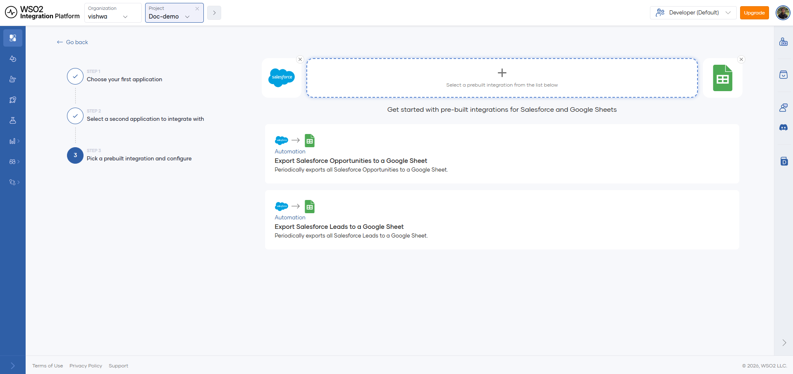
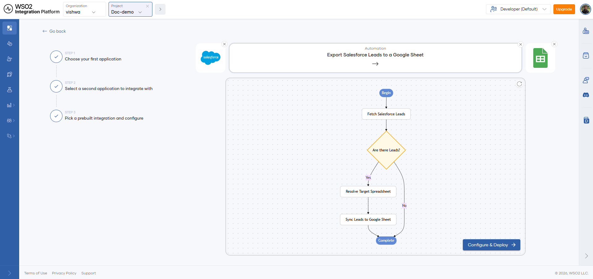
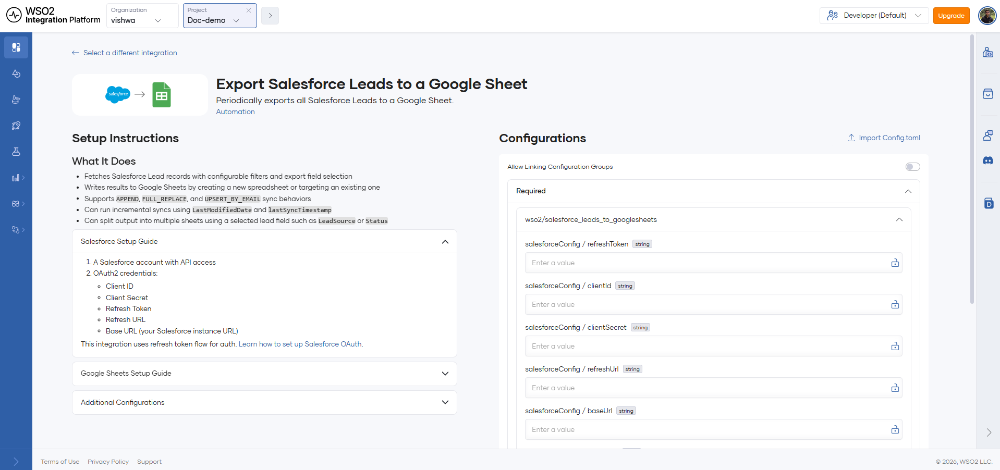
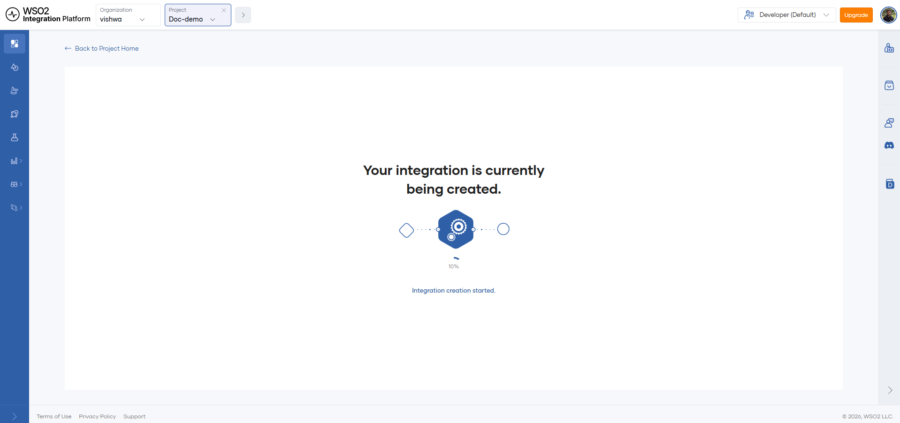
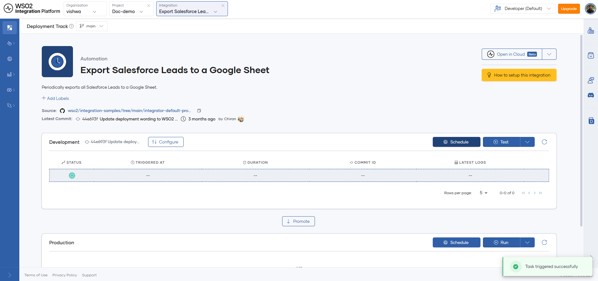
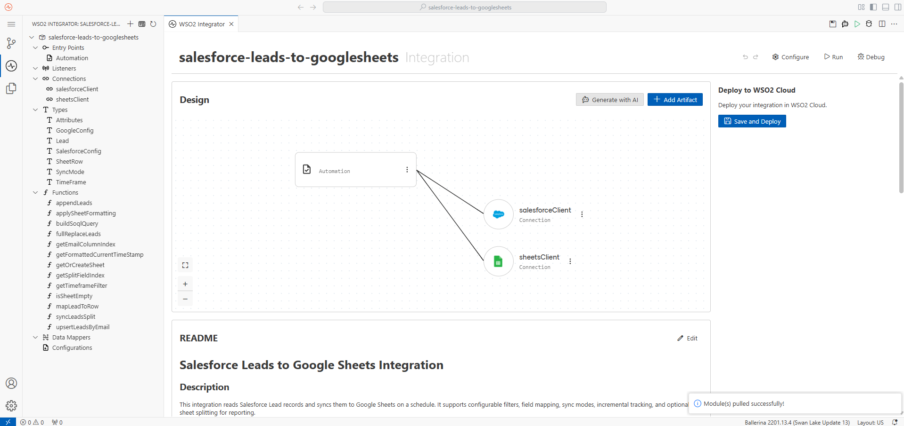

import ThemedImage from '@theme/ThemedImage';
import useBaseUrl from '@docusaurus/useBaseUrl';

**Time:** Under 10 minutes. **What you'll build:** Nothing from scratch. You'll configure and deploy a production-ready integration between two applications from the prebuilt integration catalog.

Building an integration from scratch means learning the platform's abstractions, wiring up connectors, and testing the logic before anything useful happens, even for a straightforward use case. Prebuilt integrations skip all that: each one is a production-ready integration for a real, common use case. Select the one you need, configure it, and deploy in minutes.

:::note Sample integrations vs. prebuilt integrations
[Sample integrations](../develop-and-test/create-workspace/start-with-sample-integrations.mdx) teach you the platform's abstractions. Prebuilt integrations are different: each one is a real, already-wired integration for an actual business use case.
:::

The prebuilt integrations catalog is available in WSO2 Cloud, and you can also browse it from the WSO2 Integrator home screen by selecting **Explore** and filtering by **Pre-built Integrations**. This guide follows the WSO2 Cloud path because it lets you pick a prebuilt integration, configure it, and deploy it in one go, without leaving WSO2 Cloud.

## Prerequisites

A working WSO2 Integrator environment.

- **[WSO2 Cloud setup](./setup/index.mdx)**: Sign up and launch WSO2 Integrator in the browser-based cloud editor.

## Step 1: Go to the project-level view

Log in to [WSO2 Cloud](https://console.devant.dev), then create a project and navigate to the project-level view. You'll see prebuilt integrations in the **Get Started Quickly** panel on the right. Click **Explore more prebuilt integrations** to see the full catalog.

## Step 2: Pick the first application

Choose the application you want to integrate from. The catalog currently includes Salesforce, Google Sheets, Shopify, Stripe, Google Chat, GitHub, Slack, Mailchimp, Jira, and QuickBooks, with more applications added over time. For this demonstration, select **Salesforce**.

## Step 3: Pick the second application

The list narrows to the applications Salesforce can be paired with. Select **Google Sheets**.

## Step 4: Choose an integration scenario

Every application pair has one or more ready-made scenarios, and the set available for a given pair grows as new use cases are added. Select the **Export Salesforce Leads to a Google Sheet** integration.

A flowchart shows every step of the integration from start to finish, so you know exactly what you're about to deploy. Select **Configure & Deploy** to continue.

## Step 5: Review the setup instructions and configure credentials

The configuration page's left panel explains exactly what the integration does and what you need to gather to configure **Export Salesforce Leads to a Google Sheet**. You can fill in every field individually, or **import a configuration file** instead. None of this is final: configurations are bound to the environment, and you can change any value later.

Fill in your credentials and configuration, then select **Deploy**. The integration deploys within minutes.

## Step 6: Test it

After deployment, you land on the integration's overview page. Select **Test** on the **Development** environment to trigger an execution.

Once the execution completes, check the logs, then check your Google Sheet. You'll find a fresh spreadsheet already populated with your Salesforce data.

From here, you can manage, deploy, and observe this integration just like any other integration on WSO2 Cloud.

## Step 7: Make it yours

To customize the integration, go to the overview page and select **Open in Cloud** to edit it in low-code or pro-code view, right in the cloud editor. Edit however you're most comfortable, then push the result to your own repository. At that point, it's fully yours, the same as any integration you built from scratch.

:::tip The value of prebuilt integrations
Common integration problems are already solved, so you don't have to rebuild them. Pick a use case, deploy it in minutes, and spend your time on the work that actually needs it.
:::

## What's next

- [Manage integrations](../manage/integrations/integrations.mdx) — View deployment status and manage the lifecycle of a deployed integration
- [Runtime configurations](../manage/configurations/runtime-configurations.mdx) — Update configuration values or link them to shared configuration groups after deployment
- [Deploy from the cloud editor](../deploy-and-run/deploy-to-wso2-cloud/deploy-from-cloud-editor.mdx) — Learn more about customizing and redeploying an integration you opened in the cloud editor
- [Start with sample integrations](../develop-and-test/create-workspace/start-with-sample-integrations.mdx) — Start from a teaching sample instead if you'd rather build the integration yourself
