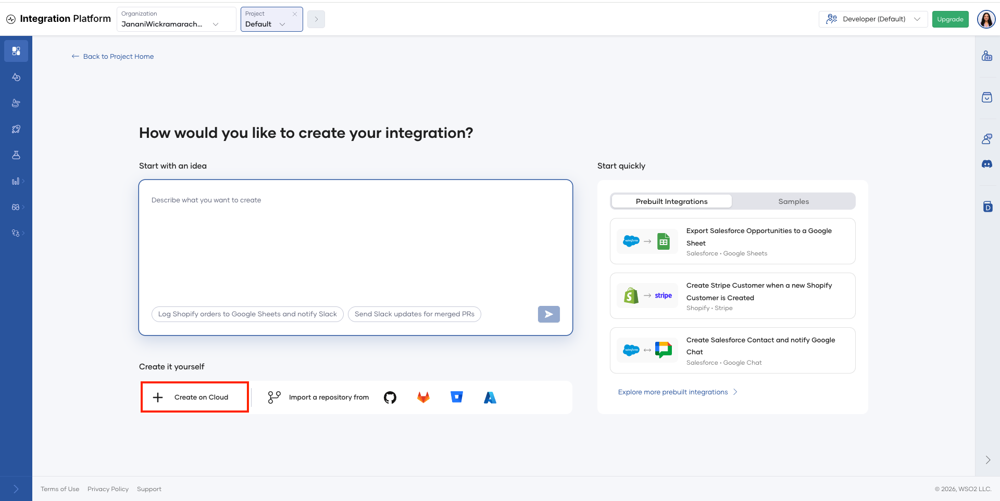
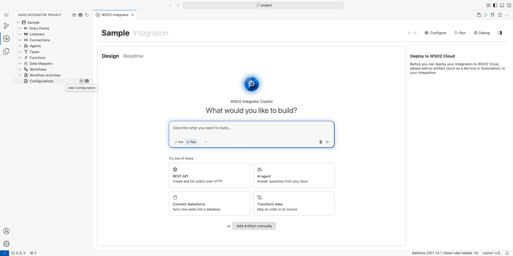
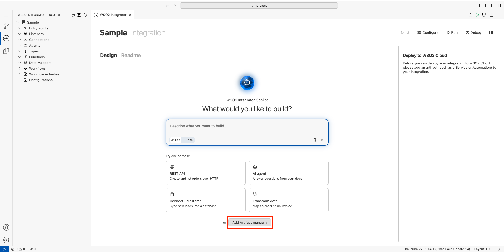
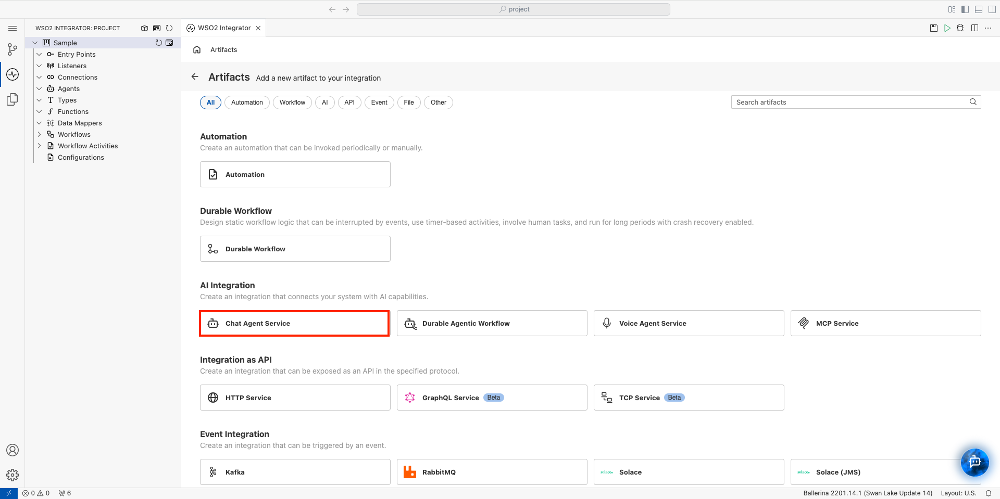
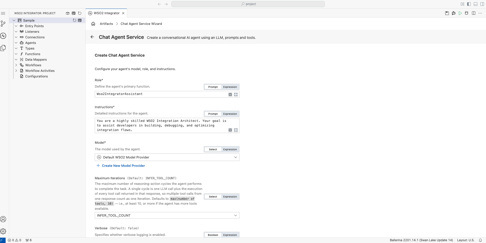
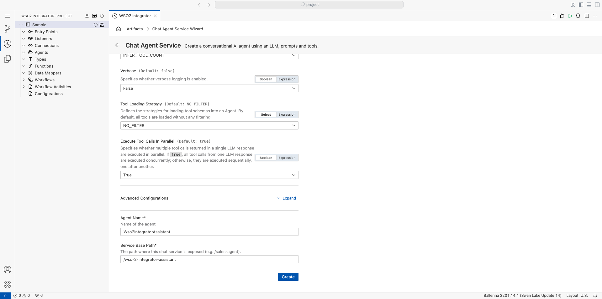
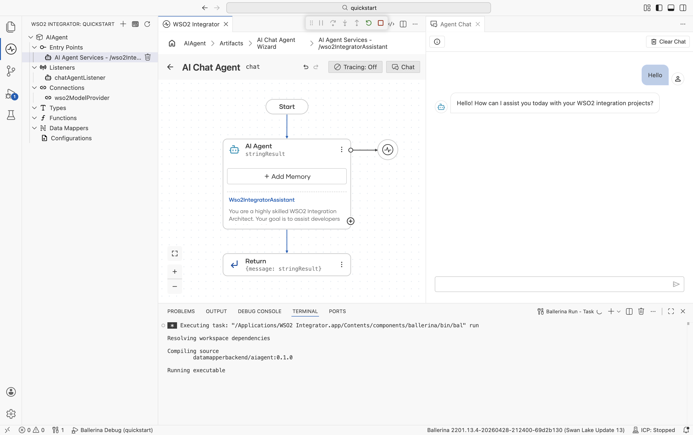

import ThemedImage from '@theme/ThemedImage';
import useBaseUrl from '@docusaurus/useBaseUrl';

**Time:** Under 10 minutes. **What you'll build:** An AI agent that connects to an LLM, uses tools, and responds to user queries in chat.

An AI agent uses an LLM to reason about user queries and call tools to retrieve information or perform actions. This quick start shows the full cycle: create a project, add an AI Chat Agent artifact, configure its instructions, and test it in the built-in chat panel.

## Prerequisites

A working WSO2 Integrator environment.


- **[WSO2 Cloud setup](../setup/index.mdx)**: Sign up and launch WSO2 Integrator in the browser-based cloud editor.


## Step 1: Create the integration

1. On the project home page, click **Create on Cloud**.

   

2. The WSO2 Integrator cloud editor opens in your browser.

   

:::info Note
The cloud editor creates a default integration for you, so you don't need to name it now. You can change its name when you deploy it. For more information, see [Save and deploy](../../deploy-and-run/deploy-to-wso2-cloud/deploy-from-cloud-editor.mdx#save-and-deploy).
:::

## Step 2: Add an AI chat agent

1. In the design view, click **Add Artifact manually**.

   

2. Select **Chat Agent Service** under **AI Integration**.

   

3. The **Create Chat Agent Service** form opens. Set **Role** to `Wso2IntegratorAssistant`.

4. Set **Instructions** to:

   ```text
   You are a highly skilled WSO2 Integration Architect. Your goal is to assist developers in building, debugging, and optimizing integration flows.
   ```

   

5. Leave the remaining configuration fields at their default values.

6. Scroll down to **Advanced Configurations** at the bottom of the form, and set **Agent Name** to `Wso2IntegratorAssistant`.

7. Click **Create**.

   

:::tip Default model provider

By default, the agent is configured to use the WSO2 model provider. If you want to use a different LLM, see [Model providers](../../develop-and-test/integration-artifacts/ai-integrations/ai-building-blocks/model-providers.mdx) for the full list of supported providers (OpenAI, Azure OpenAI, Anthropic, and others).

If you are using the WSO2 model provider, the access token is obtained through [WSO2 Integrator Copilot](../../editor/copilot/copilot.mdx). If you have not already signed in, you will be prompted to do so.
:::

## Step 3: Run and test

1. Click **Run**.

2. Click **Chat** in the Chat Agent Service title bar, or click **Test** in the pop-up.

3. Type `Hello` to check that the agent replies.

   

## Step 4: Deploy to WSO2 Cloud

To deploy your integration to WSO2 Cloud from the cloud editor, see [Save and deploy](../../deploy-and-run/deploy-to-wso2-cloud/deploy-from-cloud-editor.mdx#save-and-deploy).


### Skip ahead: deploy a ready-made sample

Rather not build it yourself? One-click deploy the AIAgent sample straight to WSO2 Cloud.


## Source code

<details>
<summary>View the generated Ballerina code</summary>

The steps above generate two files: `agents.bal` for the agent definition and `main.bal` for the listener and service.

**`agents.bal`**

```ballerina
import ballerina/ai;

final ai:Agent wso2IntegratorAssistantAgent = check new (
    systemPrompt = {
        role: string `Wso2IntegratorAssistant`,
        instructions: string `You are a highly skilled WSO2 Integration Architect. Your goal is to assist developers in building, debugging, and optimizing integration flows.`
    },
    model = wso2ModelProvider,
    tools = []
);
```

**`main.bal`**

```ballerina
import ballerina/ai;
import ballerina/http;

listener ai:Listener chatAgentListener = new (listenOn = check http:getDefaultListener());

service /wso2IntegratorAssistant on chatAgentListener {
    resource function post chat(@http:Payload ai:ChatReqMessage request) returns ai:ChatRespMessage|error {
        string stringResult = check wso2IntegratorAssistantAgent.run(request.message, request.sessionId);
        return {message: stringResult};
    }
}
```

</details>
