import ThemedImage from '@theme/ThemedImage';
import useBaseUrl from '@docusaurus/useBaseUrl';

**Time:** Under 10 minutes. **What you'll build:** A file integration that watches a folder on an FTP or SFTP server and logs a message each time a new file arrives.

File integrations are ideal for batch uploads, scheduled file processing, and ETL workflows triggered by files appearing in a folder or FTP server. This quick start shows the full cycle: add an FTP integration artifact, add a handler that runs when a new file is created, and test it by uploading a file.

## Prerequisites

A working WSO2 Integrator environment.


- **[WSO2 Cloud setup](../setup/index.mdx)**: Sign up and launch WSO2 Integrator in the browser-based cloud editor.


You'll also need access to an FTP, SFTP, or FTPS server that is reachable over the internet. Have the following details ready:

- The server's host and port.
- A username and password for the server.
- A folder on the server for the integration to watch, for example, `/quickstarts-file-integration`. Create this folder before you start.

To test the integration, you'll also need an FTP or SFTP client to upload a file to the specified folder.

:::tip Get a free test server
If you don't have a server, create a free test server on [SFTPCloud](https://sftpcloud.io/tools/free-ftp-server) by clicking **Create test FTP server**. Use the host, port, username, and password it shows.
:::

:::info Note
The cloud editor runs in WSO2 Cloud and cannot connect to a server running on `localhost` on your computer. Make sure the server is accessible over the internet.
:::


## Step 1: Create the integration

1. On the project home page, click **Create on Cloud**.

   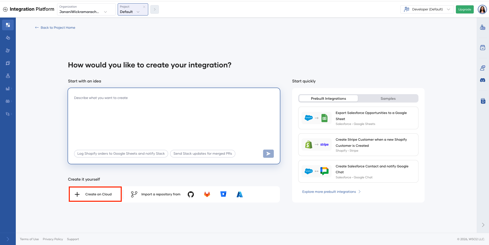

2. The WSO2 Integrator cloud editor opens in your browser.

   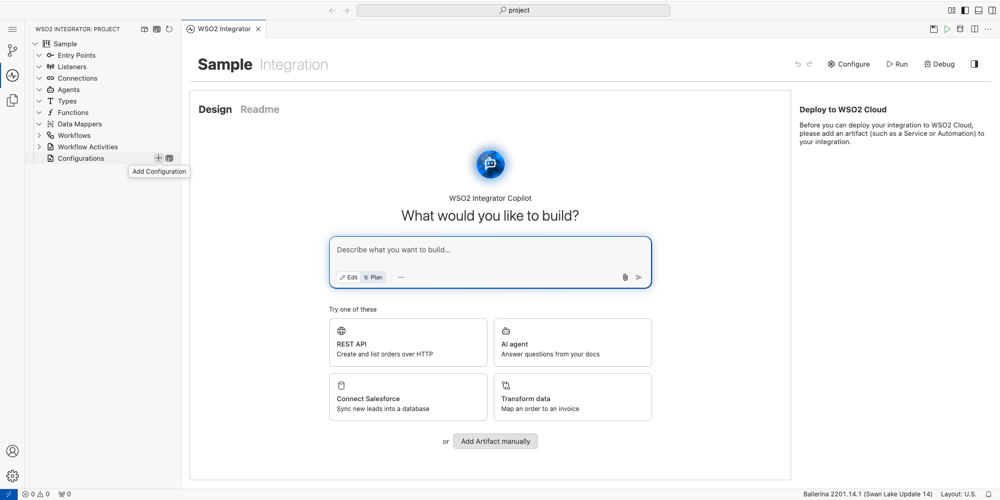

:::info Note
The cloud editor creates a default integration for you, so you don't need to name it now. You can change its name when you deploy it. For more information, see [Save and deploy](../../deploy-and-run/deploy-to-wso2-cloud/deploy-from-cloud-editor.mdx#save-and-deploy).
:::

## Step 2: Add a file integration artifact

1. In the design view, click **Add Artifact manually**.

   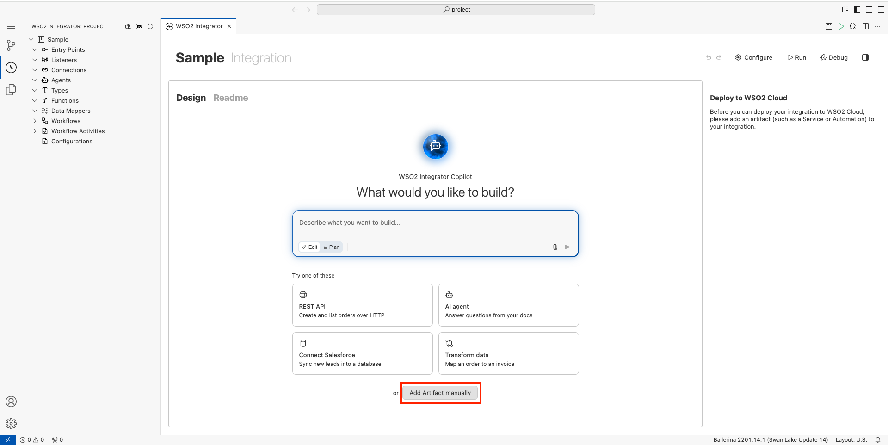

2. Select **FTP / SFTP** under **File Integration**.

   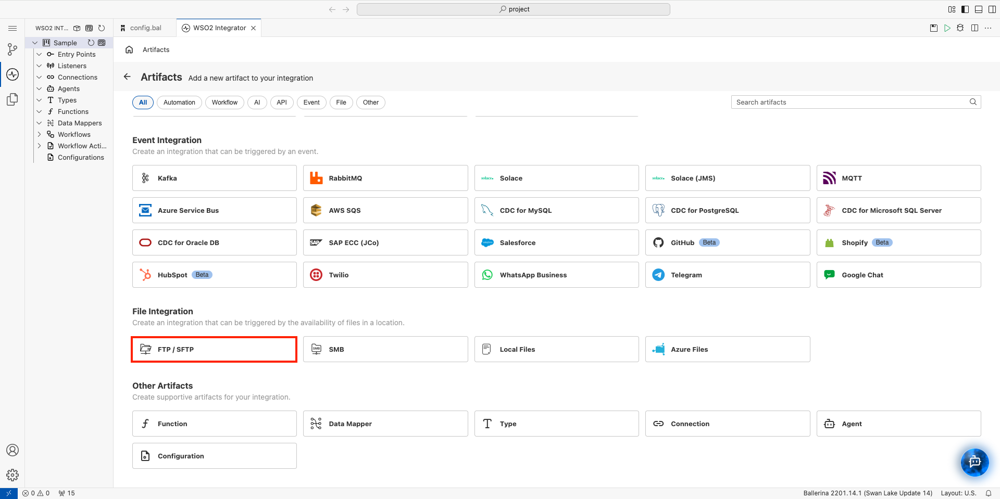

3. Set **Host** to your server's host.

4. Select the protocol your server uses: **FTP**, **SFTP**, or **FTPS**.

5. Set **Port** to your server's port. For example, SFTP usually uses port `22`.

   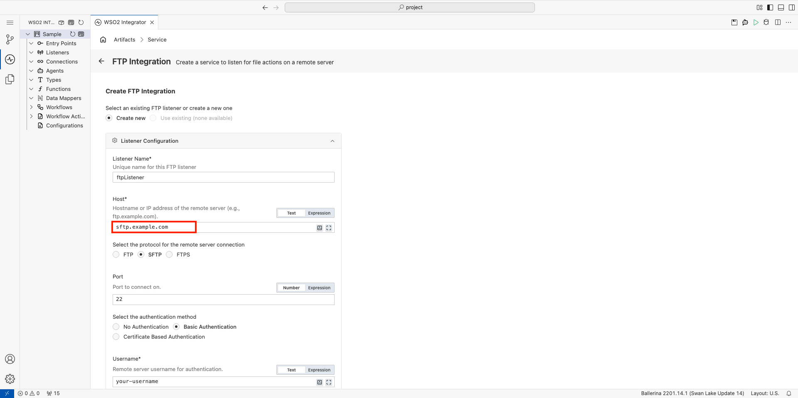

6. Select **Basic Authentication**.

7. Set **Username** and **Password** to your server's username and password.

8. Set **Monitored Path** to the folder you want to watch, for example `/quickstarts-file-integration`. The folder must already exist on the server.

9. Click **Create**.

   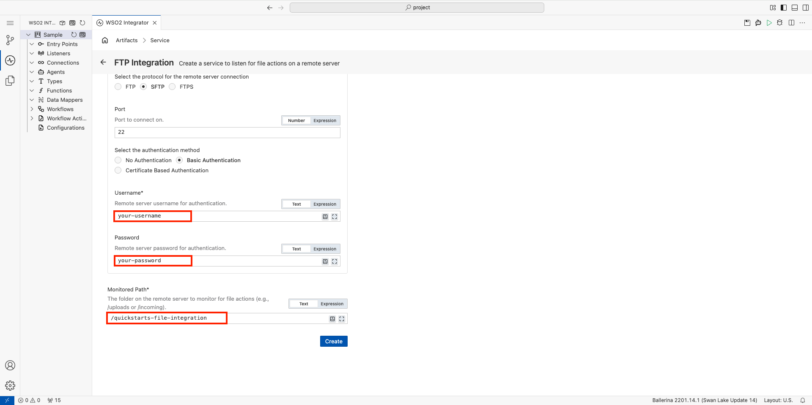

## Step 3: Add `onCreate` event handler

1. In the FTP Integration design view, click **+ Add Handler**.

2. In the **Select Handler to Add** panel, select **On Create**.

   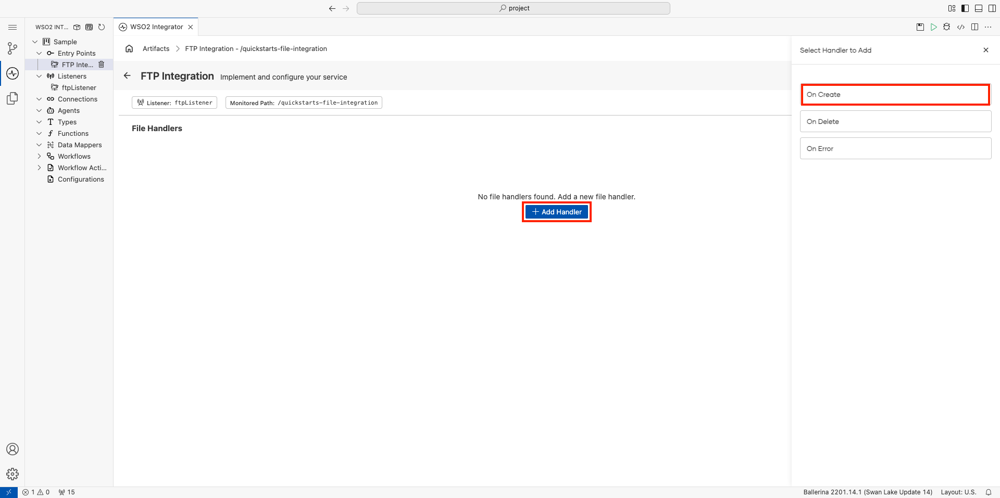

3. Set **Format** to **Text**.

4. Keep the default **File Handling Options**. After processing a file, the integration moves it to the `/home/processed` folder on your server to prevent it from being processed again.

5. Click **Save**.

   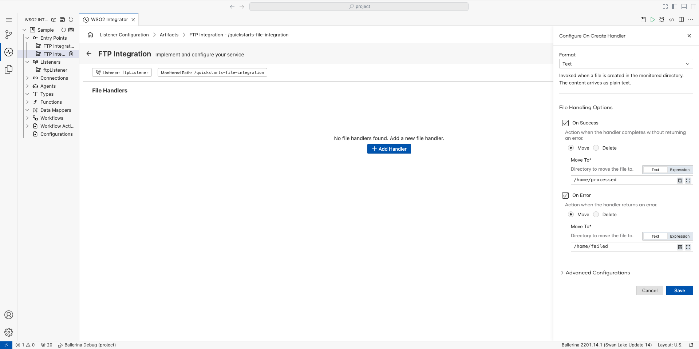

## Step 4: Add file processing logic

1. Click **+** inside the `onFileText` flow.

   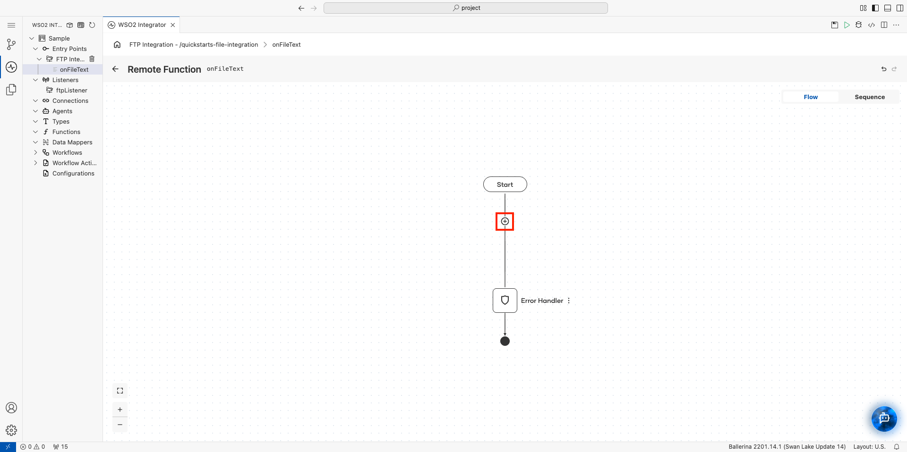

2. Select **Call Function** under **Statement**.

   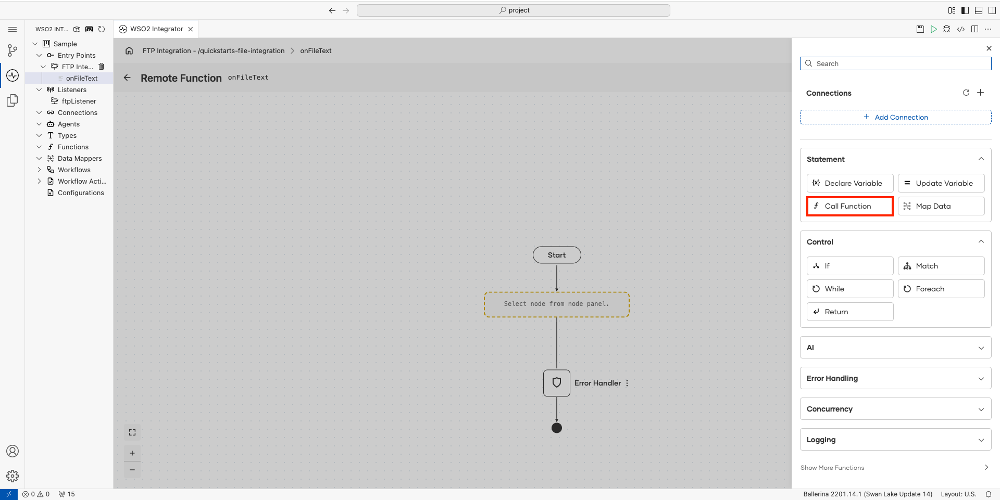

3. Search for `printInfo` in the functions panel.

4. In the search results, go to the **Standard Library** section and select the **printInfo** function under **log**.

   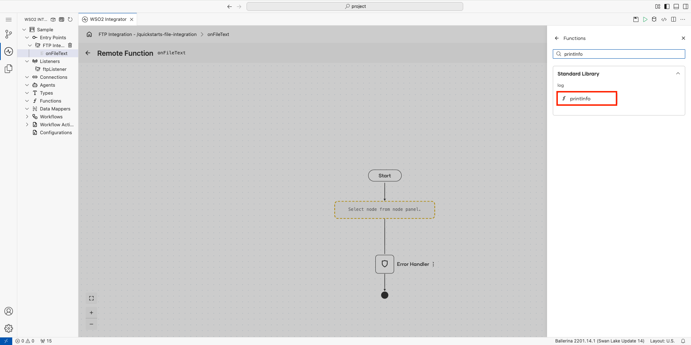

5. Set **Msg** to `New file received`.

6. Click **Save**.

   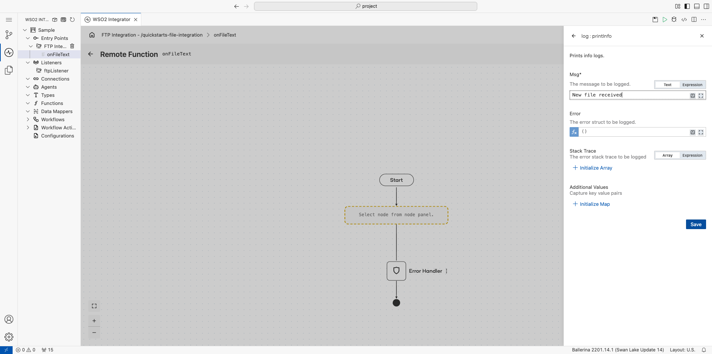

## Step 5: Run and test

1. Click **Run**. The **Debug Console** opens at the bottom of the editor. It shows some messages while the integration connects to your server, such as `Authentication succeeded`. These messages are expected.

2. Using your FTP or SFTP client, upload a text file, such as `test.txt`, to the monitored folder.

3. Wait up to a minute. The integration checks the folder every 60 seconds by default.

4. Confirm the **Debug Console** shows a log line that ends with `message="New file received"`.

   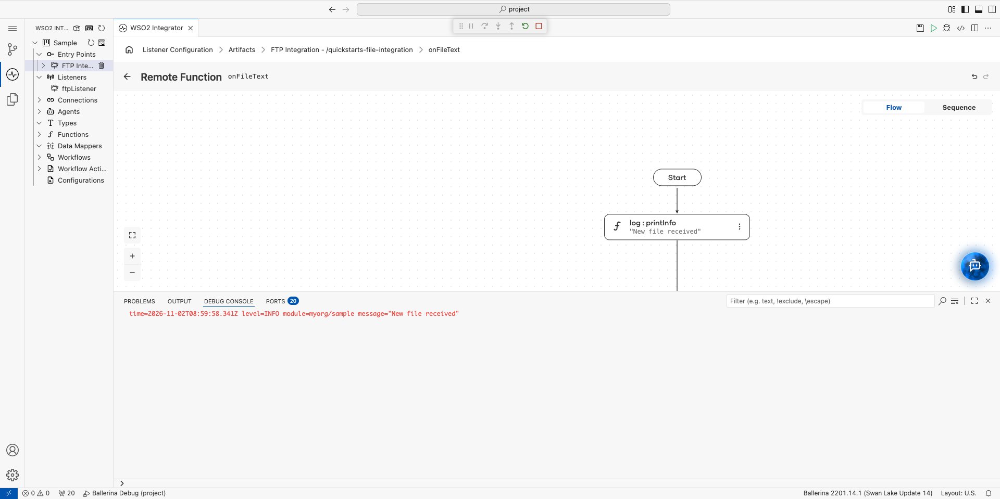

## Step 6: Deploy to WSO2 Cloud

To deploy your integration to WSO2 Cloud from the cloud editor, see [Save and deploy](../../deploy-and-run/deploy-to-wso2-cloud/deploy-from-cloud-editor.mdx#save-and-deploy).

## Source code

<details>
<summary>View the generated Ballerina code</summary>

The steps above generate the following complete, runnable Ballerina program:

```ballerina
import ballerina/ftp;
import ballerina/log;

listener ftp:Listener ftpListener = new (host = "<your-server-host>", protocol = ftp:SFTP, port = 22, auth = {credentials: {username: "<your-username>", password: "<your-password>"}});

@ftp:ServiceConfig {path: "/quickstarts-file-integration"}
service ftp:Service on ftpListener {
    @ftp:FunctionConfig {afterProcess: {moveTo: "/home/processed"}, afterError: {moveTo: "/home/failed"}}
    remote function onFileText(string content) returns error? {
        do {
            log:printInfo("New file received");
        } on fail error err {
            // handle error
            return error("unhandled error", err);
        }
    }
}
```

</details>

## Learn more

- [FTP/SFTP](../../develop-and-test/integration-artifacts/file-driven-integration/ftp-sftp/ftp-sftp.mdx) — Watch and process files on remote FTP or SFTP servers
- [Local files](../../develop-and-test/integration-artifacts/file-driven-integration/local-files.mdx) — Full Local Files listener reference (events, recursive watching, file handlers)
- [Streaming large files](../../develop-and-test/integration-artifacts/file-driven-integration/ftp-sftp/ftp-sftp.mdx#streaming-large-files) — Process large files without loading them fully into memory
- [CSV fault tolerance](../../develop-and-test/integration-artifacts/file-driven-integration/ftp-sftp/csv-fault-tolerance.mdx) — Handle errors and partial failures when processing CSV files
