import ThemedImage from '@theme/ThemedImage';
import useBaseUrl from '@docusaurus/useBaseUrl';

**Time:** Under 10 minutes. **What you'll build:** An HTTP service that listens on `/hello/greeting`, calls an external API, and returns the response to the caller.

An HTTP service exposes your integration logic as a REST endpoint. This quick start shows the full cycle: create a service, add a resource, connect to an external API, and test it using the Try-It/Test panel in WSO2 Integrator.

## Prerequisites

A working WSO2 Integrator environment.


- **[WSO2 Cloud setup](../setup/index.mdx)**: Sign up and launch WSO2 Integrator in the browser-based cloud editor.


## Step 1: Create the integration

1. On the project home page, click **Create on Cloud**.

   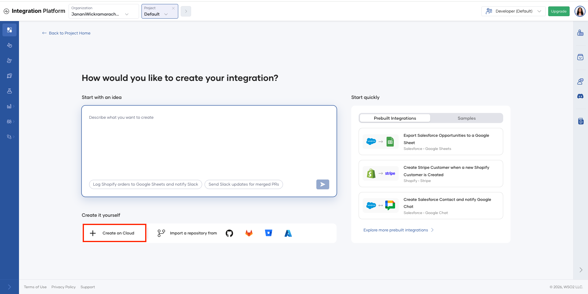

2. The WSO2 Integrator cloud editor opens in your browser.

   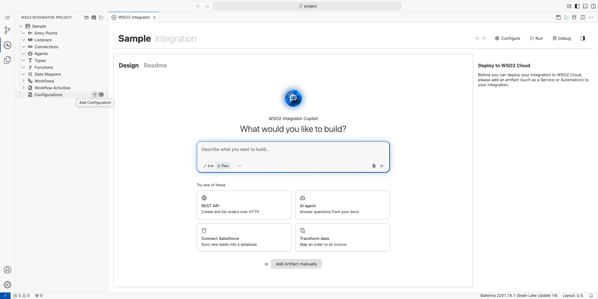

:::info Note
The cloud editor creates a default integration for you, so you don't need to name it now. You can change its name when you deploy it. For more information, see [Save and deploy](../../deploy-and-run/deploy-to-wso2-cloud/deploy-from-cloud-editor.mdx#save-and-deploy).
:::

## Step 2: Add an HTTP service

1. In the design view, click **Add Artifact manually**.

   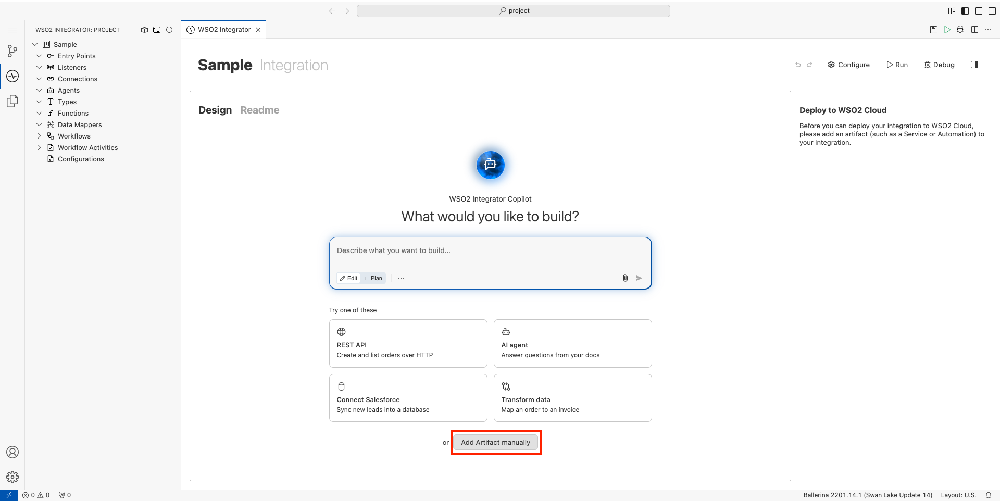

2. Select **HTTP Service** under **Integration as API**.

   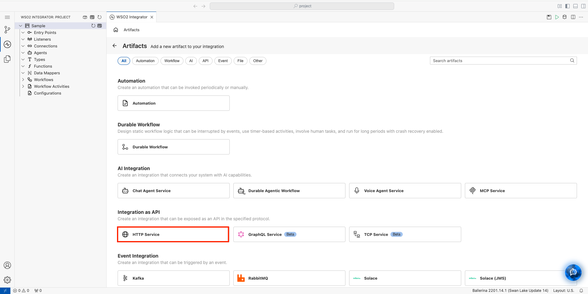

3. Keep **Service Contract** as **Design From Scratch**.

4. Set **Service Base Path** to `/hello`.

5. Click **Create**.

   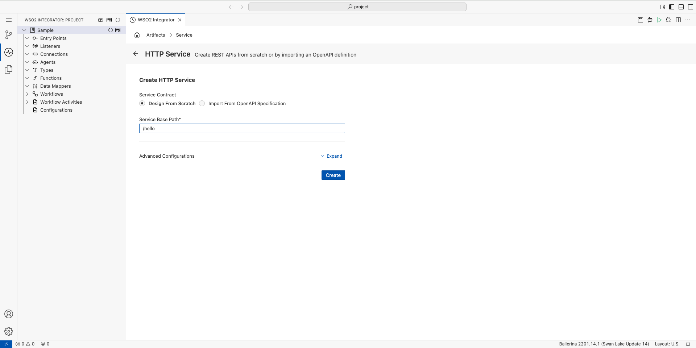

## Step 3: Add a resource

1. In the HTTP service design view, click **+ Add Resource**.

2. Select **GET**.

   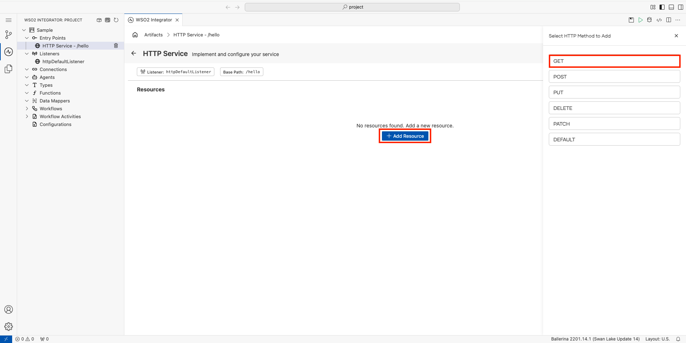

3. Set **Resource path** to `greeting`.

4. Click **Save**.

   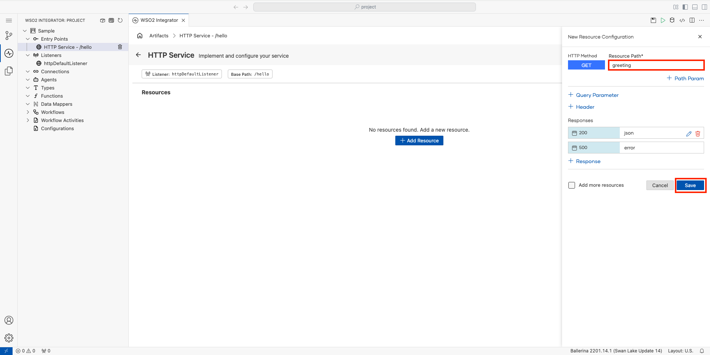

## Step 4: Connect to an external API

1. Click **+** inside the resource flow.

   

2. Click **Add Connection** under **Connections**.

   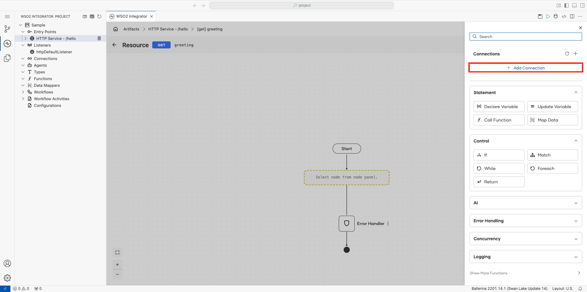

3. Select **HTTP** under **Pre-built Connectors**.

   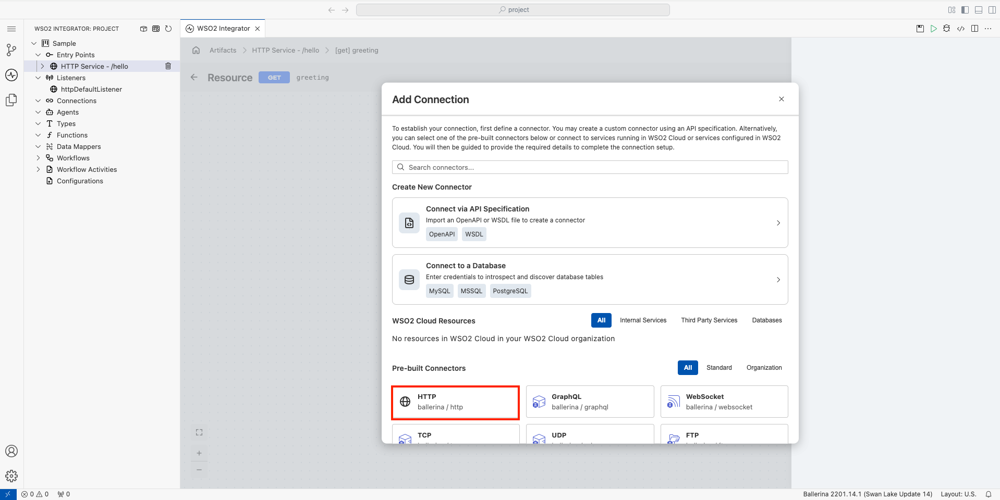

4. The **Connect to Third-Party service** form opens. Set **Url** to:

   ```text
   https://apis.wso2.com/zvdz/mi-qsg/v1.0
   ```

   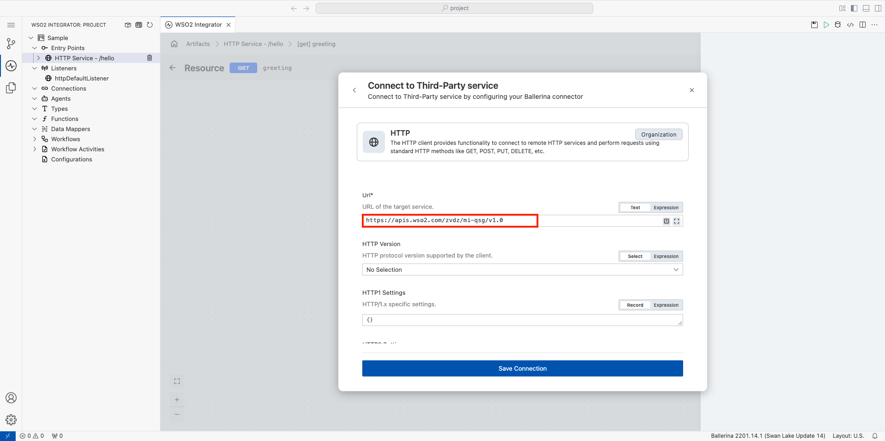

5. Scroll to the bottom of the form. Set **Connection Name** to `externalApi`.

6. Click **Save Connection**.

   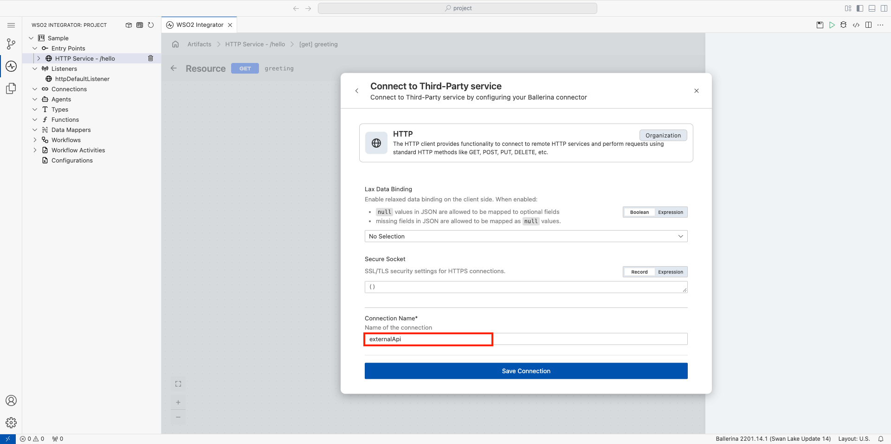

## Step 5: Call the external API

1. Click **+** inside the resource flow.

   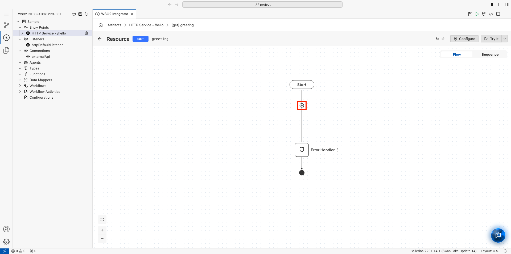

2. Select **externalApi**.

3. Select **Get**.

   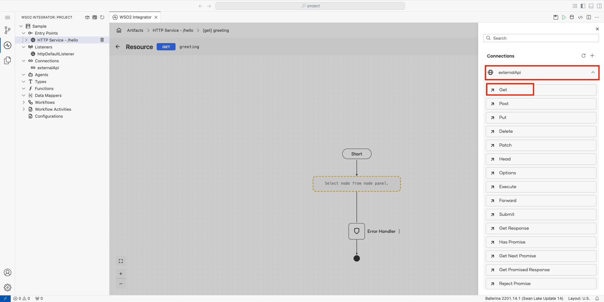

4. Set **Path** to `/`.

5. Set **Result** to `response`.

6. Set **Target Type** to `json`.

7. Click **Save**.

   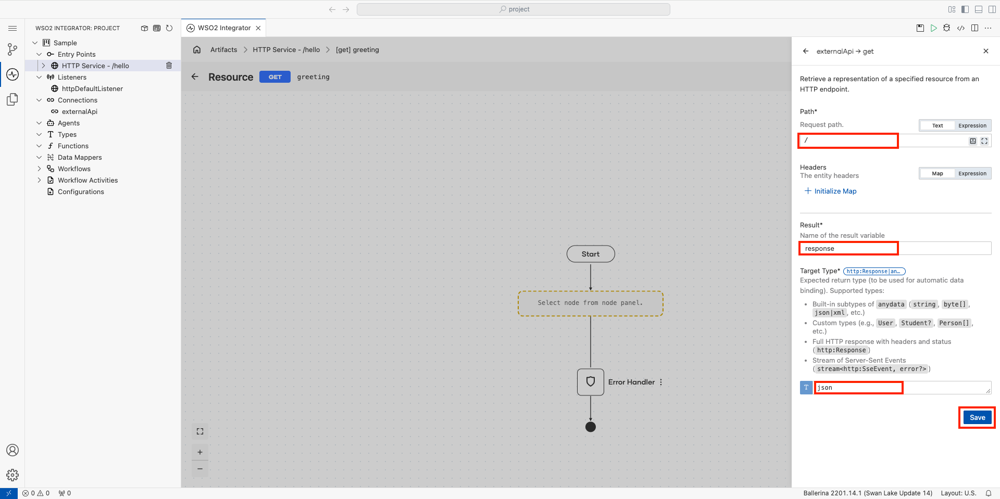

## Step 6: Return the response

1. Click **+** inside the resource flow, below the external API call node you just added.

   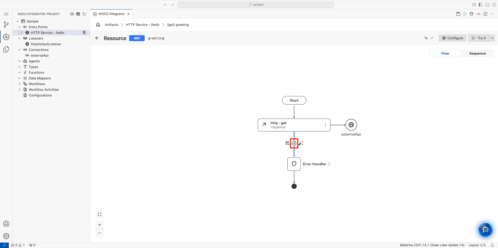

2. Select **Return** under **Control**.

   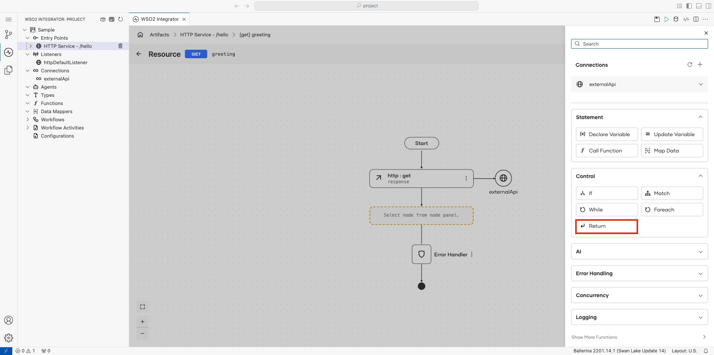

3. In the **Expression** field, select `response` from the variables.

4. Click **Save**.

   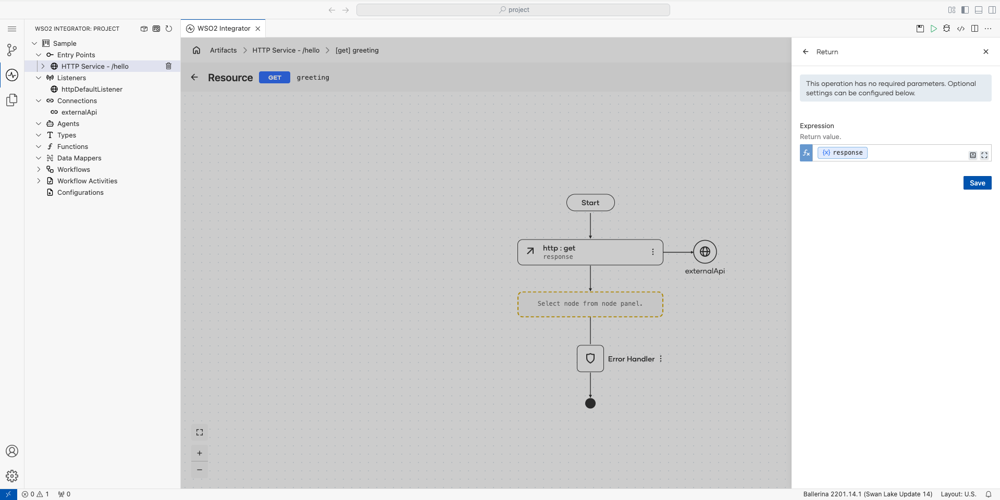

## Step 7: Run and test

1. Click **Run**.

2. Click **Test** in the confirmation dialog.

3. Click **Execute**.

4. Confirm the response shows `200 OK` with a `Hello World` body.

   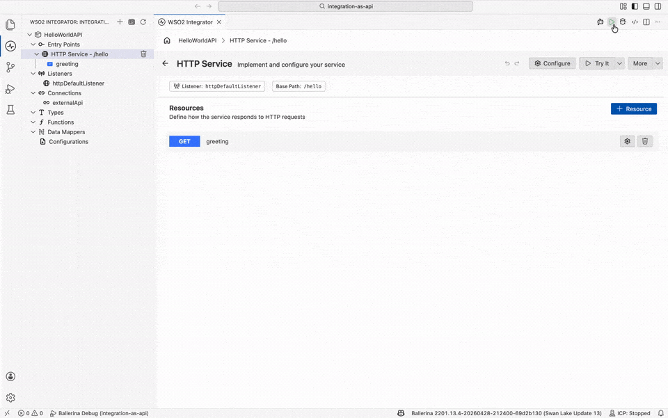

## Step 8: Deploy to WSO2 Cloud

To deploy your integration to WSO2 Cloud from the cloud editor, see [Save and deploy](../../deploy-and-run/deploy-to-wso2-cloud/deploy-from-cloud-editor.mdx#save-and-deploy).


### Skip ahead: deploy a ready-made sample

Rather not build it yourself? One-click deploy the HelloWorldAPI sample straight to WSO2 Cloud.


## Source code

<details>
<summary>View the generated Ballerina code</summary>

The steps above generate the following complete, runnable Ballerina program:

```ballerina
import ballerina/http;

listener http:Listener httpDefaultListener = http:getDefaultListener();

final http:Client externalApi = check new ("https://apis.wso2.com/zvdz/mi-qsg/v1.0");

service /hello on httpDefaultListener {

    resource function get greeting() returns json|error {
        do {
            json response = check externalApi->get("/");
            return response;
        } on fail error err {
            // handle error
            return error("unhandled error", err);
        }
    }
}
```

</details>
