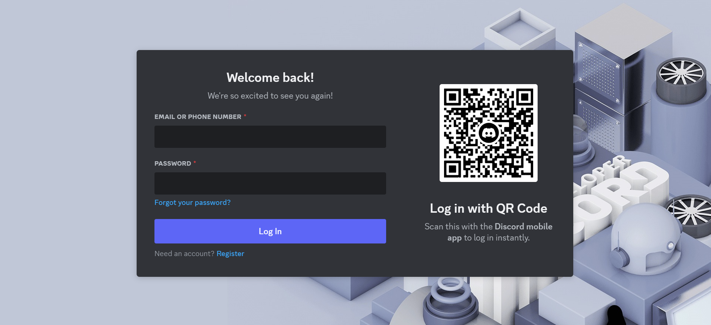
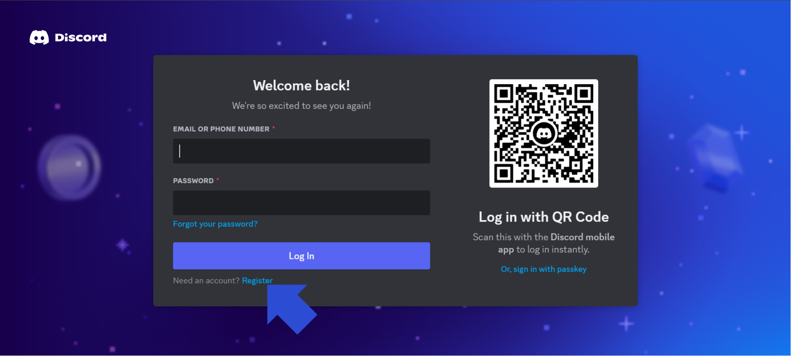
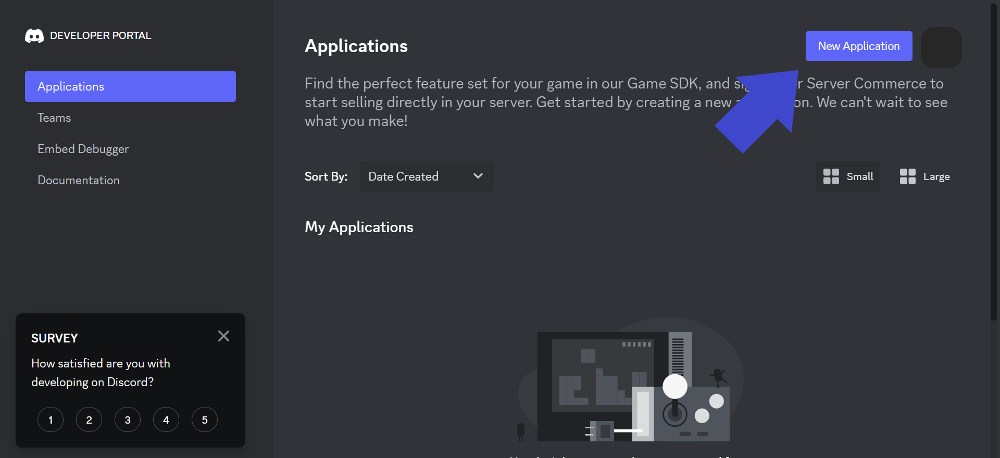
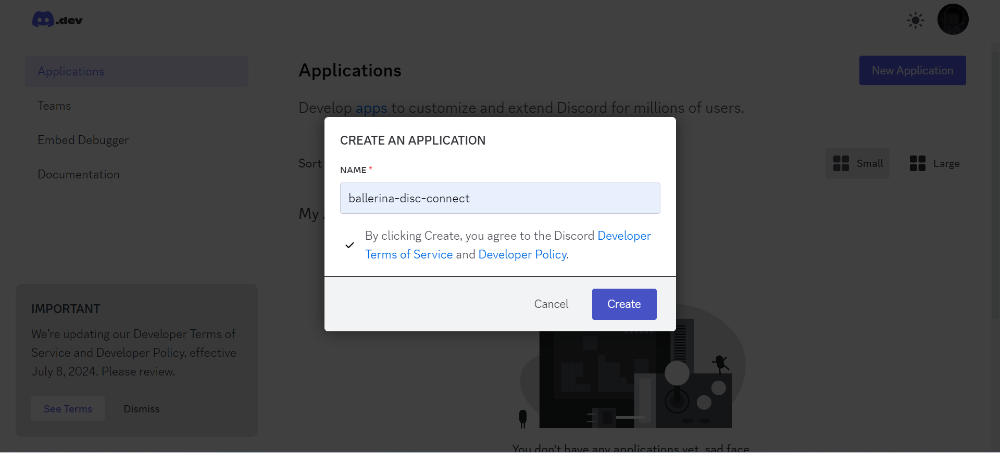
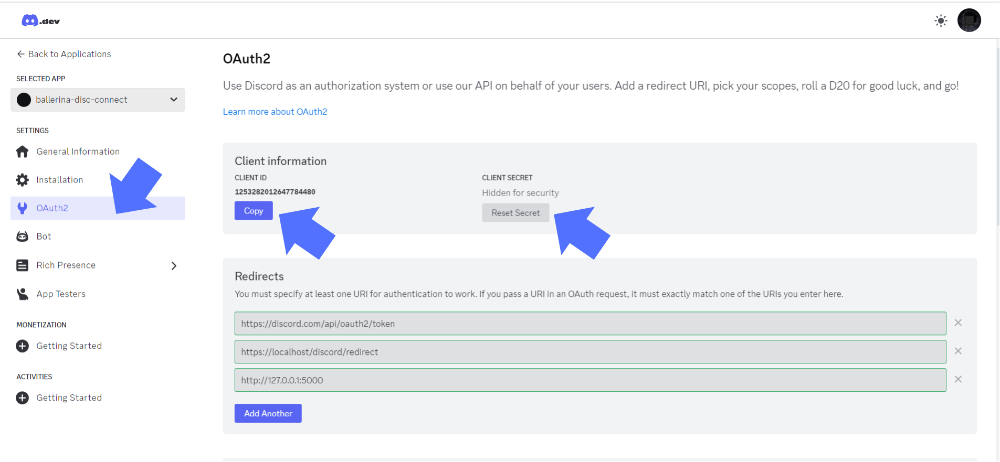

This guide walks you through creating a Discord application and obtaining the credentials required to use the Discord connector.

## Step 1: Log in to Discord Developer Portal

1. Access the [Discord developer portal](https://discord.com/login?redirect_to=%2Fdevelopers) using your Discord credentials.

   

2. If you don't have a Discord account, select **Register** beneath the login button and complete account creation.

   

## Step 2: Create a new Discord application

1. In the developer portal, select **New Application**.

   

## Step 3: Name the Discord application

1. Provide a name for your application and accept the terms of service.

   

2. Select **Next** to complete naming.

## Step 4: Obtain the client ID and client secret

1. Navigate to **OAuth2** in the sidebar to retrieve your client credentials. You need the **Client ID** and **Client Secret** to use the Discord connector.

   
