This guide walks you through creating a Shopify development store and obtaining the Admin API access token required to use the Shopify Admin connector.

## Prerequisites

- A Shopify account. If you do not have one, [sign up at the Shopify signup portal](https://accounts.shopify.com/signup).
- Membership in the [Shopify Partner Program](https://www.shopify.com/partners) to access development tools.

## Step 1: Sign up for a Shopify developer account

1. Create a Shopify account via the [Shopify signup portal](https://accounts.shopify.com/signup).

   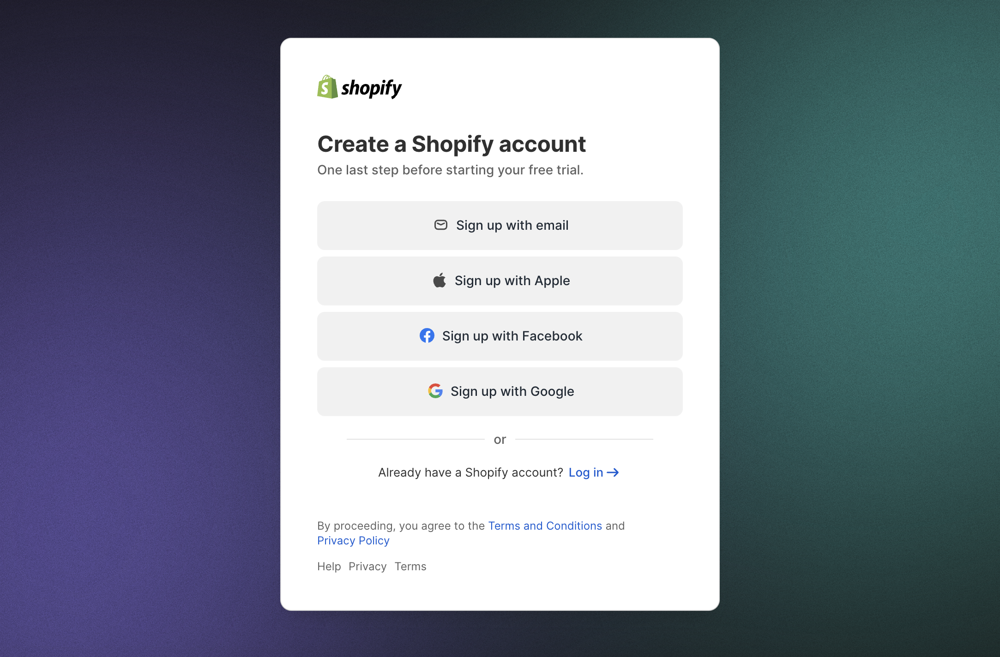

2. Join the [Shopify Partner Program](https://www.shopify.com/partners) to access development tools.

   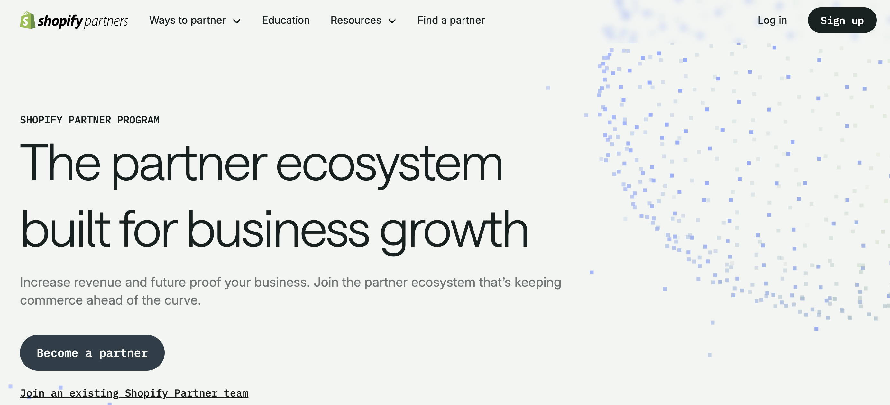

## Step 2: Create a new organization

1. In the Shopify Partner Dashboard, connect to an existing organization or create a new one.

   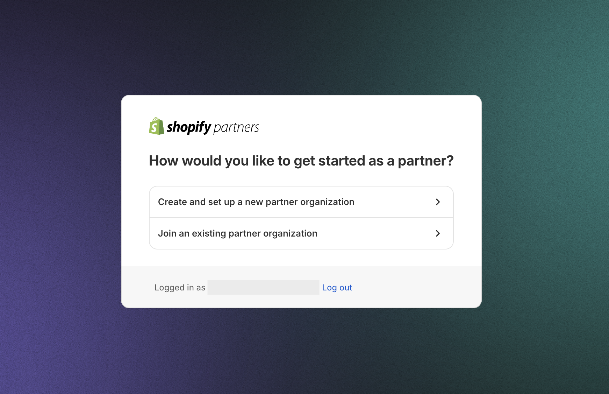

2. Select your main focus as a Shopify partner and follow the on-screen instructions.

   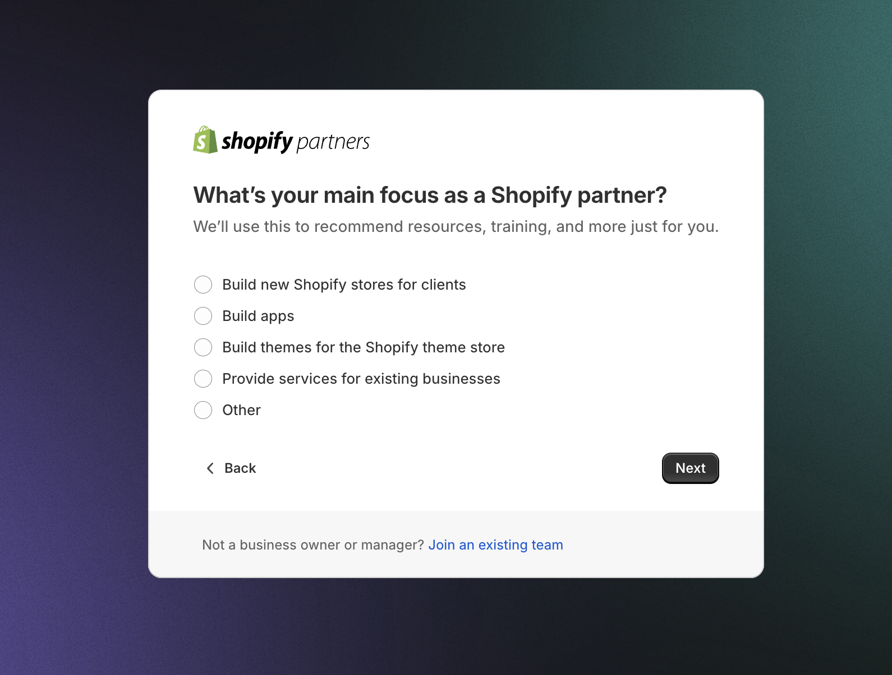

3. Provide business contact details and finalize the setup.

   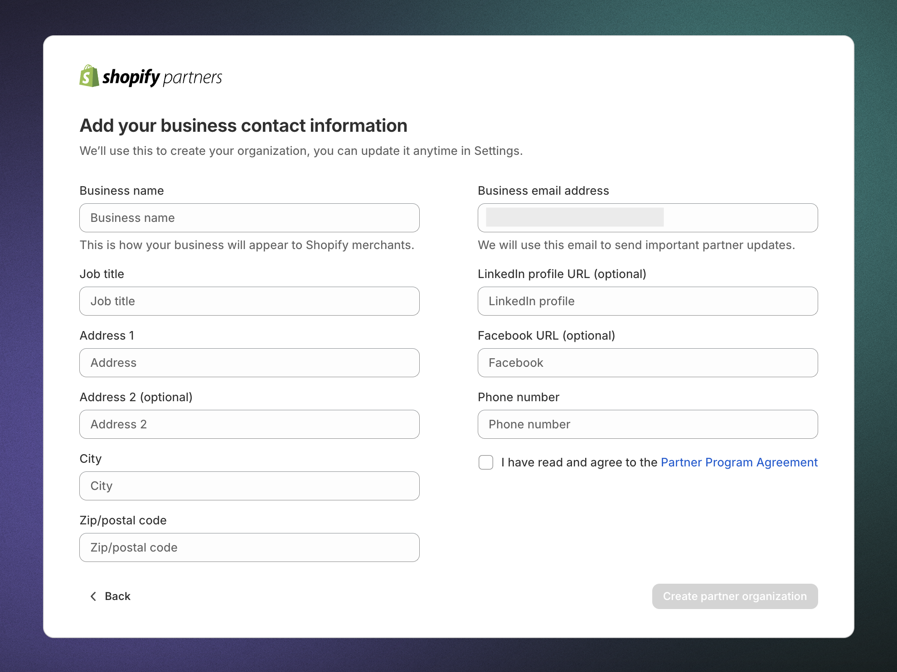

## Step 3: Create a development store

1. In the [Shopify Partner Dashboard](https://partners.shopify.com/), select **Stores** in the left navigation.

   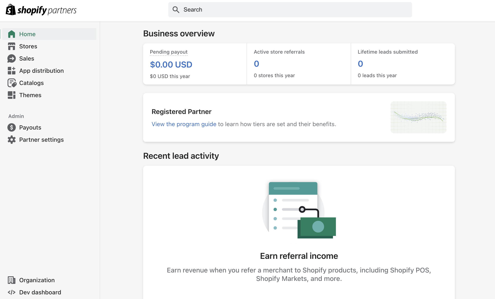

2. Select **Create store** to proceed.

   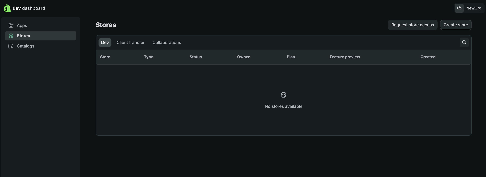

3. Complete the store setup by following the on-screen instructions.

   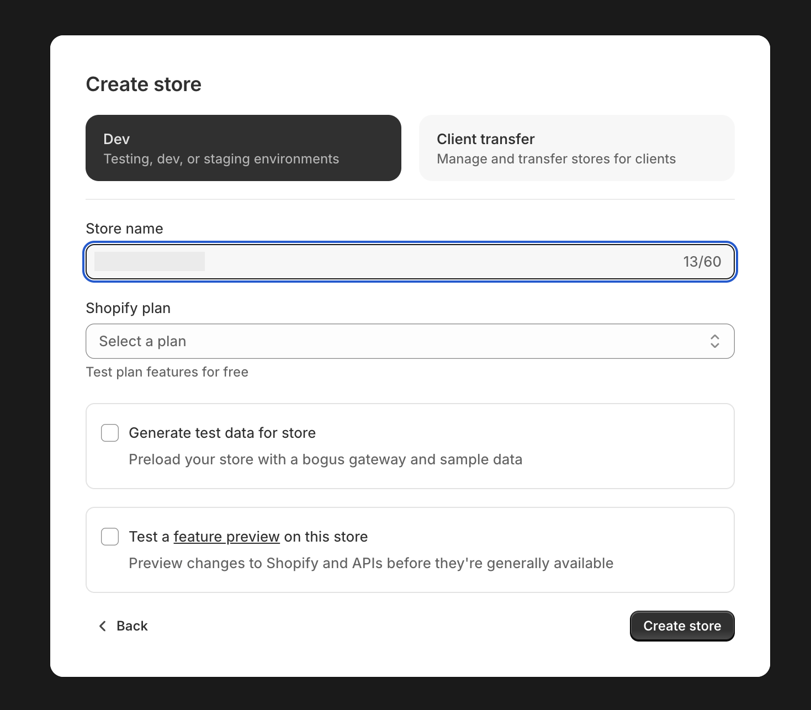

:::note
A development store is free and intended for testing and development purposes.
:::

## Step 4: Create a new app

1. In your store admin, select **Settings**.

   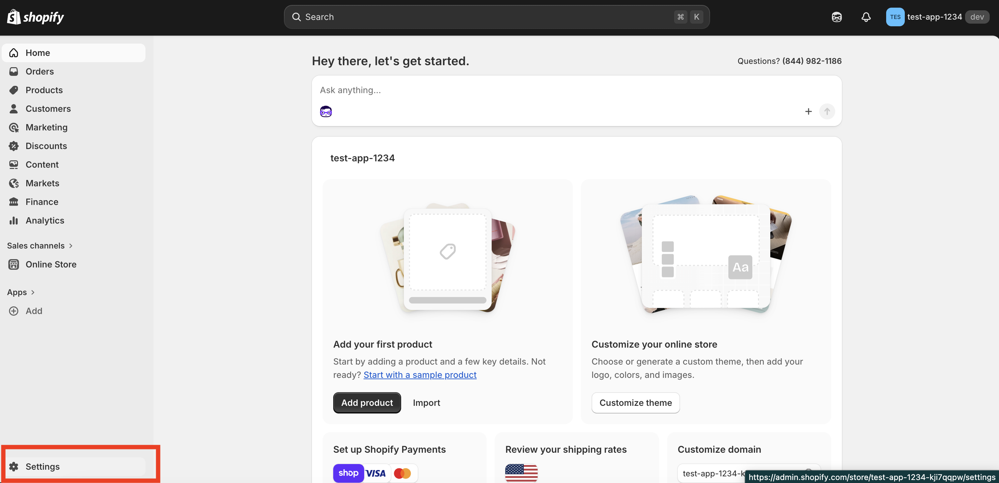

2. Go to the **Apps** section and select **Develop apps**.

   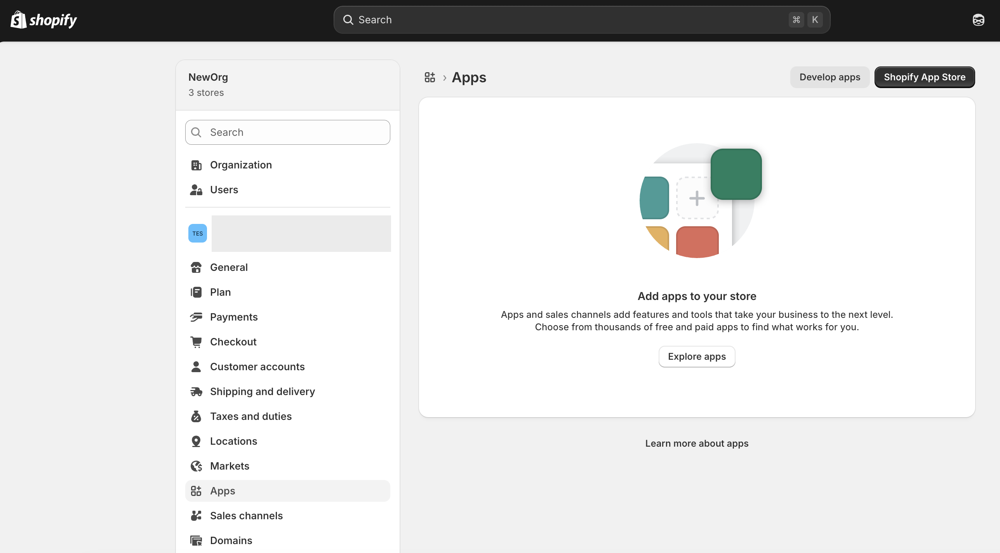

3. Select **Allow custom app development**.

   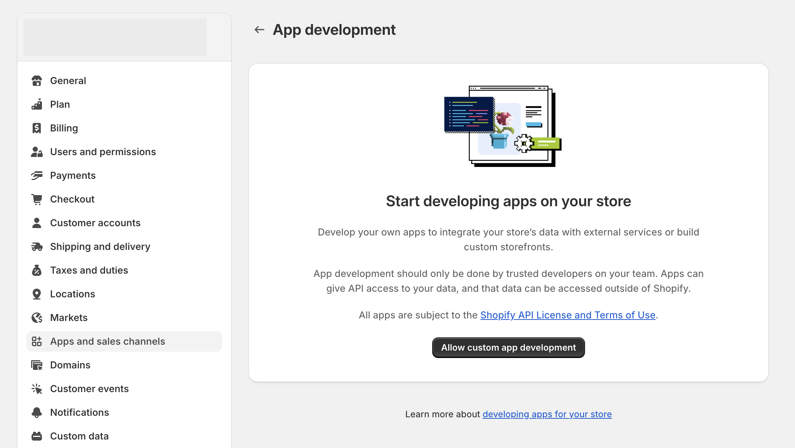

4. Select **Create an app**, enter an app name, and confirm.

   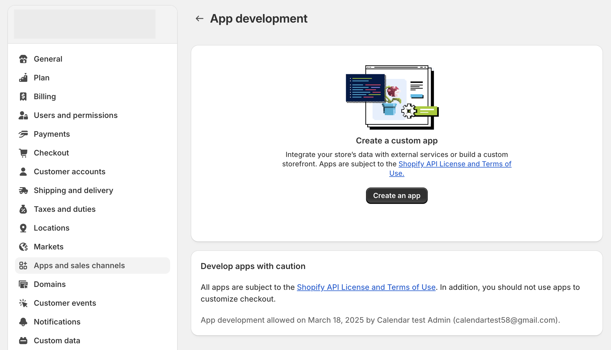

## Step 5: Generate an access token

1. Once the app is created, select **Configure Admin API scopes** and apply the scopes required for your use case (for example, `read_products`, `write_orders`).

   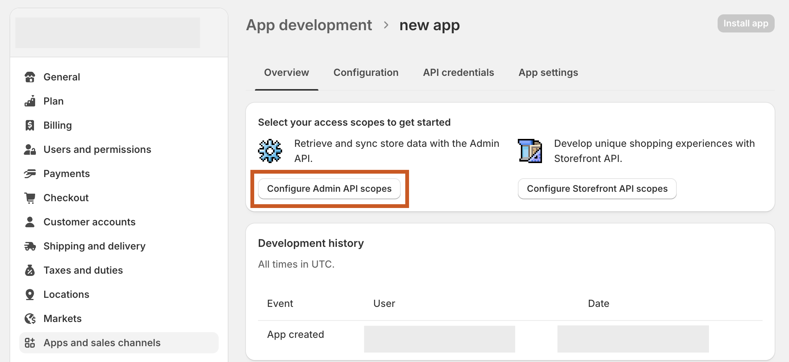

2. Select **Install app** to generate an Admin API access token.

   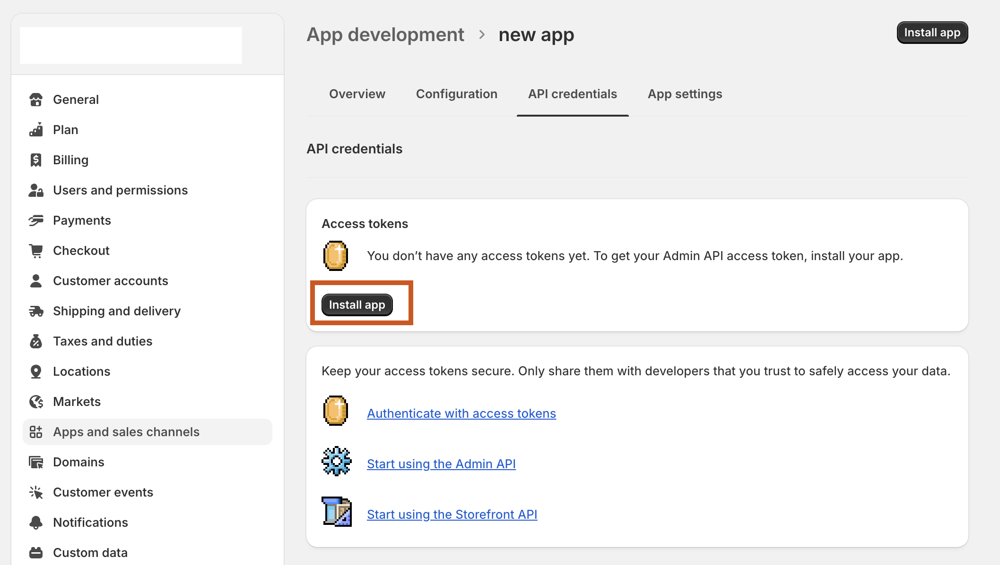

3. Select **Reveal token once** to copy and save the token securely.

   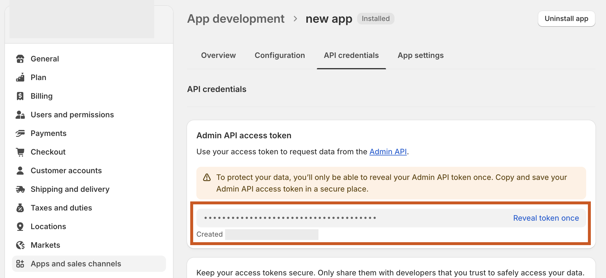

:::warning
The access token is shown only once. Copy it immediately and store it securely. Do not commit it to source control. Use Ballerina's `configurable` feature and a `Config.toml` file to supply it at runtime.
:::

## Step 6: Get your store URL

Your store URL follows this pattern:

```
https://<your-store-name>.myshopify.com
```

You can find it in the browser address bar when viewing your Shopify admin dashboard.

## What's next

- [Action reference](./actions.mdx): Available operations
- [Trigger reference](./triggers.mdx): Event-driven integration
