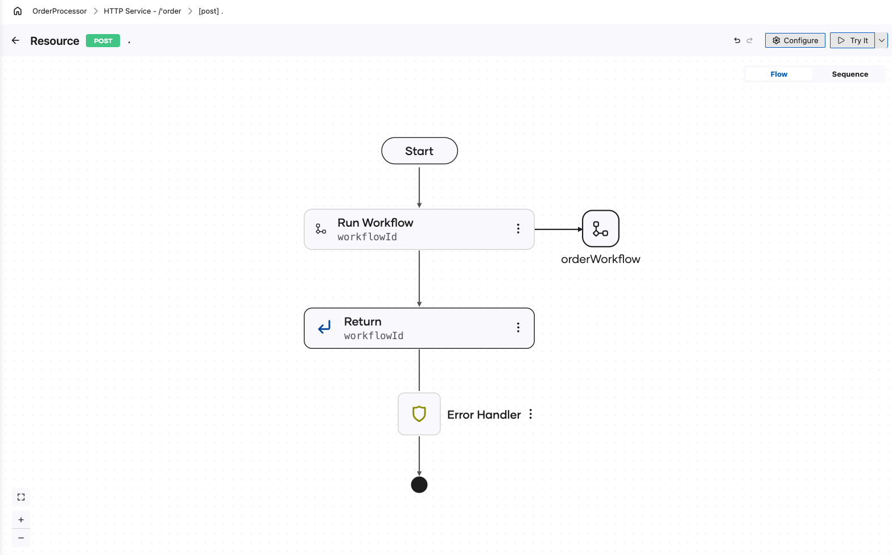
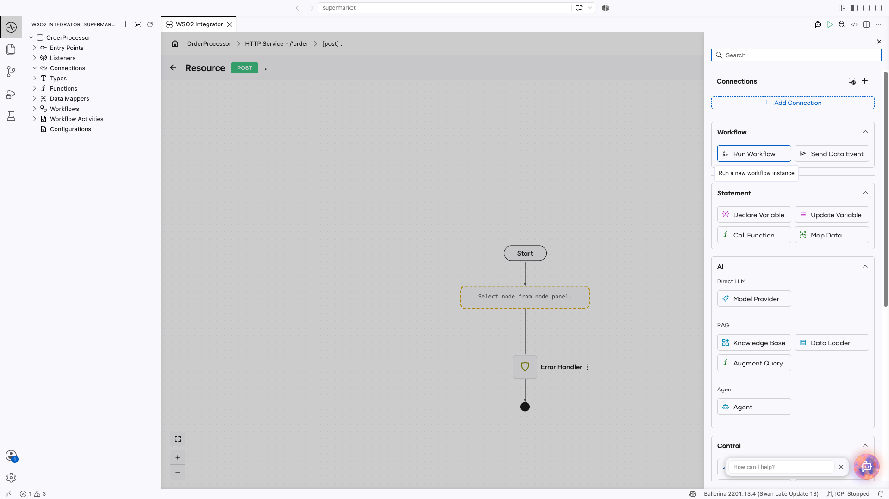
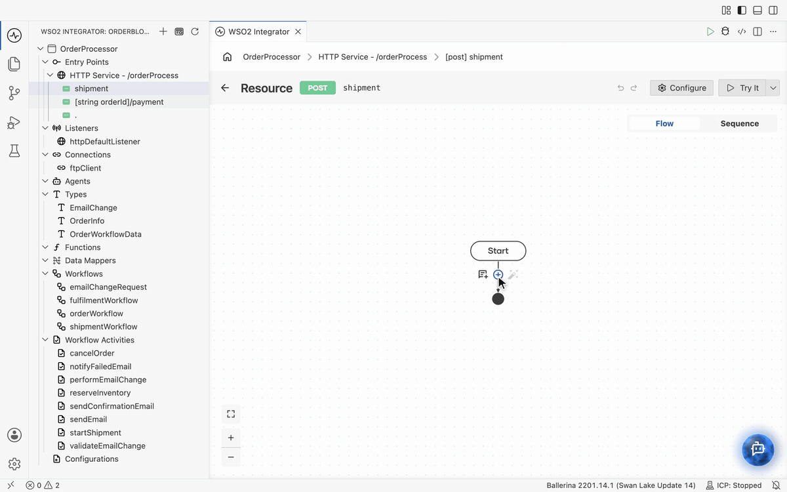

import ThemedImage from '@theme/ThemedImage';
import useBaseUrl from '@docusaurus/useBaseUrl';

A workflow does not start itself. Something has to launch it. It can be any type of trigger: a service resource that receives a request, an automation that runs on a schedule, a file handler that runs when a file arrives, or an operator starting one by hand. Whatever the trigger, starting a run returns a **workflow ID**, and that ID is the handle to the run from then on.

## Start one from an integration

1. In the trigger artifact flow design, click **+**.
2. In the node panel, under **Workflow**, click **Run Workflow**. The panel lists the workflows in the project; click the one to start.

   

3. Fill in the form:

   | Field | Required | Description |
   |---|---|---|
   | **Workflow** | Yes | The workflow to start. It is preselected with the one you clicked, and can be changed here. |
   | **Input** | Yes | The data the workflow starts with. It must match the workflow's [input type](./create.mdx). Pick the request payload from **Inputs** in the value helper. |
   | **Workflow ID Variable Name** | Yes | The variable that receives the ID of the started run. |

4. Click **Save**.

The step is drawn with an arrow across to the workflow it starts, so an entry point shows at a glance which process it kicks off. Click that marker to open the workflow itself.

## Starting returns immediately

**Run Workflow** starts the run and returns its ID straight away. It does not wait for the workflow to finish, and that is the point: a durable workflow may sit on a [human task](./await-human-task.mdx) or a [data event](./data-events.mdx) for days, and no caller should be held open for that.

So hand the ID back to whoever will need it:

- Return it in the response, so the caller can ask about the run later.
- Store it against your own record, such as the order row, so the process can be traced from your data.
- Include it in the callback URL you give a partner system, so the value they post [comes back to the right run](./data-events.mdx).

## Other ways to start a run

| Route | Use it for                                                                             |
|---|----------------------------------------------------------------------------------------|
| [Integration Control Plane](../../../../icp/manage-workflows/start-a-workflow.mdx) | Starting a run by hand from a generated form, for testing, onboarding, and operations. |
| [Management API](./management-api.mdx) | `POST /workflows` for custom portals and automation of your own. |

## Next steps

- [Await data events](./data-events.mdx) — deliver data into a run using the ID you kept.
- [Workflow executions](../../../../icp/manage-workflows/workflow-executions.mdx) — follow a started run through its timeline and execution graph.
- [Build an order processing workflow](../../../../get-started/quickstarts/build-durable-workflow.mdx) — a service resource that starts a workflow, end to end.
