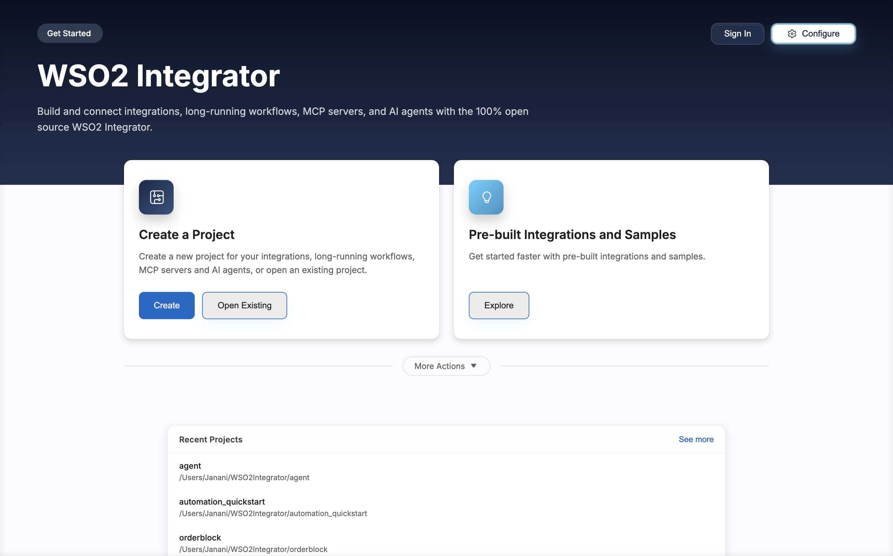
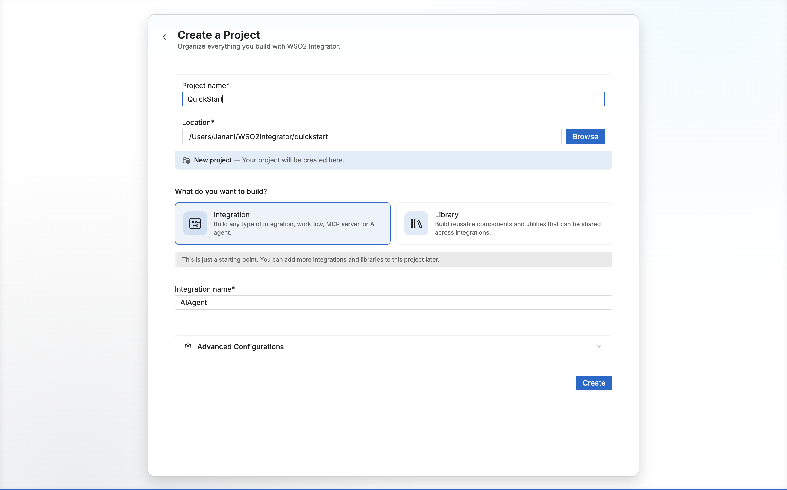
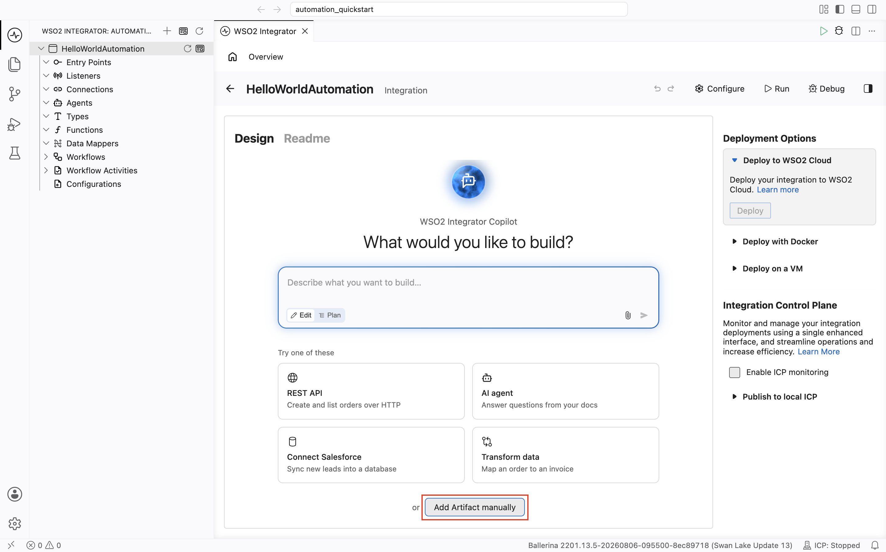
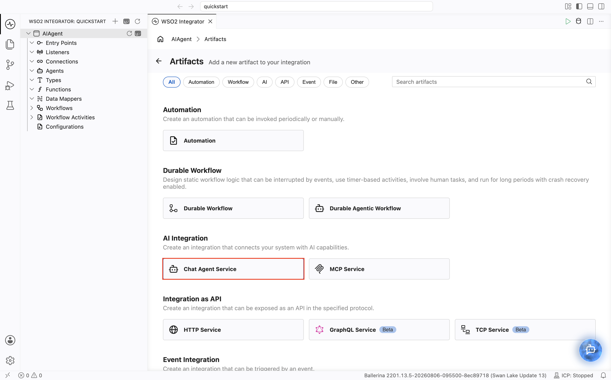
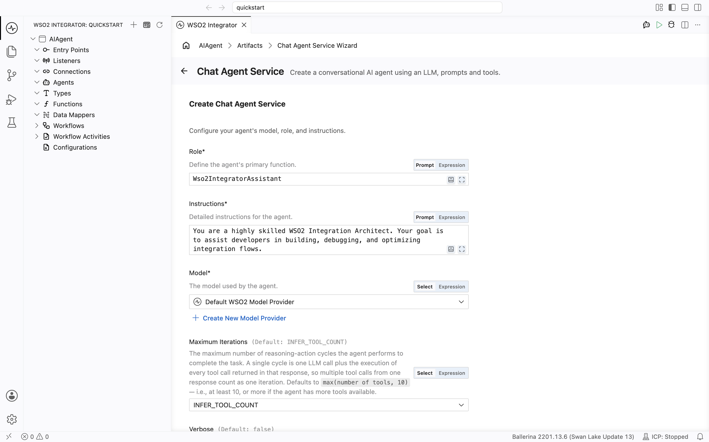
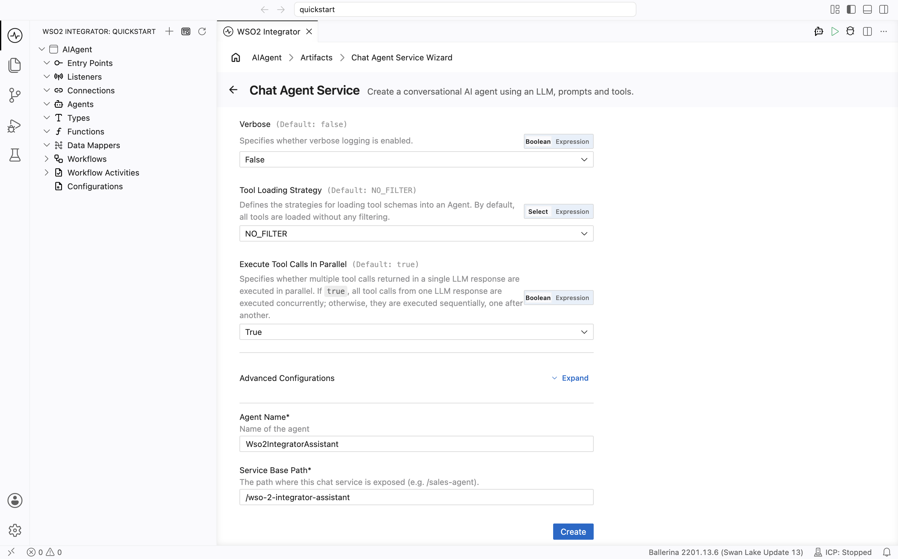
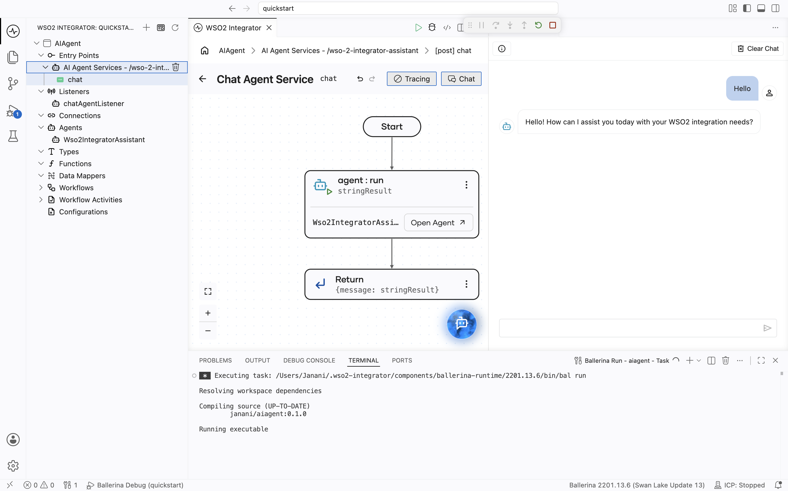

import ThemedImage from '@theme/ThemedImage';
import useBaseUrl from '@docusaurus/useBaseUrl';

- **Time:** Under 10 minutes
- **What you'll build:** An AI agent that connects to an LLM, uses tools, and responds to user queries in chat.

<p style={{textAlign: 'justify'}}>
An AI agent uses an LLM to understand user queries, reason about them, and call tools to retrieve information or perform actions. This quick start walks you through the full process: creating a project, adding an AI Chat Agent artifact, configuring its instructions, and testing the agent in the built-in chat panel.
</p>

## Prerequisites

A working WSO2 Integrator environment.

- **[Local setup](../setup/index.mdx)**: Install and launch WSO2 Integrator on your machine.
- **[WSO2 Cloud Account](../setup/index.mdx)**: For AI assisted development and WSO2 Cloud deployments.

<Steps>

## Step 1: Create the integration

:::info Note
If you're using the cloud editor, a project is already open, so you can skip this step 1 and go directly to [Step 2: Add an AI chat agent](#step-2-add-an-ai-chat-agent).
:::

1. Open WSO2 Integrator.

2. Click **Create** in the **Create a Project** card.

   

3. Set **Project Name** to `QuickStart`.

4. Set **Integration Name** to `AIAgent`.

5. Click **Create**.

   


## Step 2: Add an AI chat agent

1. Select your integration from the project overview canvas.

2. In the design view, click **Add Artifact Manually**.

   

3. Select **Chat Agent Service** under **AI Integration**.

   

4. The **Create Chat Agent Service** form opens.

5. Set **Role** to `Wso2IntegratorAssistant`.

6. Set **Instructions** to:

   ```text
   You are a highly skilled WSO2 Integration Architect. Your goal is to assist developers in building, debugging, and optimizing integration flows.
   ```

   

7. Leave the remaining configuration fields at their default values.

8. Under **Advanced Configurations**, set **Agent Name** to `Wso2IntegratorAssistant`.

9. Click **Create**.

   


:::tip Default model provider

By default, the agent is configured to use the WSO2 model provider. If you want to use a different LLM, see [Model providers](../../develop-and-test/integration-artifacts/ai-integrations/ai-building-blocks/model-providers.mdx) for the full list of supported providers (OpenAI, Azure OpenAI, Anthropic, and others).

If you are using the WSO2 model provider, the access token is obtained through [WSO2 Integrator Copilot](../../editor/copilot/copilot.mdx). If you have not already signed in, you will be prompted to do so.
:::


## Step 3: Run and test

1. Click **Run**.

2. Click **Chat** from the Chat Agent Service title bar or click **Test** from the pop-up.

3. Type `Hello` to check if it works.

   

## Step 4: Deploy to WSO2 Cloud

Deploy your integration to WSO2 Cloud - Integration Platform in any of the following ways:

- If you're using the cloud editor, see [Save and deploy](../../deploy-and-run/deploy-to-wso2-cloud/deploy-from-cloud-editor.mdx#save-and-deploy).
- If you're using WSO2 Integrator on your machine, see [Deploy from WSO2 Integrator](../../deploy-and-run/deploy-to-wso2-cloud/deploy-to-wso2-cloud.mdx).


:::tip[Skip ahead: deploy a ready-made sample]

Rather not build it yourself? One-click deploy the AIAgent sample straight to WSO2 Cloud.

[](https://console.devant.dev/new?gh=wso2/integration-samples/tree/main/integrator-default-profile/quickstart/aiagent)

:::


</Steps>

## Source code

<details>
<summary>View the generated Ballerina code</summary>

The steps above generate the following complete, runnable Ballerina program. It has two files: `agents.bal` for the agent definition and `main.bal` for the listener and service.


**`agents.bal`**

```ballerina
import ballerina/ai;

final ai:Agent wso2IntegratorAssistantAgent = check new (
   systemPrompt = {
       role: string `Wso2IntegratorAssistant`,
       instructions: string `You are a highly skilled WSO2 Integration Architect. Your goal is to assist developers in building, debugging, and optimizing integration flows.`
   },
   model = wso2ModelProvider,
   tools = []
);
```

**`main.bal`**

```ballerina
import ballerina/ai;
import ballerina/http;

listener ai:Listener chatAgentListener = new (listenOn = check http:getDefaultListener());

service /wso2IntegratorAssistant on chatAgentListener {
   resource function post chat(@http:Payload ai:ChatReqMessage request) returns ai:ChatRespMessage|error {
       string stringResult = check wso2IntegratorAssistantAgent.run(request.message, request.sessionId);
       return {message: stringResult};
   }
}
```

</details>


## What's next

- [Build an automation](./build-automation.mdx) — Build a scheduled job
- [Build an Integration as API](./build-integration-api.mdx) — Build an HTTP service
- [Build an event-driven integration](./build-event-driven-integration.mdx) — React to messages from brokers
- [Build a file-driven integration](./build-file-driven-integration.mdx) — Process files from FTP or local directories
- [AI agents](../../develop-and-test/integration-artifacts/ai-integrations/agents/agents.mdx) — Learn how to build production-grade AI agents with tools, memory, and evaluations
