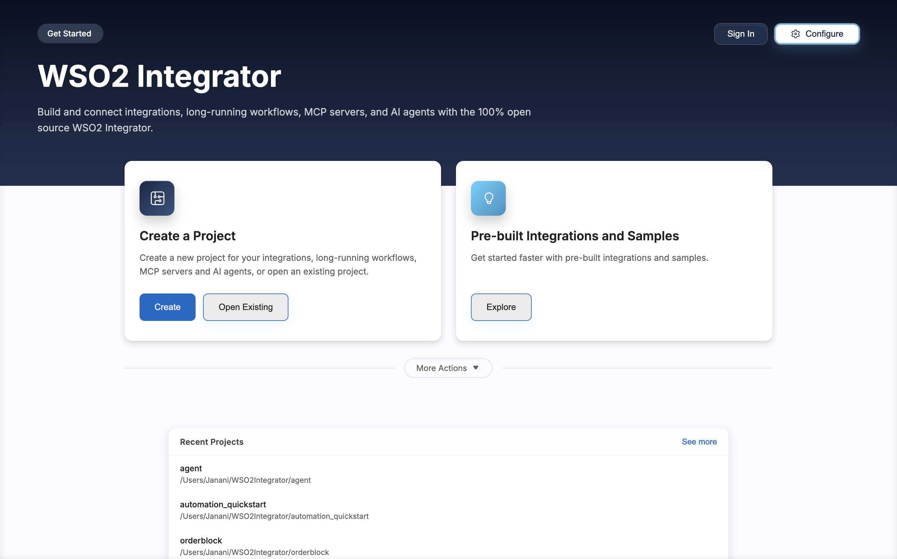
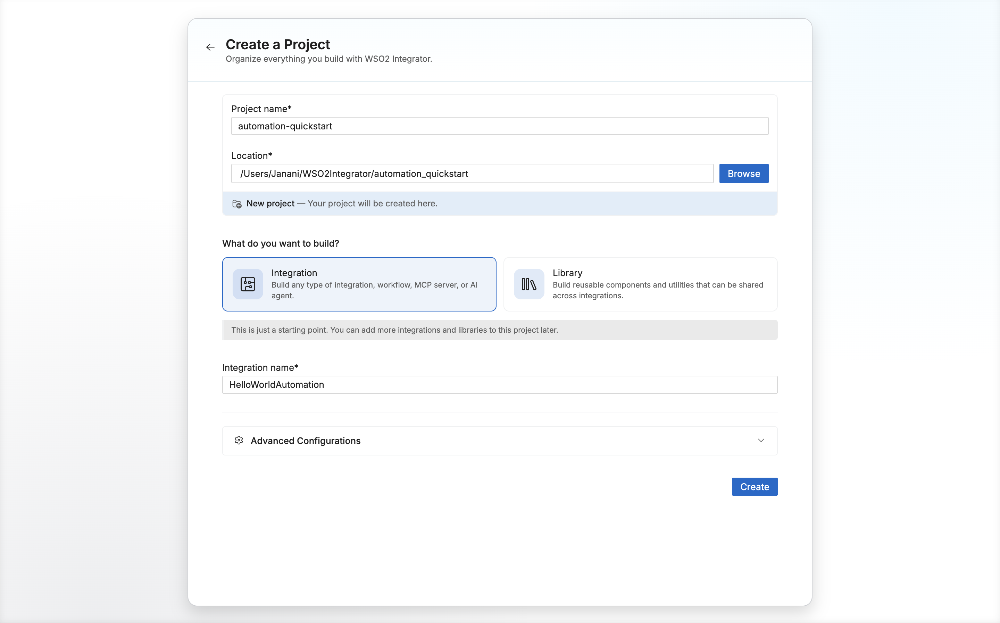
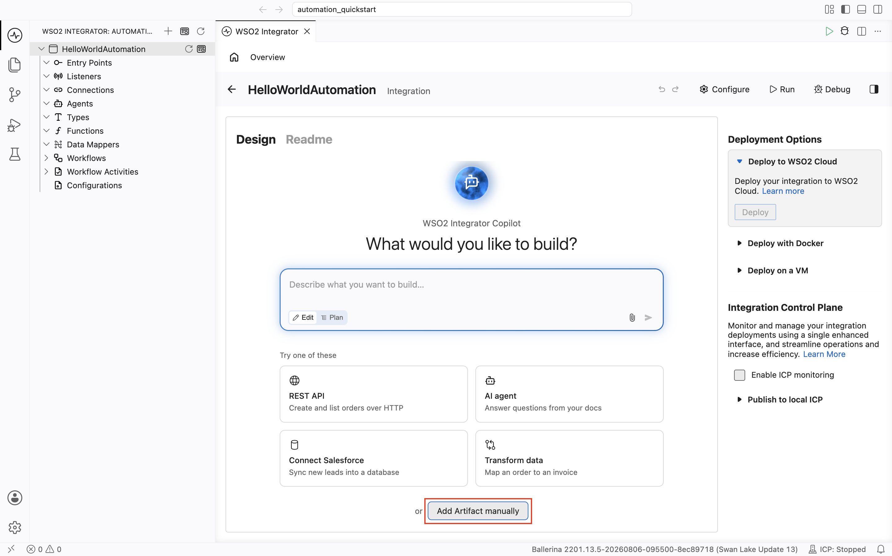
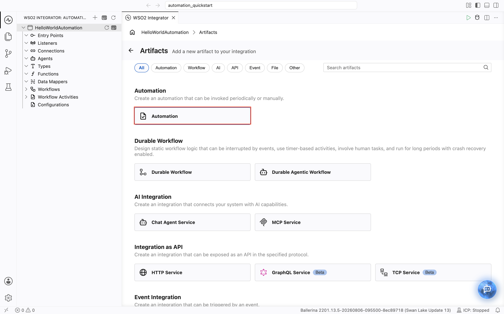
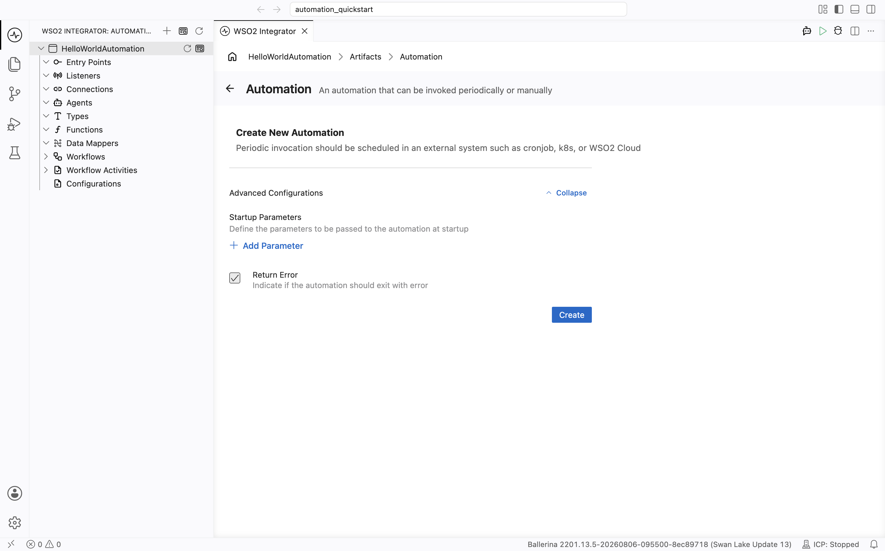
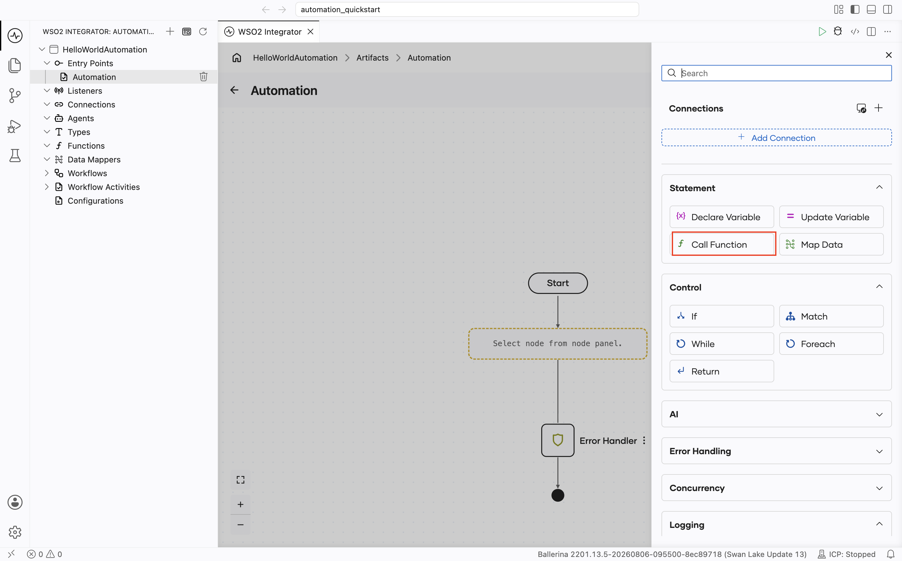
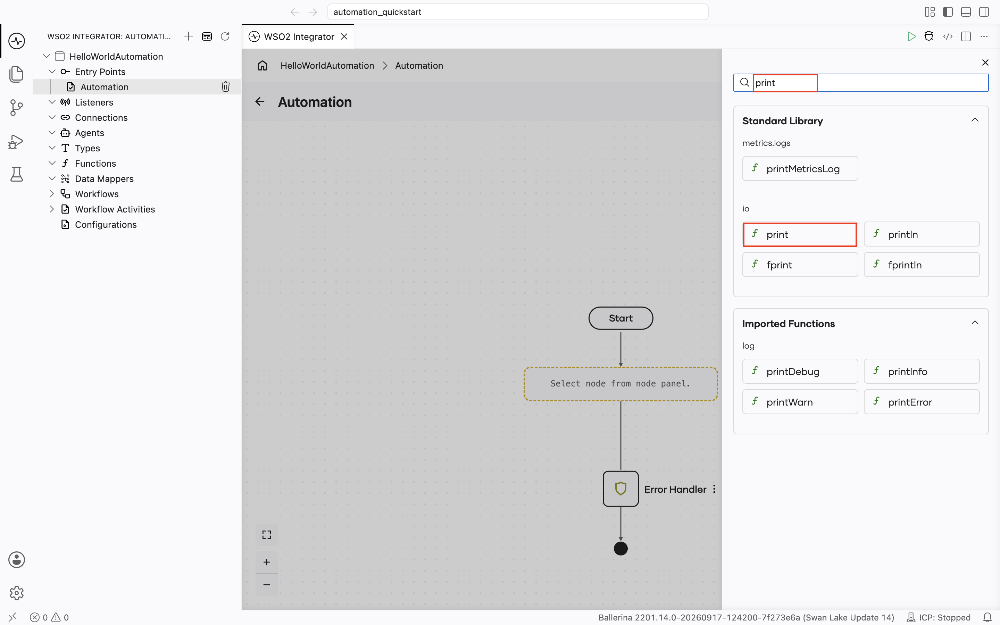
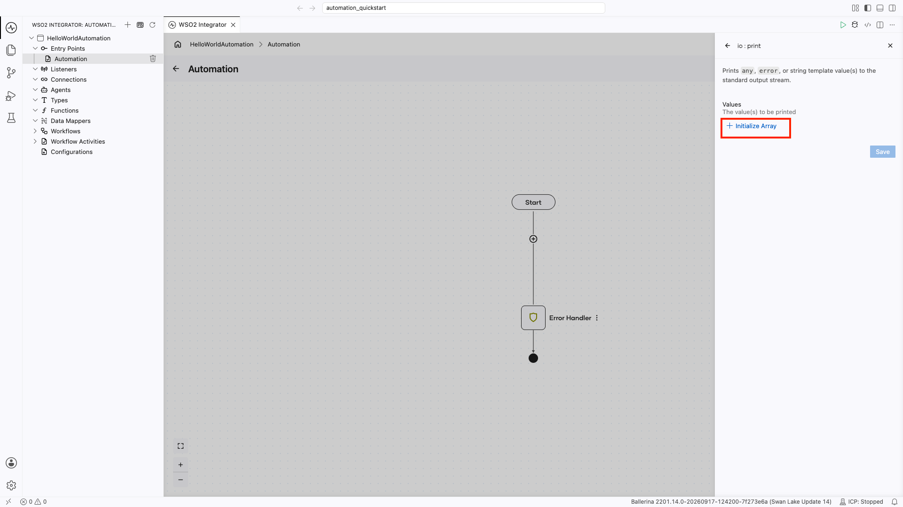
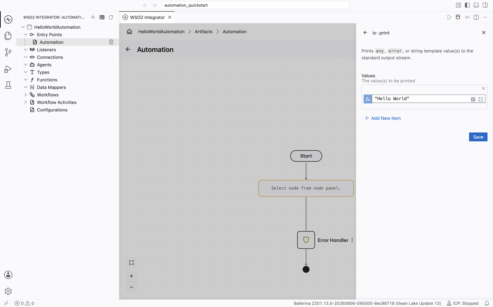
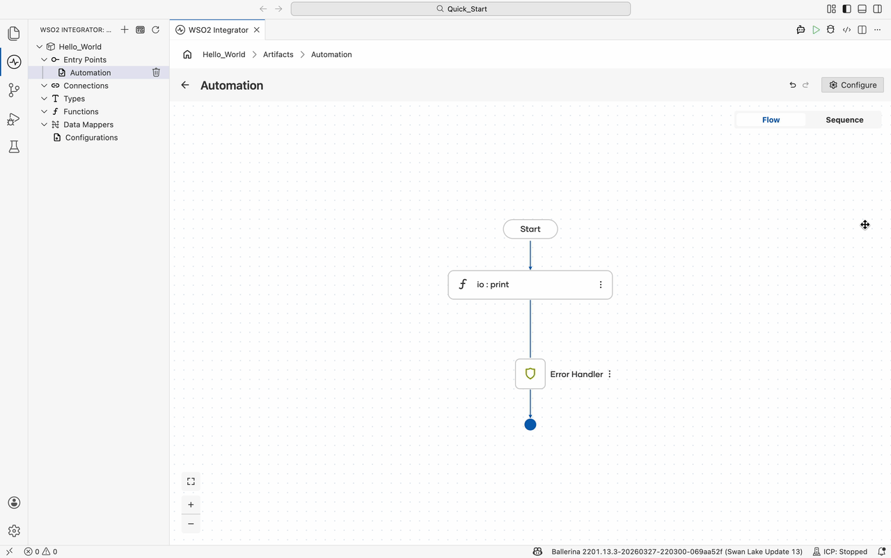

import ThemedImage from '@theme/ThemedImage';
import useBaseUrl from '@docusaurus/useBaseUrl';

- **Time:** Under 10 minutes
- **What you'll build:** An automation that prints `Hello World` to the terminal when it runs.

<p style={{textAlign: 'justify'}}>
An automation runs your integration logic without requiring an external request, either on demand or on a schedule. Automations are useful for tasks such as data synchronization, report generation, and routine maintenance. This quick start walks you through the full process: adding an automation artifact, building the logic in the visual designer, running it, and reviewing scheduling options for production.
</p>

## Prerequisites

A working WSO2 Integrator environment.

- **[Local setup](../setup/index.mdx)**: Install and launch WSO2 Integrator on your machine.
- **[WSO2 Cloud Account](../setup/index.mdx)**: For AI assisted development and WSO2 Cloud deployments.

<Steps>

## Step 1: Create the integration

:::info Note
If you're using the cloud editor, a project is already open, so you can skip this step and go directly to [Step 2: Add an automation artifact](#step-2-add-an-automation-artifact).
:::

1. Open WSO2 Integrator.

2. Click **Create** in the **Create a Project** card.

   

3. Set **Project Name** to `automation-quickstart`.

4. Set **Integration Name** to `HelloWorldAutomation`.

5. Click **Create**.

   


## Step 2: Add an automation artifact

1. Select your integration from the project overview canvas.

2. In the design view, click **Add Artifact Manually**.

   

3. Select **Automation** under **Automation**.

   

4. Click **Create**.

   


## Step 3: Add logic

1. Click **+** below the **Start** node to open the node panel.

2. Select **Call Function** under **Statement**.

   

3. Search for `print` in the functions panel.

4. In the search results, go to the **Standard Library** section and select the **print** function under **io**.

   

5. Click **Initialize Array** for the **Values** parameter.

   

6. Set **Values** to `"Hello World"` and select **Save**.

   


## Step 4: Run and test

1. Click **Run**.

2. Confirm the terminal output contains `Hello World`.

   

## Step 5: Deploy to WSO2 Cloud

Deploy your integration to WSO2 Cloud - Integration Platform in any of the following ways:

- If you're using the cloud editor, see [Save and deploy](../../deploy-and-run/deploy-to-wso2-cloud/deploy-from-cloud-editor.mdx#save-and-deploy).
- If you're using WSO2 Integrator on your machine, see [Deploy from WSO2 Integrator](../../deploy-and-run/deploy-to-wso2-cloud/deploy-to-wso2-cloud.mdx).


:::tip[Skip ahead: deploy a ready-made sample]

Rather not build it yourself? One-click deploy the HelloWorldAutomation sample straight to WSO2 Cloud.

[](https://console.devant.dev/new?gh=wso2/integration-samples/tree/main/integrator-default-profile/quickstart/automation)

:::


</Steps>

## Source code

<details>
<summary>View the generated Ballerina code</summary>

The steps above generate the following complete, runnable Ballerina program:

```ballerina
import ballerina/io;
import ballerina/log;

public function main() returns error? {
   do {
       io:print("Hello World");
   } on fail error e {
       log:printError("Error occurred", 'error = e);
       return e;
   }
}
```

</details>


## Scheduling automations

Periodic invocation is configured in an external system once the automation is deployed. Available options include:

- **Cron job**: schedule the automation from a `cron` entry on a Unix or Linux host.
- **Kubernetes**: define a `CronJob` resource to run the automation on a recurring schedule.
- **VM**: use a host scheduler such as Windows Task Scheduler or `systemd` timers.
- **WSO2 Integration Platform**: configure the schedule in the WSO2 Integration Platform when the integration is pushed to the cloud.


## What's next

- [Build an Integration as API](./build-integration-api.mdx) — Build an HTTP service
- [Build an AI agent](./build-ai-agent.mdx) — Build an intelligent agent
- [Build an event-driven integration](./build-event-driven-integration.mdx) — React to messages from brokers
- [Build a file-driven integration](./build-file-driven-integration.mdx) — Process files from FTP or local directories
- [Automation](../../develop-and-test/integration-artifacts/automation.mdx) — Configure scheduling, manual execution, and integration logic
