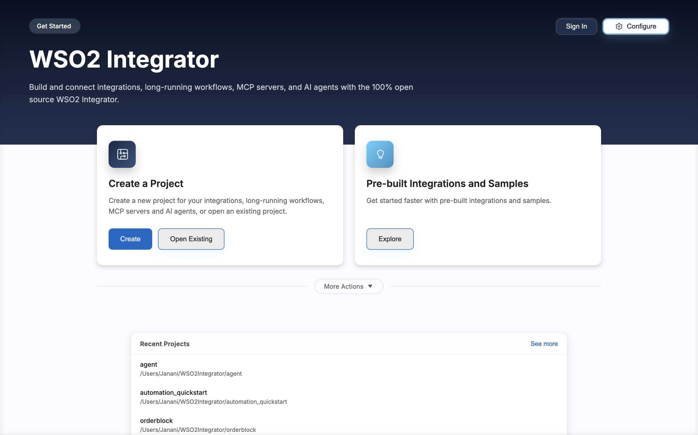
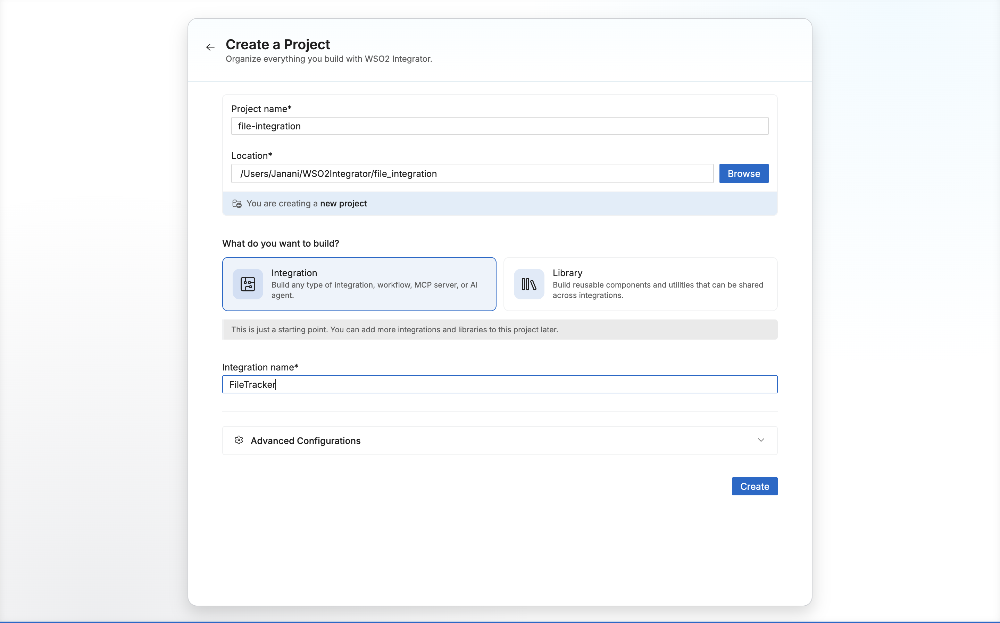
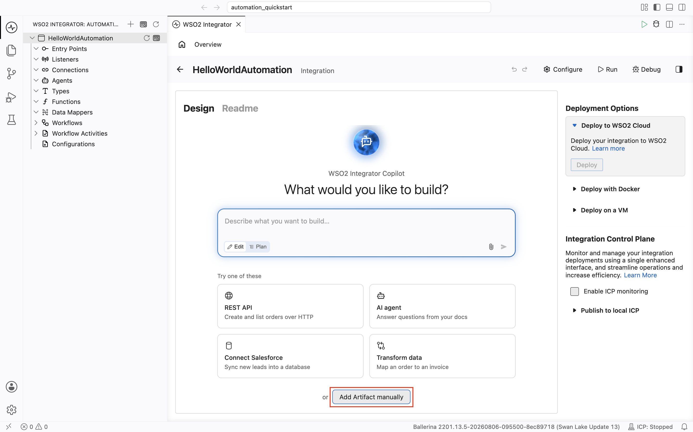
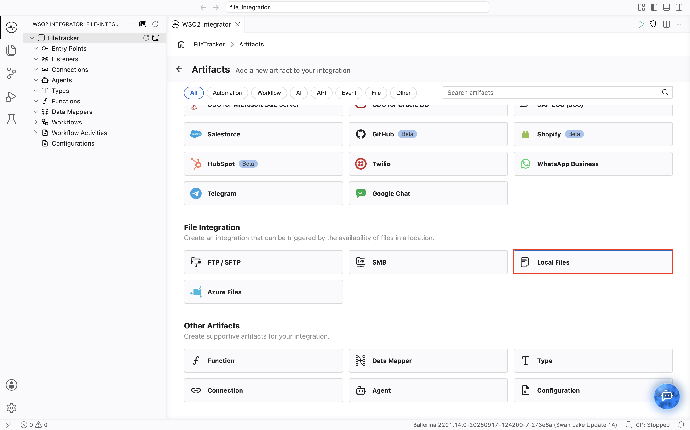
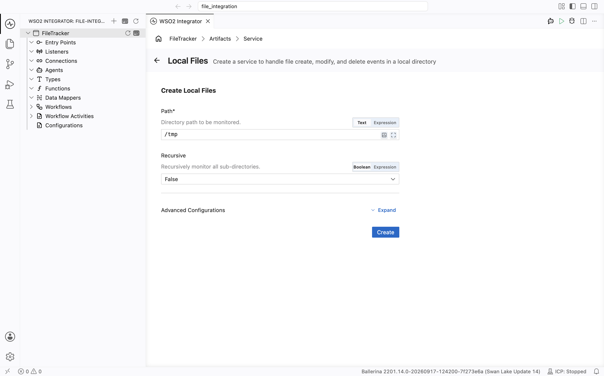
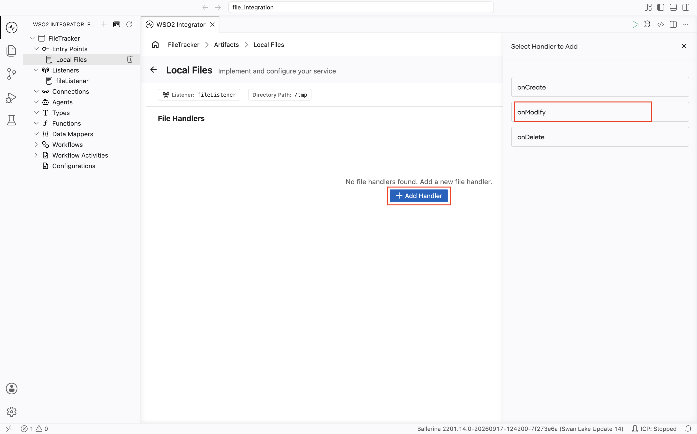
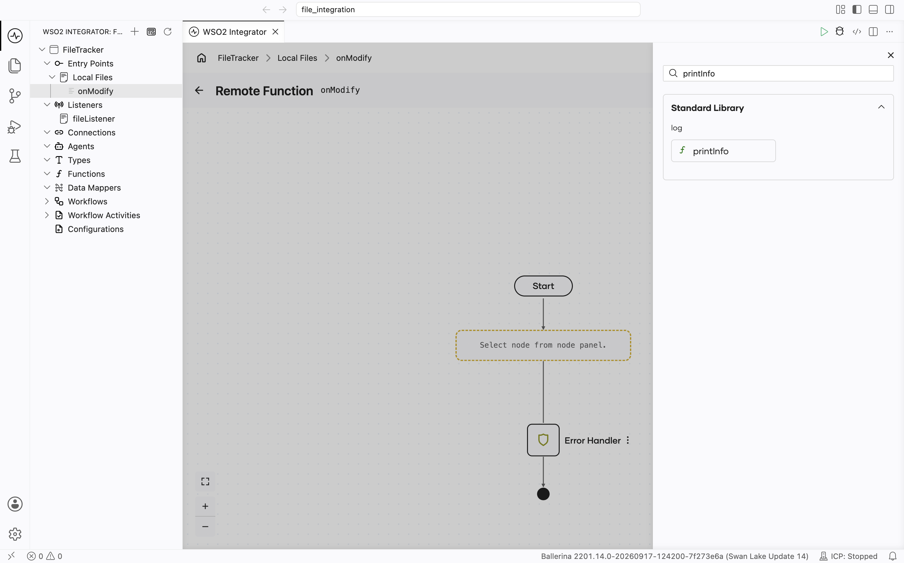
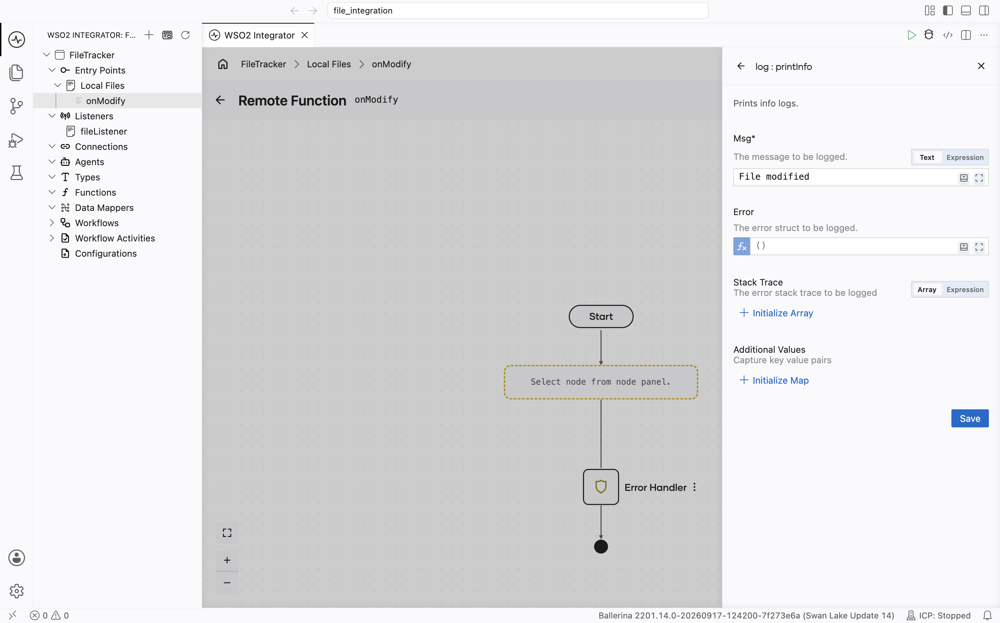
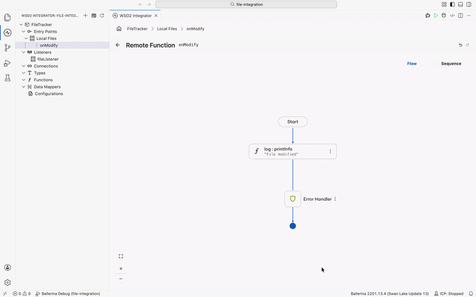

import ThemedImage from '@theme/ThemedImage';
import useBaseUrl from '@docusaurus/useBaseUrl';
import Tabs from '@theme/Tabs';
import TabItem from '@theme/TabItem';

**Time:** Under 10 minutes. **What you'll build:** A file integration that adds an `onModify` handler to track file changes and uses `printInfo` to log file modification events.

<p style={{textAlign: 'justify'}}>
File integrations are ideal for batch uploads, scheduled file processing, and ETL workflows triggered by files appearing in a folder or FTP server.
</p>

## Prerequisites

A working WSO2 Integrator environment.

- **[Local setup](../setup/index.mdx)**: Install and launch WSO2 Integrator on your machine.
- **[WSO2 Cloud Account](../setup/index.mdx)**: For AI assisted development and WSO2 Cloud deployments.

Also required, a file at the listener path to watch. Create one if you don't have one:

<Tabs groupId="os">
<TabItem value="unix" label="macOS / Linux" default>

```bash
echo "test" > /tmp/testfile.txt
```

</TabItem>
<TabItem value="windows" label="Windows">

```bat
mkdir C:\tmp 2>nul
echo test > C:\tmp\testfile.txt
```

</TabItem>
</Tabs>

## Step 1: Create the integration

:::info Note
If you're using the cloud editor, a project is already open, so you can skip this step and go directly to [Step 2: Add a file integration artifact](#step-2-add-a-file-integration-artifact).
:::

1. Open WSO2 Integrator.

2. Click **Create** in the **Create a Project** card.

   

3. Set **Project Name** to `file-integration`.

4. Set **Integration Name** to `FileTracker`.

5. Click **Create**.

   

## Step 2: Add a file integration artifact

1. Select your integration from the project overview canvas.

2. In the design view, click **Add Artifact Manually**.

   

3. Select **Local Files** under **File Integration**.

   

4. Set **Path** to the folder you want to watch:

   <Tabs groupId="os">
   <TabItem value="unix" label="macOS / Linux" default>

   ```text
   /tmp
   ```

   </TabItem>
   <TabItem value="windows" label="Windows">

   ```text
   C:\tmp
   ```

   </TabItem>
   </Tabs>

5. Click **Create**.

   

## Step 3: Add `onModify` event handler

1. In the service designer view, click **+ Add Handler**.

2. Select **onModify**.

   

3. In the **Configure onModify Handler** panel, clear both **On Success** and **On Error** under **File Handling Options**, then click **Save**. Both options arrive ticked and set to **Move**, which moves each processed file out of the watched directory. Clearing them keeps `testfile.txt` in `/tmp`, where the later steps expect it. For details, see [Post-processing: moving or deleting files](../../develop-and-test/integration-artifacts/file-driven-integration/local-files.mdx#post-processing-moving-or-deleting-files).

## Step 4: Add file tracking logic

1. Click **+** in the flow diagram.

2. Search for `printInfo` and select **printInfo**.

   

3. Set **Msg** to `File modified`.

4. Click **Save**.

   

## Step 5: Run and test

1. Click **Run** in the toolbar.

2. Run the modify command in your terminal to trigger the handler:

  <Tabs groupId="os">
  <TabItem value="unix" label="macOS / Linux" default>

  ```bash
  echo "modify" > /tmp/testfile.txt
  ```

  </TabItem>
  <TabItem value="windows" label="Windows">

  ```bat
  echo modify > C:\tmp\testfile.txt
  ```
  </TabItem>
  </Tabs>

3. Confirm the run terminal shows the log line `File modified`.

   

## Source code

<details>
<summary>View the generated Ballerina code</summary>

The steps above generate the following complete, runnable Ballerina program:


:::info Windows
Change the listener `path` from `"/tmp"` to `"C:\\tmp"` (backslash escaped) before running the program.
:::


```ballerina
import ballerina/file;
import ballerina/log;

listener file:Listener fileListener = new (path = "/tmp", recursive = false);

service file:Service on fileListener {
   remote function onModify(file:FileEvent event) returns error? {
       do {
           log:printInfo("File modified");
       } on fail error err {
           // handle error
           return error("unhandled error", err);
       }
   }


}
```

</details>


## What's next

- [Local files](../../develop-and-test/integration-artifacts/file-driven-integration/local-files.mdx) — Full Local Files listener reference (events, recursive watching, file handlers)
- [FTP/SFTP](../../develop-and-test/integration-artifacts/file-driven-integration/ftp-sftp/ftp-sftp.mdx) — Watch and process files on remote FTP or SFTP servers
- [Streaming large files](../../develop-and-test/integration-artifacts/file-driven-integration/ftp-sftp/ftp-sftp.mdx#streaming-large-files) — Process large files without loading them fully into memory
- [CSV fault tolerance](../../develop-and-test/integration-artifacts/file-driven-integration/ftp-sftp/csv-fault-tolerance.mdx) — Handle errors and partial failures when processing CSV files
